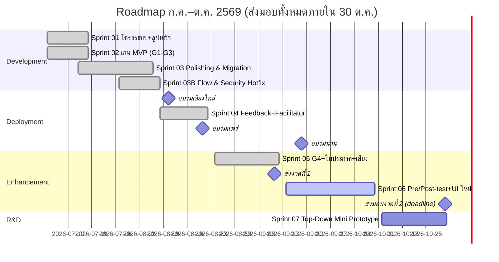

# Sprint Planning & Roadmap

**Last Updated:** 2026-10-01 | **Version:** 1.3

> กรอบเวลาโครงการ: ออกแบบสื่อ ก.ค.–ต.ค. 2569 | สัญญา (MOU ลงนาม 11 ส.ค.): ดำเนินการ 12 ส.ค.–30 ต.ค. 2569 | งวดที่ 1 กำหนดส่ง 10 ก.ย. | **งวดที่ 2 (สุดท้าย) ส่งมอบภายใน 30 ต.ค. 2569** — ดู [รายงานความคืบหน้างวดที่ 1](../wiki/tor/งวดที่%201%20-%20รายงานความคืบหน้าการพัฒนา.md)
>
> **อบรมภาคสนาม (วันจริงจากข้อมูล analytics):** เชียงใหม่ 10 ส.ค. ✅ | แพร่ 19–21 ส.ค. ✅ | น่าน 18 ก.ย. ✅ (เลื่อนจากแผนเดิม 24–25 ส.ค.) — รวม 5 กิจกรรม 145 คน ดู [สรุปผู้เข้าร่วมกิจกรรมอบรม](../analytics/training-participants-summary.md)

## 📅 Sprint Schedule Overview

| Sprint                                                      | Timeline                 | Focus Area                                                                                                                                                                                         | Status                                              |
| :---------------------------------------------------------- | :----------------------- | :------------------------------------------------------------------------------------------------------------------------------------------------------------------------------------------------- | :-------------------------------------------------- |
| [Sprint 01](./sprint-backlog/archives/sprint-01.md)            | 2026-07-06 → 2026-07-17 | โครงระบบ + ลูปหลัก (Landing, Consent, Video, Sequence)                                                                                                                              | Completed                                           |
| [Sprint 02](./sprint-backlog/archives/sprint-02.md)            | 2026-07-06 → 2026-07-17 | เกม MVP ทั้ง 3 (G1, G2, G3) + ดาว + แชร์ LINE (พัฒนาโค้ดเสร็จแล้ว)                                                                                                 | Completed                                           |
| [Sprint 03 polishing](./sprint-backlog/sprint-03-polishing.md) | 2026-07-15 → 2026-08-05 | QA เกมหลัก 3 แบบ (G3, G6, G5) + ย้ายระบบสู่ Next.js+Supabase + เขียนชุดทดสอบ E2E/Offline                                                                         | Completed                                           |
| [Sprint 03B](./sprint-backlog/sprint-03b-refinement.md)        | 2026-07-27 → 2026-08-08 | ⚡**Fast-tracked:** รื้อ Flow เรียนต่อเนื่อง (คลิป→เกม) + Responsive/UX + Security Hotfix v0.8.1                                                                   | Completed (80%+)                                    |
| 🎯 Milestone 1                                              | 2026-08-10               | **อบรมเชียงใหม่** (28 คน) — เลื่อนจากแผนเดิม 6–7 ส.ค.                                                                                                     | ✅ Done                                             |
| [Sprint 04](./sprint-backlog/sprint-04.md)                     | 2026-08-08 → 2026-08-21 | ปรับจาก feedback เชียงใหม่ + Facilitator Mode + เตรียมงานแพร่ (v0.8.2 → v0.12.3)                                                                                     | Closed — มีงานค้าง (ดูด้านล่าง) |
| 🎯 Milestone 2                                              | 2026-08-19 → 2026-08-21 | **อบรมแพร่** 3 ครั้ง (63 คน)                                                                                                                                                  | ✅ Done                                             |
| [Sprint 05](./sprint-backlog/sprint-05.md)                     | 2026-08-24 → 2026-09-11 | G4, ใบประกาศ, เสียงอ่าน — ไม่มี release ในช่วงนี้ (changelog กระโดดจาก 0.12.3 → 0.13.0)                                                                  | Closed — มีงานค้าง (ดูด้านล่าง) |
| 🎯 ส่งงวดที่ 1                                     | 2026-09-10               | กำหนดส่งงวดที่ 1 ตาม MOU — เตรียม[รายงานการส่งมอบงาน](../wiki/tor/งวดที่%201%20-%20รายงานการส่งมอบงาน.md) แล้ว                  | 📝 รอลงนาม/ยืนยันวันส่งจริง  |
| 🎯 Milestone 3                                              | 2026-09-18               | **อบรมน่าน** (54 คน) — เลื่อนจากแผนเดิม 24–25 ส.ค.                                                                                                             | ✅ Done                                             |
| [Sprint 06](./sprint-backlog/sprint-06.md)                     | 2026-09-14 → 2026-10-09 | แผนเดิม: Dashboard, G4, Offline queue — งานจริง: Pre/Post-test, ดีไซน์ชุดใหม่, GP1/GP2, โหมด normal/research (v0.13.0) + รายงานงวดที่ 1                | 🟡 Active (Current Sprint)                          |
| 🎯 ส่งงวดที่ 2                                     | 2026-10-30 (deadline)    | ระบบฉบับปรับปรุง + ข้อมูลประเมินผล — ดู[งวดที่ 2](../wiki/tor/งวดที่%202%20-%20ระบบฉบับปรับปรุงและข้อมูลประเมินผล.md) | Upcoming                                            |
| [Sprint 07](./sprint-backlog/sprint-07.md)                     | 2026-10-12 → 2026-10-30 | **R&D:** Top-Down Mini Prototype "รู้ทันกลางสายหมอก" — Canvas 2D world ห่อมินิเกม G1–G10 (E-WORLD) — บีบจาก 14 พ.ย. ให้จบทันส่งมอบ       | Planned                                             |

## 🚀 Sprint Details

- **[Sprint 01](./sprint-backlog/archives/sprint-01.md)** (Completed): US-CORE-01, US-CORE-02, US-CORE-03, US-CORE-04 — จบ Sprint ต้องกดลิงก์จาก LINE → ดูคลิป → ไปหน้าเกม (placeholder) ได้ครบลูป
- **[Sprint 02](./sprint-backlog/archives/sprint-02.md)** (Completed): US-GAME-01, US-GAME-02, US-GAME-03, US-GAME-06, US-REWARD-01, US-LEAD-01, US-UX-01, US-DATA-02, US-UX-04 — การพัฒนาโค้ดหลักเสร็จสิ้นทั้งหมดแล้ว (QA ย้ายไปทำร่วมกับขัดเกลาธีมใน Sprint 03)
- **[Sprint 03 polishing](./sprint-backlog/sprint-03-polishing.md)** (Completed): QA เกมหลัก 3 แบบ (G3/G5/G6) + **ย้ายสแตกระบบหลักสู่ Next.js (TypeScript) + Supabase + Tailwind + shadcn/ui** + ตั้งค่าชุดทดสอบ Vitest/Playwright + ตั้งค่า URL Redirect + Hardening (ทดสอบ LINE browser, เตรียม QR สำหรับเชียงใหม่)
- **[Sprint 03B](./sprint-backlog/sprint-03b-refinement.md)** (Completed 80%+; เดิมวางแผนไว้ในชื่อ "Sprint 08"): US-FLOW-01 (รื้อ Flow ต่อเนื่อง: คลิปสั้น→เกม G1→G3→G6 + ปิดท้าย G13→`/lessons/complete`), US-VIDEO-01 (Autoplay fallback & 5s countdown), US-SEC-01 (🔥 Supabase IPv4 Pooler + 500 offline logs cap), US-UX-05, US-DOC-01, US-DEBT-01
- **[Sprint 04](./sprint-backlog/sprint-04.md)** (Closed 2026-08-21): US-LEAD-02 + US-03-01 + แก้ไขจาก feedback งานเชียงใหม่ — ออก v0.8.2 → v0.12.3: ย้ายคลิปไปไฟล์ข้อมูล, ตรึงขนาดตัวอักษร, เชื่อม G13 กับกระดานคะแนน, เปลี่ยนการระบุพื้นที่จาก GPS เป็นเลือกจังหวัด/อำเภอ/ตำบลเอง, ปรับธีมสี; ใช้งานจริงที่แพร่ 19–21 ส.ค.
- **[Sprint 05](./sprint-backlog/sprint-05.md)** (Closed 2026-09-11): US-GAME-05, US-GAME-07, US-REWARD-02, US-UX-02 — ไม่มี release ในช่วงนี้; G7 ทำเป็น prototype ใน Dev Game Hub; ทีมเตรียมเอกสารส่งงวดที่ 1
- **[Sprint 06](./sprint-backlog/sprint-06.md)** (🟡 Active): แผนเดิม US-DATA-01, US-GAME-04, US-CORE-05, ปิดโครงการ — **งานที่ทำจริงในช่วงนี้ (v0.13.0, 11–18 ก.ย.):** ระบบ Pre/Post-test (self-assessment), ดีไซน์ UI ชุดใหม่ (G1/G3/G6/G11/G13), เกม Generative AI GP1/GP2 (prototype), โหมด normal/research, Docker dev; ตามด้วยรายงาน analytics sep19 + รายงานส่งมอบงวดที่ 1 (25–28 ก.ย.)
- **[Sprint 07](./sprint-backlog/sprint-07.md)** (Planned 2026-10-12 → 2026-10-30 — R&D / Production-Transition; ต้องจบพร้อมส่งมอบงวดที่ 2): Epic E-WORLD — Top-Down Mini Prototype "รู้ทันกลางสายหมอก" — US-WORLD-01…09 (Canvas 2D world ห่อมินิเกม G1–G10, เดินสำรวจ+บทสนทนา+เหตุการณ์ ลดความรู้สึกเหมือนทำแบบทดสอบ). **ตัดสินใจใช้ Canvas 2D ไม่ใช่ Phaser** เพราะ field feedback เครื่องสเปคต่ำ (A10s) เข้า Phaser ไม่ได้ — ดู [Sprint 07 §Key Decision](./sprint-backlog/sprint-07.md#-key-decision--ใช้-canvas-2d-ไม่ใช่-phaser)

## 📋 งานค้างจาก Sprint 04–06 (ยกไปวางแผนใหม่)

> สถานะอ้างอิงจากไฟล์ user story และโค้ดใน `src/` ณ 2026-10-01 — **ยังไม่มีข้อใดผ่านการตรวจตาม Acceptance Criteria จึงยังไม่ mark Done** (ตามกติกาข้อ 1 ใน AGENT.md)

| ID                                      | งาน                                          | Sprint เดิม | สถานะ                                                                                                                                                                   |
| --------------------------------------- | ----------------------------------------------- | --------------- | ---------------------------------------------------------------------------------------------------------------------------------------------------------------------------- |
| US-LEAD-02                              | Facilitator Mode                                | 04              | 🔍 In QA — มีหน้า `/facilitator` และ `/facilitator/[id]` แล้ว ยังไม่ตรวจตาม AC                                                                |
| [US-03-01](./user-stories/US-03-01.md)     | User Testing กับผู้สูงอายุ         | 04              | 🔍 รอสรุปผล — ใช้งานจริงกับผู้สูงอายุแล้ว 3 จังหวัด แต่ยังไม่ได้สรุปผลทดสอบและปิด AC ในไฟล์ US |
| [US-GAME-05](./user-stories/US-GAME-05.md) | G5 กางโล่ "หยุด คิด ถาม ทำ"   | 05              | 🔍 In QA — อยู่ในลำดับการเรียนแล้ว                                                                                                                   |
| [US-GAME-07](./user-stories/US-GAME-07.md) | G7 วิ่งสู้ภัยไซเบอร์           | 05              | 🔨 Prototype — อยู่ใน Dev Game Hub รอ playtest                                                                                                                      |
| US-REWARD-02                            | ใบประกาศเมื่อเรียนครบ      | 05              | 🔍 In QA — มีหน้า `/certificate` + `CertificateScreen` แล้ว                                                                                                   |
| US-UX-02                                | เสียงอ่านโจทย์/เฉลย           | 05              | 🟡 Partial — มี TTS ในบางเกม (เช่น G2, G4, G10, G12) ยังไม่ครบทุกเกม                                                                           |
| US-DATA-01                              | Dashboard แยกพื้นที่/ช่วงอายุ | 06              | 🟡 Partial — ทำเป็นรายงาน/กราฟจากสคริปต์ใน `docs/analytics/` แทน ยังไม่มี dashboard ในระบบ                                   |
| [US-GAME-04](./user-stories/US-GAME-04.md) | G4 แชร์ดีไหม?                          | 06              | 🔨 Prototype — อยู่ใน Dev Game Hub รอ playtest                                                                                                                      |
| US-CORE-05                              | Offline queue (Queue to Sync)                   | 06              | 🟡 Partial — มี offline log cap ใน `loggingService` (จาก US-SEC-01) ยังไม่ครบ AC                                                                          |
| [US-SEC-01](./user-stories/US-SEC-01.md)   | อุดช่อง secret/auth/quiz integrity       | 03B             | 🔥 In Progress — รอ rotate รหัสจริง + auth/quiz-integrity                                                                                                         |
| [US-CF-25](./user-stories/US-CF-25.md)     | G3: ภาพถ่ายจริง 1–2 รูป          | CF 08-04        | 🟡 Partial — รอ asset ภาพจริง                                                                                                                                      |

## 📌 Client Feedback รอบ 2026-08-04 (task list)

> รอบผลตอบรับใหม่ (**คนละวันกับ 2026-07-31**) — ดู [ML-2026-08-04](./meeting-log/ML-2026-08-04-client-feedback.md) + [Product Backlog §Client Feedback 2026-08-04](./01-product-backlog.md). หน้าแรก/Start Menu (US-CF-21, 22) ทำแล้ว; รอบนี้ปิดเกือบครบแล้ว เหลือ US-CF-25 (รอ asset)

| ID                                           | สรุปงาน                                                                                                  | Estimate | Status                                                    |
| -------------------------------------------- | --------------------------------------------------------------------------------------------------------------- | -------- | --------------------------------------------------------- |
| [US-CF-23](./user-stories/archives/US-CF-23.md) | consent: เพิ่มตัวเลือกจังหวัด "อื่นๆ"                                                  | XS       | 🟢 Done (code) — แนะนำ browser QA                   |
| [US-CF-24](./user-stories/archives/US-CF-24.md) | G1: วิธีเล่น + หมวดข่าว (น้ำมะนาวโซดา→สุขภาพ) + ปุ่มข้อสุดท้าย | S        | 🟢 Done (code) — แนะนำ browser QA                   |
| [US-CF-25](./user-stories/US-CF-25.md)          | G3: ลด header โจทย์ + เพิ่มภาพถ่ายจริง 1–2 รูป                                       | M        | 🟡 Partial — header เสร็จ, ภาพจริงรอ asset |
| [US-CF-26](./user-stories/archives/US-CF-26.md) | G6: ชื่อ "จำลองแชทไลน์" + "ไลน์" + ตัดหน้าสถานการณ์ + ปุ่มจบ          | M        | 🟢 Done                                                   |
| [US-CF-27](./user-stories/archives/US-CF-27.md) | G13: ป้าย "เกมฝึกสมอง" + ปุ่ม "เล่นอีกรอบ" + sprite ไอติมใหม่              | M        | 🟢 Done (code) — รอ browser QA                         |
| [US-CF-28](./user-stories/archives/US-CF-28.md) | คำกลางทั้งแอป: ลบ "วัยเก๋า" + ตัด ครับ/ค่ะ/คะ (UI+TTS+JSON)                   | M-L      | 🟢 Done                                                   |

## ⚠️ Risks

| Risk                                                                                                                                                                | Impact                                                       | Mitigation                                                                                                                                                                                                       |
| ------------------------------------------------------------------------------------------------------------------------------------------------------------------- | ------------------------------------------------------------ | ---------------------------------------------------------------------------------------------------------------------------------------------------------------------------------------------------------------- |
| รายการคลิป/ลิงก์ YouTube ยังไม่ครบ                                                                                                          | Block Sprint 01                                              | ขอจากทีมเนื้อหาภายในสัปดาห์แรก; ระหว่างรอใช้คลิป placeholder                                                                                                       |
| สื่อ AI ตัวอย่างสำหรับ G3 ผลิตไม่ทัน                                                                                                    | G3 หลุด MVP                                              | เริ่มผลิต/คัดเลือกตั้งแต่ Sprint 01 คู่ขนานกับ dev                                                                                                                             |
| LINE in-app browser มีข้อจำกัดที่ไม่คาดคิด                                                                                                    | UX พังในสนามจริง                                | ทดสอบใน LINE จริงตั้งแต่ Sprint 01 ไม่รอ Sprint 03                                                                                                                                        |
| งบจำกัด — เกมทำไม่ครบ                                                                                                                            | ลด scope                                                   | ลำดับตัด: G5 → G4 → เสียงอ่าน (G1–G3 ห้ามตัด)                                                                                                                                         |
| เครื่องสเปคต่ำเข้าเกมไม่ได้ (A10s) — บทเรียนจาก Phaser (MCI)                                                                  | Sprint 07 prototype เล่นไม่ได้ในสนามจริง | ใช้**Canvas 2D ไม่ใช่ Phaser**, cap FPS/ลด effect/unload มินิเกม, ทดสอบบน A10s ก่อนถือว่าผ่าน (US-WORLD-09); fallback DOM node-map                                  |
| งานค้างจาก Sprint 04–06 สะสม (11 รายการข้างบน) ขณะที่ต้องส่งมอบทั้งหมดภายใน 30 ต.ค.                        | ส่งงวดที่ 2 ไม่ครบเกณฑ์ตรวจรับ    | จัดลำดับงานที่ผูกกับเกณฑ์ตรวจรับงวดที่ 2 ก่อน (ระบบฉบับปรับปรุง + ข้อมูลประเมินผล) แล้วค่อยทำ R&D Sprint 07                   |
| Sprint 07 ถูกบีบจาก 34 วันเหลือ 19 วัน (12–30 ต.ค.) เพื่อให้จบภายใน deadline 30 ต.ค.                                        | US-WORLD-01…09 ทำไม่ครบ                             | ลด scope เหลือ prototype ขั้นต่ำที่เล่นได้บน A10s; ส่วนที่ไม่ทันระบุเป็นข้อเสนอแนะต่อยอด ไม่ผูกกับเกณฑ์ตรวจรับงวดที่ 2 |
| G13 จับเวลา + มีกระดานคะแนน ขัดกับ TOR 3.1.3(5)/3.1.5 (ไม่มีคะแนนแข่งขัน/จับเวลาในโหมดผู้สูงอายุ) | ตรวจรับไม่ผ่านบางข้อ                     | ชี้แจงว่าเป็นเกมเสริมไม่บังคับ หรือปรับแก้ในงวดที่ 2                                                                                                            |

## Related Documents

- Backlog: [Product Backlog](./01-product-backlog.md)
- Concept: [Concept &amp; Architecture](../gdd/00-concept.md)
- ส่งมอบงวดที่ 1: [รายงานความคืบหน้า](../wiki/tor/งวดที่%201%20-%20รายงานความคืบหน้าการพัฒนา.md) · [รายงานการส่งมอบงาน](../wiki/tor/งวดที่%201%20-%20รายงานการส่งมอบงาน.md)
- งวดที่ 2: [ระบบฉบับปรับปรุงและข้อมูลประเมินผล](../wiki/tor/งวดที่%202%20-%20ระบบฉบับปรับปรุงและข้อมูลประเมินผล.md)
- ผลใช้งานจริง: [สรุปผู้เข้าร่วมกิจกรรมอบรม](../analytics/training-participants-summary.md)
