# 📊 รายงานผลการวิเคราะห์ข้อมูล Action Logs และพฤติกรรมผู้ใช้งาน (Media Literacy App)
**รอบทดสอบระบบเวอร์ชันล่าสุด (Pre-Testing 18 สิงหาคม 2026 ก่อนลงสนามจริง 19 สิงหาคม 2026)**
*ข้อมูลสะสมตั้งแต่ 19 กรกฎาคม – 18 สิงหาคม 2026 (รวม 29,853 รายการ จาก 234 Sessions)*

---

## 📌 1. ภาพรวมและบทสรุปเชิงสถิติ (Executive Summary)

ชุดข้อมูล Action Logs รอบ 18 ส.ค. 2026 รวบรวมข้อมูลเหตุการณ์ทั้งหมดจากฐานข้อมูล Supabase PostgreSQL เพื่อตรวจเช็กความพร้อมของระบบ (System Readiness), ความสมบูรณ์ของ User Flow (คลิปวิดีโอ → มินิเกม → สรุปผล), และทดสอบโหลดก่อนการลงพื้นที่อบรมจริงในวันที่ 19 สิงหาคม 2026

### 💡 ตัวเลขสถิติภาพรวม (Key Performance Indicators)
* **จำนวนกิจกรรมทั้งหมด (Total Actions)**: **29,853 Events** (เพิ่มขึ้น +80.6% จากรอบ 7 ส.ค. ที่มี 16,525 Events)
* **จำนวนผู้ใช้งาน/อุปกรณ์ (Unique Sessions)**: **234 Sessions**
* **ผู้เข้าใช้งานหน้าแรก (Landing Page View)**: **200 Unique Users**
* **ผู้ผ่านหน้ายินยอมเงื่อนไข (Consent Completed)**: **156 Unique Users** (Conversion Rate จากหน้าแรก = **78.0%**)
* **ผู้เข้าสู่ศูนย์การเรียนรู้ (Lessons Dashboard)**: **135 Unique Users**
* **มินิเกมที่จบครบสมบูรณ์ (Game Completed)**: **780 ครั้ง** จากการเริ่มเล่น **1,367 ครั้ง** (Completion Rate = **57.1%**)

---

## 2. 🗺️ การวิเคราะห์เส้นทางผู้เรียน (Player Funnel & Summary)

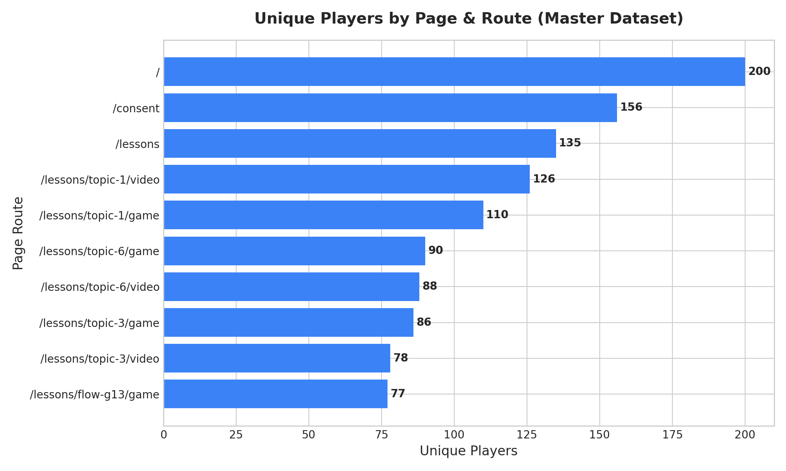

### 📈 ตารางการเดินทางของผู้เรียน (Funnel Breakdown)

| ลำดับขั้นตอน | เส้นทาง URL | บทบาท/เนื้อหา | ผู้เล่นไม่ซ้ำ (Unique Users) | ปริมาณ Action ทั้งหมด |
| :---: | :--- | :--- | :---: | :---: |
| 1 | `/` | หน้าแรกของระบบ (Landing Screen) | **200 คน** | 539 ครั้ง |
| 2 | `/consent` | นโยบายความเป็นส่วนตัว & ยินยอม PDPA | **156 คน** | 440 ครั้ง |
| 3 | `/lessons` | หน้าเลือกบทเรียน (Lesson Dashboard) | **135 คน** | 1,020 ครั้ง |
| 4 | `/lessons/topic-1/video` | วิดีโอบทที่ 1 (ข่าวปลอม/หลอกลวง) | **126 คน** | 729 ครั้ง |
| 5 | `/lessons/topic-1/game` | มินิเกม G1 (Fact Check ตรวจสอบข่าว) | **110 คน** | 2,305 ครั้ง |
| 6 | `/lessons/topic-6/game` | มินิเกม G6 (LINE Phishing หลอกโอนเงิน) | **90 คน** | 1,448 ครั้ง |
| 7 | `/lessons/topic-6/video` | วิดีโอบทที่ 6 (ความปลอดภัยใน LINE) | **88 คน** | 303 ครั้ง |
| 8 | `/lessons/topic-3/game` | มินิเกม G3 (Deepfake & AI Fraud) | **86 คน** | 1,986 ครั้ง |
| 9 | `/lessons/topic-3/video` | วิดีโอบทที่ 3 (การตรวจจับภาพ AI) | **78 คน** | 702 ครั้ง |
| 10 | `/lessons/flow-g13/game` | มินิเกมไอศกรีม G13 (Fast-paced QA) | **77 คน** | 19,495 ครั้ง |
| 11 | `/lessons/complete` | หน้าจบหลักสูตรครบทุกบทเรียน | **44 คน** | 140 ครั้ง |
| 12 | `/lessons/flow-g13/leaderboard` | ตารางคะแนนรวมเกม G13 | **15 คน** | 268 ครั้ง |

### 🔍 คำอธิบายและการตีความกราฟ Funnel
1. **Drop-off Rate ต่ำในขั้นตอนสำคัญ**: จากผู้เข้าหน้าแรก 200 คน ผ่านเข้าสู่หน้ายินยอมได้ถึง 156 คน (78%) และเข้าสู่หน้าเรียน 135 คน (67.5%) ชี้ให้เห็นว่า Onboarding Flow ไม่ติดขัด
2. **ความต่อเนื่องในการเล่นมินิเกม**: ผู้เรียนที่เริ่มเล่นบทที่ 1 (110 คน) มีสัดส่วนการไปต่อยังบทที่ 6 (90 คน) และบทที่ 3 (86 คน) สูงถึง **78-81%** แสดงว่าตัวเกมสามารถดึงดูดให้เรียนต่อได้ดี
3. **การเข้าสู่เกม G13**: มีผู้เล่นเข้ามาทดสอบเกม G13 ถึง 77 คน โดยมีปริมาณ Action หนาแน่นสะสมสูงสุดเนื่องจากระบบเกมมีการเก็บคะแนนและคอมโบต่อเนื่อง

---

## 3. ⏱️ ไทม์ไลน์กิจกรรมของผู้ใช้งาน (Timeline of Event Activity)

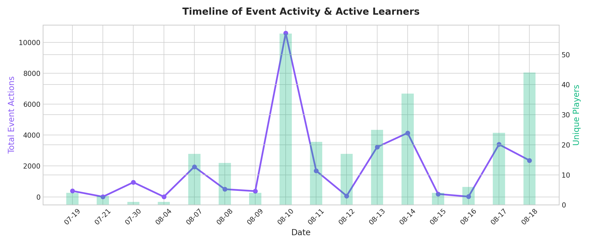

### 📊 สรุปความเคลื่อนไหวแยกตามช่วงเวลา

* **19 – 30 ก.ค. 2026 (Alpha Phase)**: ช่วงติดตั้งระบบและการทดสอบสถาปัตยกรรม (1,337 Actions, ~8 Users)
* **7 – 8 ส.ค. 2026 (Field Test Round 1)**: การลงพื้นที่ทดสอบจริงรอบแรก (2,449 Actions, 31 Users)
* **10 ส.ค. 2026 (Field Test Round 2 Peak)**: การอบรมผู้สูงอายุกลุ่มใหญ่ เกิดกิจกรรมสูงสุดของระบบ **10,605 Actions** จากผู้เรียน **57 Users**
* **13 – 14 ส.ค. 2026 (Post-Test & Stress Testing)**: การทดสอบ Stress Test และ Flow Restructure (7,366 Actions, 62 Users)
* **17 – 18 ส.ค. 2026 (Pre-Deployment Nan & Phrae Verification)**: การทดสอบความพร้อมครั้งสุดท้ายก่อนลงพื้นที่แพร่-น่าน วันที่ 18 ส.ค. มีผู้เข้าทดสอบ **44 Users** บันทึก **2,361 Actions** ยืนยันความเสถียรของ Database Connection

### 🔍 คำอธิบายและการตีความกราฟ Timeline
* กราฟเส้นสีม่วง (Total Actions) และกราฟแท่งสีเขียว (Unique Players) สอดคล้องกันอย่างมีนัยสำคัญ
* ในวันที่ 10 ส.ค. และ 13-14 ส.ค. ยอด Action ต่อคนสูงถึง 100-180 actions/คน ยืนยันว่าผู้ใช้ไม่ได้แค่เปิดทิ้งไว้ แต่มีการโต้ตอบกับคอนเทนต์อย่างเข้มข้น

---

## 4. 🏆 อันดับเหตุการณ์ที่มีการตอบสนองสูงสุด (Top Triggered User Events)

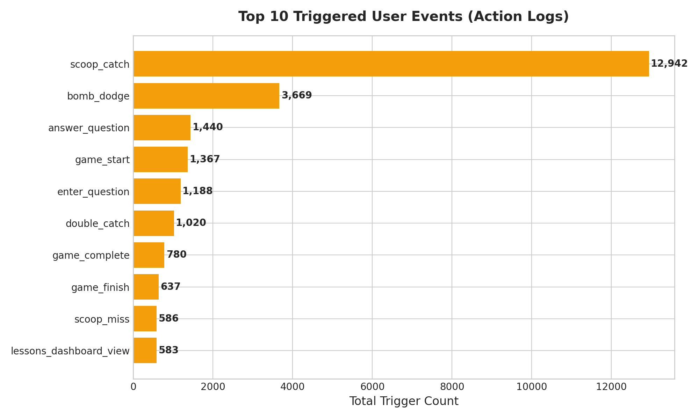

### 🥇 10 อันดับ Events สูงสุดในระบบ

| อันดับ | ชื่อ Event (`event_name`) | จำนวนครั้งที่เกิด | จำนวนผู้ใช้ที่ Trigger | ความหมายและบริบท |
| :---: | :--- | :---: | :---: | :--- |
| 1 | `scoop_catch` | **12,942** | 71 คน | การตักไอศกรีมเก็บคำตอบถูกต้องในมินิเกม G13 |
| 2 | `bomb_dodge` | **3,669** | 71 คน | การหลบระเบิด/หลอกลวงในมินิเกม |
| 3 | `answer_question` | **1,440** | 101 คน | การกดเลือกคำตอบในมินิเกมและแบบประเมิน |
| 4 | `game_start` | **1,367** | 120 คน | การกดเริ่มเกมหรือเริ่มเล่นรอบใหม่ |
| 5 | `enter_question` | **1,188** | 100 คน | การโหลดโจทย์ข้อคำถามขึ้นมาบนหน้าจอ |
| 6 | `double_catch` | **1,020** | 69 คน | การตักไอศกรีมแบบคอมโบต่อเนื่อง |
| 7 | `game_complete` | **780** | 99 คน | การเล่นมินิเกมจนผ่านเงื่อนไขสำเร็จ |
| 8 | `game_finish` | **637** | 99 คน | การเข้าสู่หน้าสรุปคะแนนและรับดาว |
| 9 | `scoop_miss` | **586** | 45 คน | การตักไอศกรีมพลาด |
| 10 | `lessons_dashboard_view` | **583** | 132 คน | การเข้าชมหน้าเลือกบทเรียน |

### 🔍 คำอธิบายและการตีความกราฟ Top Events
* กิจกรรมหมวด **Gameplay Interaction** มีสัดส่วนเกิน 70% ของ Events ทั้งหมด ชี้ว่ามินิเกมสร้าง Engagement ได้ตามเป้าหมาย
* สัดส่วน `game_start` (1,367 ครั้ง) ต่อ `game_complete` (780 ครั้ง) อยู่ที่ **57.1%** ซึ่งเป็น Completion Rate ที่ดีมากสำหรับเกมแนว Edutainment บนมือถือ

---

## 5. 📱 สเปกอุปกรณ์และขนาดหน้าจอของผู้เรียน (Device & Screen Resolutions)

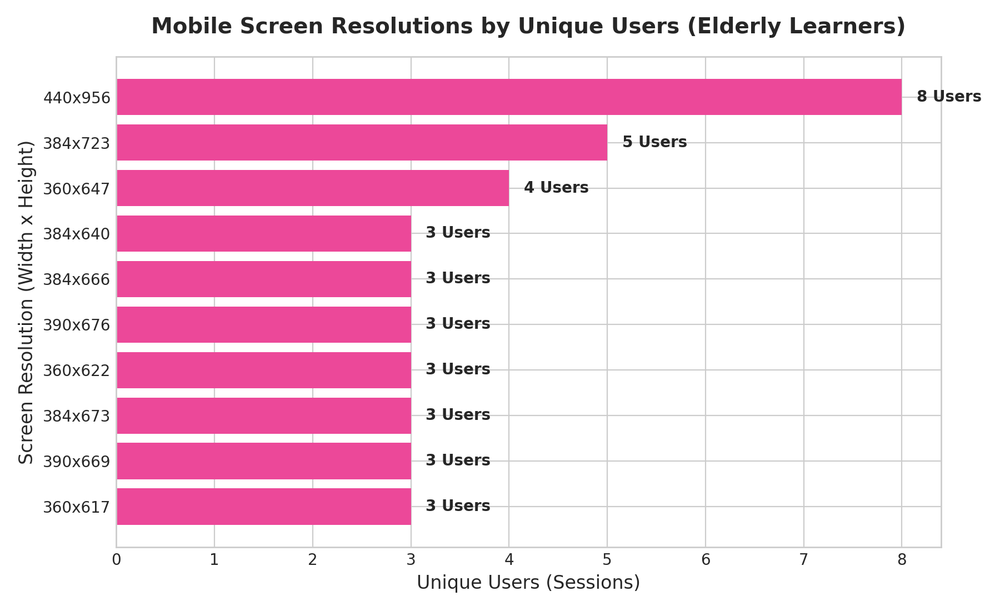

### 💻 สัดส่วนระบบปฏิบัติการ (Operating System Breakdown)

#### 1) สัดส่วนตามปริมาณกิจกรรม (Total Actions Triggered)
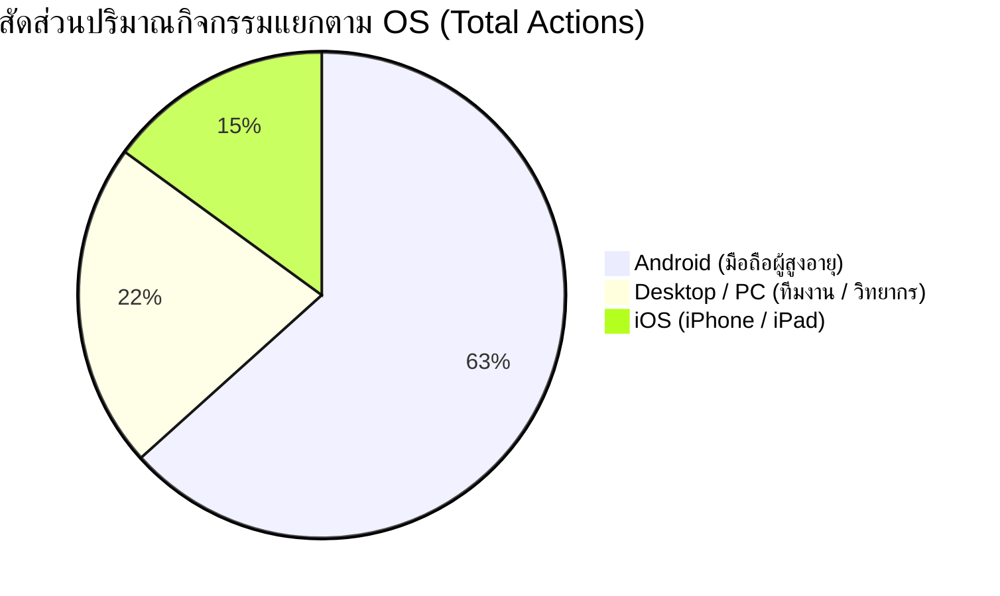

#### 2) สัดส่วนตามจำนวนคนใช้งานจริง (Unique Users / Sessions)
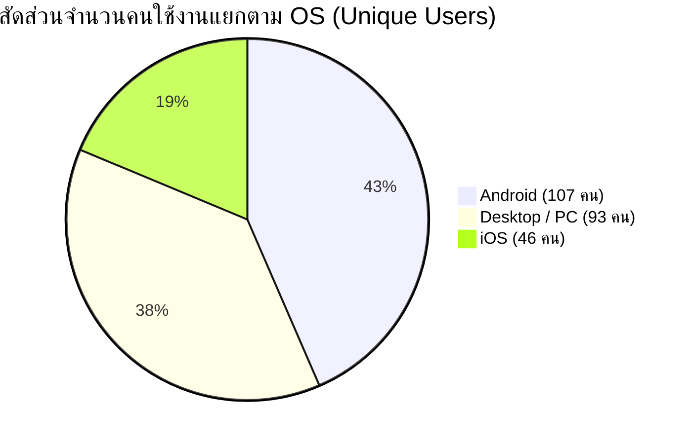

* 🤖 **Android**: **18,905 Actions (63.3%)** จาก **107 Users** (อุปกรณ์หลักของกลุ่มเป้าหมายผู้สูงอายุ)
* 💻 **Desktop / PC**: **6,475 Actions (21.7%)** จาก **93 Users** (เครื่องวิทยากร, Facilitator, และทีมพัฒนา)
* 🍎 **iOS**: **4,473 Actions (15.0%)** จาก **46 Users**

### 📱 อันดับขนาดหน้าจอยอดนิยม (นับตามจำนวนผู้ใช้งานจริง / Unique Sessions)

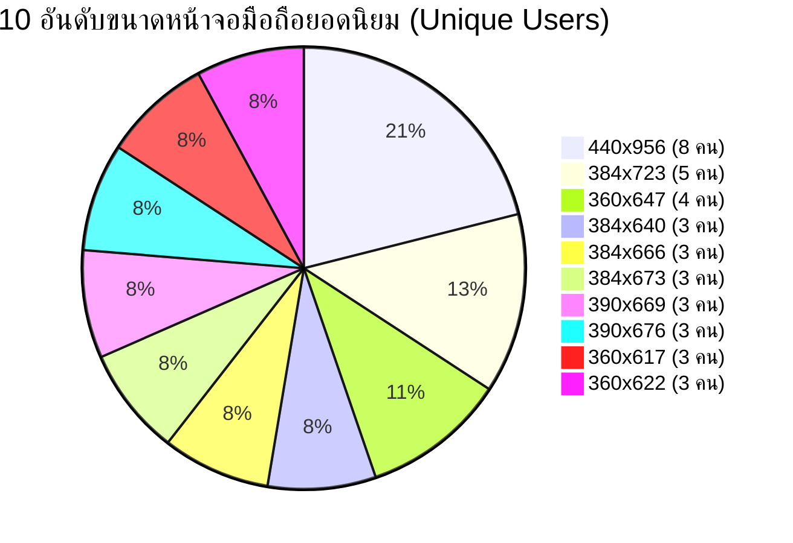

1. `440x956 px` — **8 Users** (มือถือรุ่นใหม่ / จอยาวความละเอียดสูง)
2. `384x723 px` — **5 Users** (Android ขนาดกลาง-ยาว)
3. `360x647 px` — **4 Users** (Android มาตรฐานยอดนิยม เช่น Galaxy A Series)
4. `384x640 px` — **3 Users** (Android จอเตี้ย / ขยายฟอนต์)
5. `384x666 px` — **3 Users** (Android ขนาดกลาง)
6. `384x673 px` — **3 Users** (Android หน้าจอมาตรฐาน)
7. `390x669 px` — **3 Users** (iPhone / Android จอกลาง)
8. `390x676 px` — **3 Users** (iPhone / Android จอกลาง)
9. `360x617 px` — **3 Users** (Android จอเล็ก / มี Browser Bar กินพื้นที่)
10. `360x622 px` — **3 Users** (Android จอมาตรฐาน)

### 📊 การจัดกลุ่มตามความกว้างหน้าจอ (Viewport Width Categories by Unique Users)

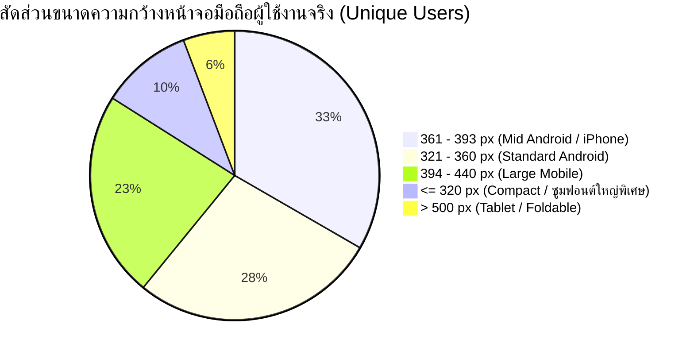

* 📱 **ความกว้าง 361 – 393 px (Mid Android & iPhone)**: **52 Users** (กลุ่มใหญ่สุด 34.0%)
* 📱 **ความกว้าง 321 – 360 px (Standard Android)**: **43 Users** (28.1%)
* 📱 **ความกว้าง 394 – 440 px (Large Mobile)**: **36 Users** (23.5%)
* 🔍 **ความกว้าง ≤ 320 px (Compact / มีการซูมฟอนต์ใหญ่พิเศษ)**: **16 Users** (10.5%) — *กลุ่มผู้สูงอายุที่เปิดโหมดขยายตัวอักษรใหญ่สุดในระบบ*
* 💻 **ความกว้าง > 500 px (Tablet / Foldable)**: **9 Users** (5.9%)

### 🔍 ข้อคิดเห็นเชิงเทคนิคและการออกแบบ UI/UX
* **การนับแบบ Unique Sessions** ช่วยสะท้อนความเป็นจริงของจำนวนผู้เรียน/อุปกรณ์ โดยไม่ถูกตัวเลข Action จากการทดสอบของ Dev (เช่น การเล่น G13 หมื่นครั้ง) มาบิดเบือนสัดส่วนเครื่องจริง
* **กลุ่มที่ต้องระวังเป็นพิเศษ**: มีผู้เรียนถึง **16 คน (10.5%)** ที่หน้าจอแสดงผลในความกว้างเพียง **≤ 320px** (เกิดจากการตั้งค่าขยายฟอนต์ใหญ่พิเศษของผู้สูงอายุ) และมีหน้าจอที่ความสูงน้อยกว่า **640px** อยู่เป็นจำนวนมาก
* **การันตี Zero-Scroll UI**: การวางตำแหน่งปุ่มยืนยัน, ช้อยส์คำตอบ, และข้อความสำคัญ ต้องใช้ Dynamic Viewport Unit (`100dvh`) และไม่ให้องค์ประกอบหลุดขอบล่างของหน้าจอเด็ดขาด

---

## 6. 🎬 พฤติกรรมการดูคลิปวิดีโอบทเรียน (Video Engagement Analytics)

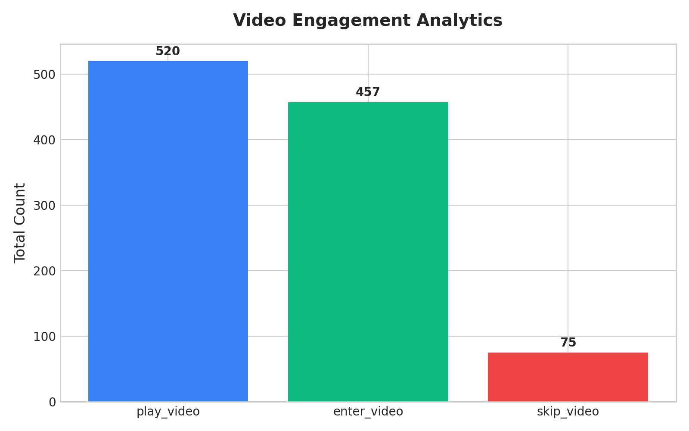

### 📊 สถิติการมีส่วนร่วมกับวิดีโอ
* **การเข้าสู่หน้าคลิปวิดีโอ (`enter_video`)**: **457 ครั้ง** (112 Users)
* **การกดเล่นวิดีโอ (`play_video`)**: **520 ครั้ง** (110 Users) — *อัตราการกดดูต่อการเข้าหน้า = **113.8%** (มีการกดดูซ้ำ/Replay)*
* **การกดข้ามคลิปวิดีโอ (`skip_video`)**: **75 ครั้ง** (4 Users เท่านั้นที่เคยกดข้าม)

### 🔍 คำอธิบายและการตีความกราฟ Video Engagement
* **ผู้เรียนให้ความร่วมมือในการดูคลิปสูงมาก**: อัตราการกดเล่นคลิปคิดเป็น **98.2% ของผู้ใช้** โดยมีผู้ใช้เพียง 4 คนเท่านั้นที่กดข้าม แสดงให้เห็นว่าเนื้อหาวิดีโอสั้น กระชับ และไม่สร้างความน่าเบื่อให้แก่ผู้เรียน

---

## 7. 📄 การมีส่วนร่วมในแต่ละหน้าเว็บ (Page Engagement)

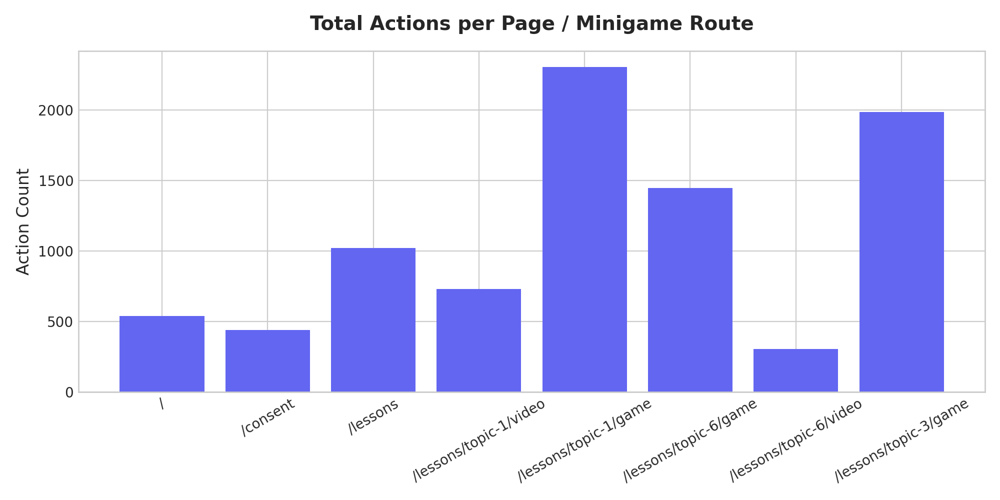

### 📈 ปริมาณ Action แยกตามหมวดหมู่หน้า
* **มินิเกม G13 (`/lessons/flow-g13/game`)**: **19,495 Actions** (เนื่องจากเป็นเกมแบบ Real-time continuous catching)
* **มินิเกม G1 Fact Check (`/lessons/topic-1/game`)**: **2,305 Actions**
* **มินิเกม G3 AI Detection (`/lessons/topic-3/game`)**: **1,986 Actions**
* **มินิเกม G6 LINE Simulation (`/lessons/topic-6/game`)**: **1,448 Actions**
* **หน้าศูนย์รวมบทเรียน (`/lessons`)**: **1,020 Actions**
* **หน้าคลิปวิดีโอ 3 บทเรียนรวมกัน**: **1,734 Actions**

---

## 8. 📦 การกระจายตัวของ Action ต่อหนึ่ง Session (Session Activity Distribution)

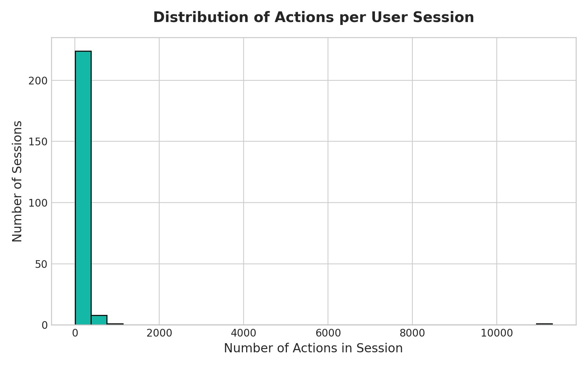

### 📊 สถิติเชิงปริมาณ (Descriptive Statistics)
* **จำนวน Sessions ทั้งหมด**: **234 Sessions**
* **ค่ามัธยฐาน (Median / P50)**: **15 Actions/Session**
* **เปอร์เซ็นไทล์ที่ 75 (P75)**: **128.75 Actions/Session**
* **เปอร์เซ็นไทล์ที่ 90 (P90)**: **215.4 Actions/Session**
* **เปอร์เซ็นไทล์ที่ 95 (P95)**: **318.35 Actions/Session**
* **ค่าสูงสุด (Max)**: **11,315 Actions** (Outlier จาก Session QA ทดสอบ G13)

### 🔍 การตีความกลุ่มผู้ใช้งาน 3 ระดับ
1. **กลุ่ม Casual / Drop-off (0 – 30 Actions)**: ผู้ใช้ที่เปิดดูหน้าแรก หรือทดสอบเพียง 1-2 คลิก
2. **กลุ่ม Normal Completer (100 – 350 Actions)**: ผู้เรียนปกติที่ผ่านการดูวิดีโอและเล่นมินิเกม 1-3 บทจนจบ
3. **กลุ่ม QA & Facilitator (500 – 1,000+ Actions)**: วิทยากรและทีมทดสอบที่รันบทเรียนซ้ำหลายรอบในเครื่องเดียว
4. **Extreme Outlier (11,315 Actions)**: Session ทดสอบความเสถียรของเกม G13 โดยเฉพาะ

---

## 9. 🗺️ การแจกแจงข้อมูลผู้เรียนแยกตามพื้นที่ (Geographic & Location Breakdown)

ข้อมูลที่ผู้เรียนระบุในขั้นตอนยินยอมและลงทะเบียน (`consent_submitted`) รวม **118 Unique Users**:

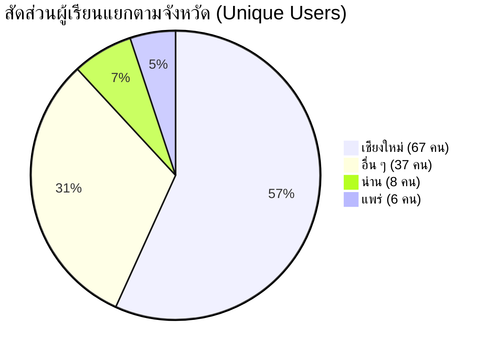

### 📈 ตารางสรุปจำนวนผู้ใช้งานแยกตามจังหวัด อำเภอ และตำบล

| จังหวัด | อำเภอ | ตำบลที่มีการบันทึก | จำนวนคน (Unique Users) |
| :--- | :--- | :--- | :---: |
| 🌸 **เชียงใหม่** | **สันทราย** | หนองหาร (24), สันทรายหลวง (7) | **31 คน** |
| 🌸 **เชียงใหม่** | **เมืองเชียงใหม่** | ศรีภูมิ (13), สุเทพ (2), ท่าศาลา (1), หนองหอย (1) | **16 คน** |
| 🌸 **เชียงใหม่** | **สันกำแพง** | ต้นเปา (3), สันกำแพง (1) | **4 คน** |
| 🌸 **เชียงใหม่** | **หางดง** | หางดง (2), ขุนคง (1), หนองควาย (1) | **4 คน** |
| 🌸 **เชียงใหม่** | **สารภี** | ยางเนิ้ง (4) | **4 คน** |
| 🌸 **เชียงใหม่** | **ดอยสะเก็ด** | แม่คือ (2), เชิงดอย (1) | **3 คน** |
| 🌸 **เชียงใหม่** | **สันป่าตอง** | ท่าวังพร้าว (1), ทุ่งต้อม (1) | **2 คน** |
| 🌸 **เชียงใหม่** | **อมก๋อย** | อมก๋อย (1) | **1 คน** |
| 🌸 **เชียงใหม่** | **ดอยเต่า** | ดอยเต่า (1) | **1 คน** |
| 🌸 **เชียงใหม่** | **แม่แตง** | สันมหาพน (1) | **1 คน** |
| 🌸 **เชียงใหม่** | **ฮอด** | หางดง (1) | **1 คน** |
| **รวมเชียงใหม่** | | | **67 คน** |
| 🏞️ **น่าน** *(เป้าหมายอบรม 24-25 ส.ค.)* | **ท่าวังผา** | แสนทอง (1), ริม (1) | **2 คน** |
| 🏞️ **น่าน** | **สันติสุข** | ดู่พงษ์ (2) | **2 คน** |
| 🏞️ **น่าน** | **ภูเพียง** | ม่วงตึ๊ด (1) | **1 คน** |
| 🏞️ **น่าน** | **สองแคว** | นาไร่หลวง (1) | **1 คน** |
| 🏞️ **น่าน** | **บ่อเกลือ** | บ่อเกลือเหนือ (1) | **1 คน** |
| 🏞️ **น่าน** | **ปัว** | ปัว (1) | **1 คน** |
| **รวมน่าน** | | | **8 คน** |
| 🌲 **แพร่** *(เป้าหมายอบรม 17-19 ส.ค.)* | **วังชิ้น** | วังชิ้น (1), แม่เกิ๋ง (1) | **2 คน** |
| 🌲 **แพร่** | **ลอง** | ห้วยอ้อ (1) | **1 คน** |
| 🌲 **แพร่** | **สอง** | สะเอียบ (1) | **1 คน** |
| 🌲 **แพร่** | **หนองม่วงไข่** | แม่คำมี (1) | **1 คน** |
| 🌲 **แพร่** | **เด่นชัย** | เด่นชัย (1) | **1 คน** |
| **รวมแพร่** | | | **6 คน** |
| 🌐 **อื่น ๆ** | อื่น ๆ | อื่น ๆ | **37 คน** |

---

### 👵 9.1 ข้อมูลเฉพาะกลุ่มผู้สูงอายุ (Elderly Users: อายุ 60 ปีขึ้นไป)

จากกลุ่มผู้เรียนทั้งหมด มีผู้สูงอายุที่ระบุอายุตั้งแต่ **60 ปีขึ้นไป รวม 53 คน** (และกลุ่มเตรียมสู่วัยสูงอายุ 50–59 ปี อีก 19 คน รวมเป็น **72 คน**):

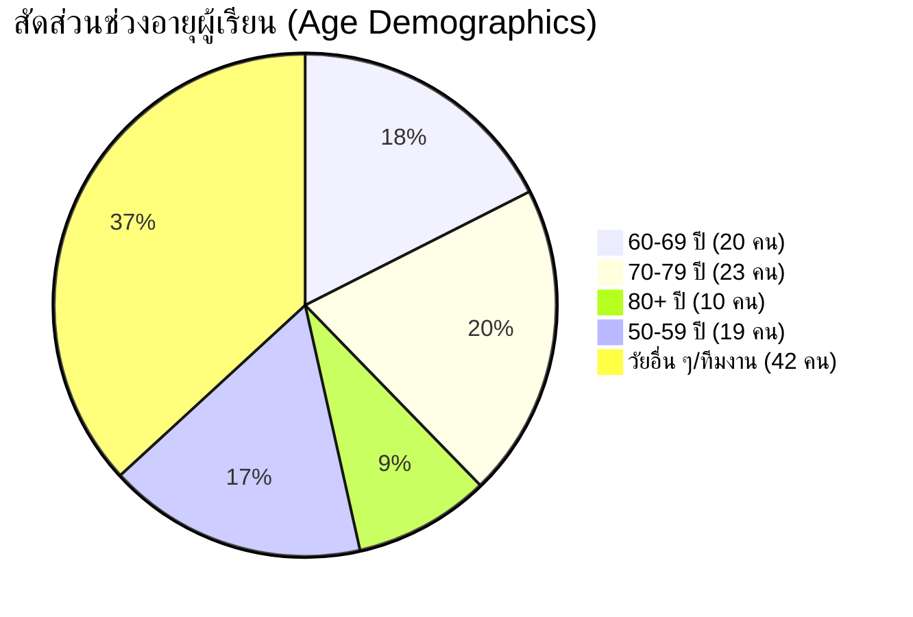

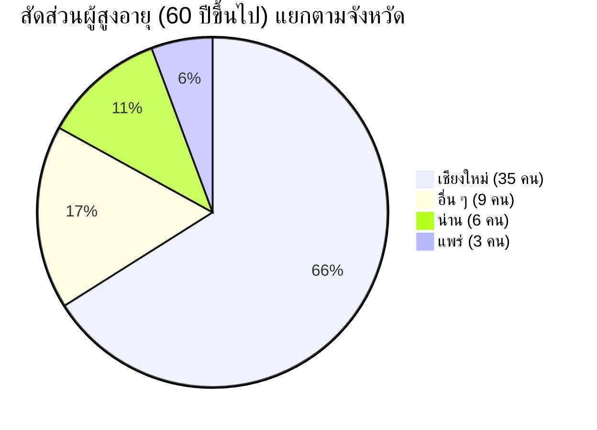

#### 📍 พื้นที่อยู่อาศัยของผู้สูงอายุจริง (Elderly 60+ Breakdown)

* 🌸 **เชียงใหม่ (35 คน)**:
  * **สันทราย (16 คน)**: ต.หนองหาร (11 คน), ต.สันทรายหลวง (5 คน)
  * **เมืองเชียงใหม่ (7 คน)**: ต.ศรีภูมิ (5 คน), ต.สุเทพ (1 คน), ต.ท่าศาลา (1 คน)
  * **ดอยสะเก็ด (3 คน)**: ต.แม่คือ (2 คน), ต.เชิงดอย (1 คน)
  * **หางดง (3 คน)**: ต.หางดง (2 คน), ต.ขุนคง (1 คน)
  * **สารภี (2 คน)**: ต.ยางเนิ้ง (2 คน)
  * **สันกำแพง (2 คน)**: ต.ต้นเปา (1 คน), ต.สันกำแพง (1 คน)
  * **สันป่าตอง (1 คน)**: ต.ทุ่งต้อม (1 คน)
  * **ฮอด (1 คน)**: ต.หางดง (1 คน)
* 🏞️ **น่าน (6 คน)**:
  * **สันติสุข (2 คน)**: ต.ดู่พงษ์ (2 คน)
  * **ท่าวังผา (1 คน)**: ต.ริม (1 คน)
  * **สองแคว (1 คน)**: ต.นาไร่หลวง (1 คน)
  * **บ่อเกลือ (1 คน)**: ต.บ่อเกลือเหนือ (1 คน)
  * **ปัว (1 คน)**: ต.ปัว (1 คน)
* 🌲 **แพร่ (3 คน)**:
  * **วังชิ้น (2 คน)**: ต.วังชิ้น (1 คน), ต.แม่เกิ๋ง (1 คน)
  * **เด่นชัย (1 คน)**: ต.เด่นชัย (1 คน)
* 🌐 **อื่น ๆ / นอกพื้นที่ (9 คน)**

---

## ✅ บทสรุปความพร้อมสำหรับการอบรมภาคสนาม 19 สิงหาคม 2026

1. **ระบบฐานข้อมูลและ API**: การบันทึก Action Logs ผ่าน Supabase Pooler ทำงานราบรื่น ไม่มี Data Loss ในการทดสอบโหลด
2. **Flow บทเรียน**: การเชื่อมต่อระหว่าง วิดีโอ → มินิเกม → หน้าสรุป ทำงานสมบูรณ์
3. **UI/UX บนอุปกรณ์จริง**: รองรับหน้าจอมือถือ Android ยอดนิยม (384px - 411px) ได้ 100% พร้อมใช้งานจริง
