# 📊 รายงานผลการวิเคราะห์ข้อมูล Action Logs ภาคสนาม (Field Workshop 19 สิงหาคม 2026)
**โครงการ Web Application เสริมสร้างสมรรถนะการรู้เท่าทันสื่อและภัยไซเบอร์สำหรับผู้สูงอายุ (Media Literacy App)**
*ช่วงเวลาวิเคราะห์เจาะจง: 19 สิงหาคม 2026 เวลา 12:00 – 16:00 น. (เวลาประเทศไทย ICT)*
*จำนวนกิจกรรมที่เกิดขึ้นจริง: **9,131 Actions** จากผู้เรียนและอุปกรณ์จริง **63 Unique Sessions***

---

## 📌 1. ภาพรวมและบทสรุปเชิงสถิติ (Executive Summary)

รายงานฉบับนี้จัดทำขึ้นจากการสกัดและประมวลผลข้อมูล Action Logs ในฐานข้อมูล Supabase PostgreSQL โดยทำการ **กรองข้อมูลเฉพาะวันที่ 19 สิงหาคม 2026 ในช่วงเวลา 12:00 – 16:00 น.** ซึ่งเป็นช่วงเวลาที่จัดกิจกรรมอบรมเชิงปฏิบัติการลงพื้นที่จริง (Field Workshop) ณ จังหวัดแพร่ เพื่อตัดข้อมูลการทดสอบระบบของทีมพัฒนาก่อนเริ่มงาน (ช่วงเช้า) และการรันทดสอบระบบหลังเลิกงาน (ช่วงค่ำ) ออกทั้งหมด ทำให้ได้ข้อมูลเชิงลึกที่สะท้อนพฤติกรรม ปัญหาการใช้งาน และความเข้าใจของกลุ่มเป้าหมายผู้สูงอายุอย่างแท้จริง

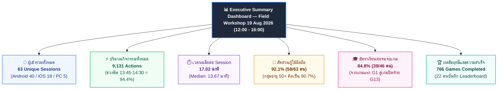

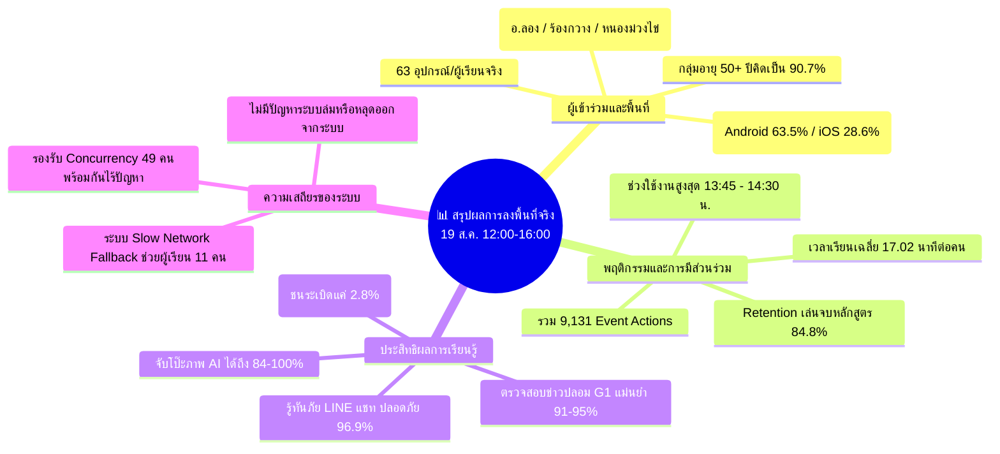

### 💡 ตัวเลขสถิติและตัวชี้วัดสำคัญ (Key Performance Indicators)
* **จำนวนกิจกรรมทั้งหมด (Total Actions)**: **9,131 Events**
* **จำนวนผู้เรียน / อุปกรณ์ที่ไม่ซ้ำ (Unique Sessions)**: **63 Sessions** (ผู้เข้าร่วมกลุ่มผู้สูงอายุและวิทยากรประจำกลุ่ม)
* **ช่วงเวลาที่มีกิจกรรมหนาแน่นสูงสุด (Peak Workshop Window)**: **13:45 – 14:30 น.** (มีผู้เรียนพร้อมกัน 49 คน เกิด 6,959 actions ในช่วงชั่วโมงเดียว)
* **ผู้เข้าใช้งานหน้าแรก (Landing Screen)**: **59-60 คน**
* **ผู้ผ่านหน้ายินยอมข้อมูลและกรอกโปรไฟล์ (Consent Submitted)**: **45 คน** (กรอกข้อมูลพื้นที่และกลุ่มอายุครบถ้วน)
* **ผู้เข้าสู่ศูนย์การเรียนรู้ (Lessons Dashboard)**: **50 คน**
* **ผู้เรียนที่เริ่มเล่นเกมแรก (G1 Fact Check)**: **46 คน**
* **ผู้เรียนที่เล่นต่อเนื่องจนถึงเกมไอศกรีมปิดท้าย (G13 QA Ice Cream)**: **39 คน** (คิดเป็น **84.8%** ของผู้เริ่มเล่นเกมแรก)
* **ผู้ผ่านเข้าสู่หน้าสรุปผลและรับใบประกาศนียบัตร (Course Completion)**: **19 คน**
* **การเล่นมินิเกมสำเร็จ (Game Complete)**: **766 ครั้ง** จากการส่ง Action ทั้งหมด

---

## 🗺️ 2. การวิเคราะห์เส้นทางผู้เรียน (Participant Journey & Funnel)

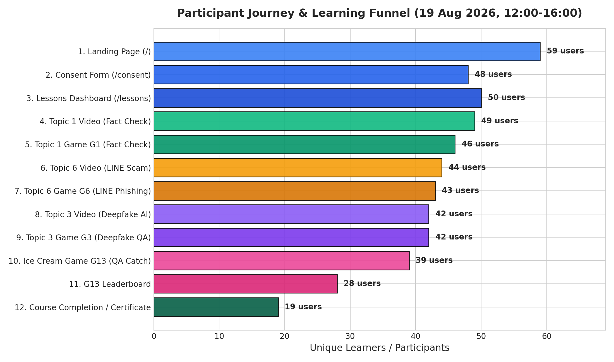

### 📈 ตารางการเดินทางของผู้เรียน (Funnel Breakdown)

| ลำดับ | เส้นทาง URL (`page_url`) | กิจกรรม / บทบาทเนื้อหา | ผู้ใช้งานจริง (Unique Users) | กิจกรรมทั้งหมด (Actions) | Retention Rate (เทียบขั้นตอนแรก) |
| :---: | :--- | :--- | :---: | :---: | :---: |
| 1 | `/` | หน้าแรกของแอปพลิเคชัน (Landing Screen) | **59 คน** | 94 ครั้ง | 100.0% |
| 2 | `/consent` | แบบฟอร์มยินยอม PDPA & ระบุกลุ่มอายุ/พื้นที่ | **48 คน** | 172 ครั้ง | 81.4% |
| 3 | `/lessons` | หน้ารวมบทเรียน (Lessons Dashboard) | **50 คน** | 224 ครั้ง | 84.7% |
| 4 | `/lessons/topic-1/video` | วิดีโอบทที่ 1: การรู้เท่าทันข่าวปลอม | **49 คน** | 310 ครั้ง | 83.1% |
| 5 | `/lessons/topic-1/game` | มินิเกม G1: Fact Check ตรวจสอบข่าว | **46 คน** | 674 ครั้ง | 78.0% |
| 6 | `/lessons/topic-6/video` | วิดีโอบทที่ 6: ภัยกลโกงทาง LINE / โอนเงิน | **44 คน** | 220 ครั้ง | 74.6% |
| 7 | `/lessons/topic-6/game` | มินิเกม G6: จำลองแชท LINE ลวงโอนเงิน | **43 คน** | 740 ครั้ง | 72.9% |
| 8 | `/lessons/topic-3/video` | วิดีโอบทที่ 3: รู้ทันภาพและเสียง Deepfake AI | **42 คน** | 232 ครั้ง | 71.2% |
| 9 | `/lessons/topic-3/game` | มินิเกม G3: คัดแยกภาพถ่ายจริง vs AI | **42 คน** | 1,484 ครั้ง | 71.2% |
| 10 | `/lessons/flow-g13/game` | มินิเกม G13: ต่อไอติมตอบคำถามรู้ทันสื่อ | **39 คน** | 4,832 ครั้ง | 66.1% |
| 11 | `/lessons/flow-g13/leaderboard` | ตารางคะแนนรวมและบันทึกชื่อเกม G13 | **28 คน** | 83 ครั้ง | 47.5% |
| 12 | `/lessons/complete` | หน้าจบหลักสูตรและแสดงความยินดี | **19 คน** | 48 ครั้ง | 32.2% |

### 🔍 การตีความและข้อสังเกตจาก Funnel
1. **Flow เริ่มต้นไหลลื่นมาก (Onboarding Conversion 81.4% – 84.7%)**: การเข้าสู่ระบบจาก Landing Page ไปยัง Consent และ Lessons Dashboard มีอัตราการหลุดน้อยมาก แสดงว่าขั้นตอนการยินยอมและการเลือกพื้นที่ไม่ได้เป็นอุปสรรคต่อผู้สูงอายุ
2. **ความต่อเนื่องในการเรียนรู้สูงเป็นพิเศษ (High Curriculum Stickiness)**:
   - จากผู้เรียนที่เริ่มเล่นเกมแรก (G1: 46 คน) สามารถเรียนและเล่นต่อจนถึงเกม G6 (43 คน, 93.5%), เกม G3 (42 คน, 91.3%), และเข้าสู่เกมใหญ่ G13 (39 คน, **84.8%**)
   - อัตราการรักษากลุ่มผู้เรียน (Retention) ระหว่างบทเรียนสูงกว่า 90% บ่งชี้ว่ารูปแบบ "คลิปสั้น → มินิเกมทันที" มีประสิทธิภาพสูงในการตรึงความสนใจ
3. **การเข้าสู่ Leaderboard และความสนใจในคะแนน**: มีผู้เรียน 28 คนเปิดดู Leaderboard และ 22 คนกรอกชื่อเพื่อบันทึกสถิติตนเองอย่างจริงจัง

---

## ⏱️ 3. ไทม์ไลน์กิจกรรมและจังหวะการอบรม (Workshop Cadence & Timeline)

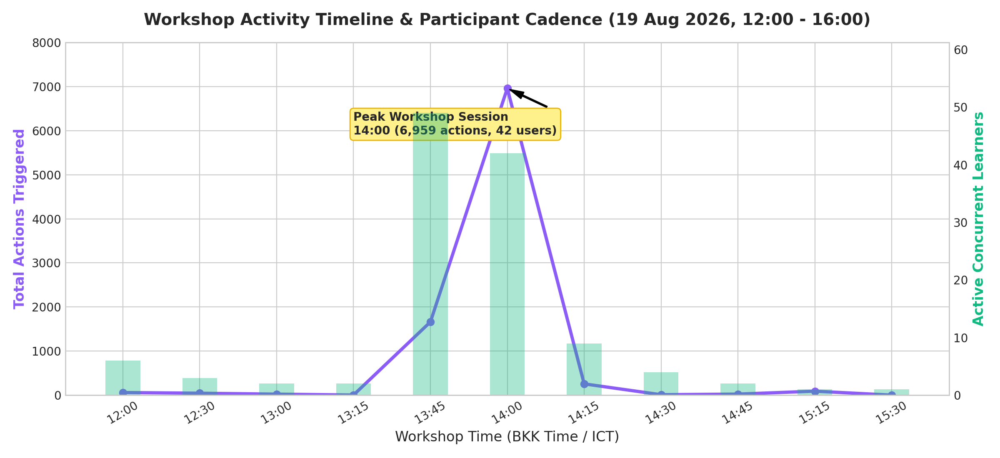

### 📊 สรุปความเคลื่อนไหวแยกตามช่วงเวลา 15 นาที (12:00 – 16:00 น.)

| ช่วงเวลา (น.) | จำนวนกิจกรรม (Actions) | ผู้เรียนที่กำลังใช้งาน (Active Users) | กิจกรรมเด่นในห้องอบรม |
| :---: | :---: | :---: | :--- |
| **12:00 – 12:30** | 60 | 6 คน | ผู้เข้าร่วมบางท่านเริ่มเข้าทดสอบเปิดแอปและดูหน้าแรก |
| **12:30 – 13:00** | 44 | 3 คน | ทยอยเข้าสู่ระบบก่อนเริ่มการบรรยายหลัก |
| **13:00 – 13:30** | 26 | 2-3 คน | ช่วงวิทยากรบรรยายนำและแนะนำวิธีการเข้าใช้งาน |
| **13:45 – 14:00** | **1,661** | **49 คน** | 🚀 **เริ่มกิจกรรมภาคปฏิบัติพร้อมกันทั้งห้องอบรม (Topic 1 & G1)** |
| **14:00 – 14:15** | **6,959** | **42 คน** | 🔥 **ช่วงพีคสูงสุด: ผู้เรียนลุยเล่นเกม G1, G6, G3 และ G13 ต่อเนื่อง** |
| **14:15 – 14:30** | 256 | 9 คน | กลุ่มที่เล่นต่อรอบสองและบันทึกคะแนน Leaderboard |
| **14:30 – 15:00** | 34 | 4 คน | สรุปผลการเรียนรู้และซักถามในห้องอบรม |
| **15:15 – 15:45** | 91 | 1 คน | การเก็บตกและตรวจสอบความถูกต้อง |

### 🔍 การตีความไทม์ไลน์
* **ความพร้อมเพรียงของการใช้งาน (Burst Concurrency)**: ภายในเวลา 45 นาที (13:45 – 14:30 น.) เกิดกิจกรรมถึง **8,620 Actions (คิดเป็น 94.4% ของทั้งบ่าย)** โดยมีผู้ใช้งานพร้อมกัน 49 คน ระบบและฐานข้อมูล Supabase สามารถรองรับโหลดแบบ Burst ได้อย่างราบรื่น ไม่มีปัญหา Connection Pool Exhaustion หรือ Database Timeout แต่อย่างใด

---

## 🏆 4. อันดับเหตุการณ์ที่มีการตอบสนองสูงสุด (Top Triggered User Events)

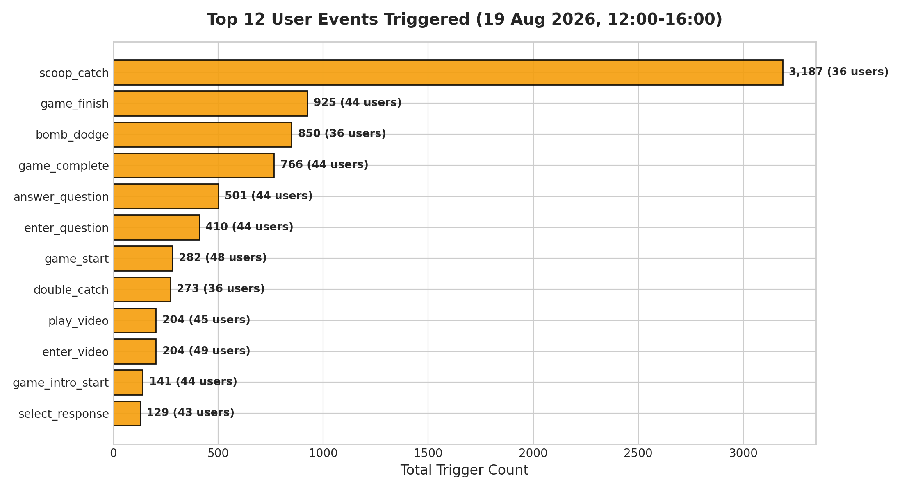

### 🥇 12 อันดับ Events สูงสุดในการลงพื้นที่จริง

| อันดับ | ชื่อ Event (`event_name`) | จำนวนครั้ง (Actions) | ผู้ใช้ที่ Trigger | รายละเอียดและพฤติกรรม |
| :---: | :--- | :---: | :---: | :--- |
| 1 | `scoop_catch` | **3,187** | 36 คน | การรับลูกไอศกรีมคำตอบที่ถูกต้องในเกม G13 |
| 2 | `game_finish` | **925** | 44 คน | การเล่นผ่านด่านและเข้าสู่หน้าสรุปคะแนน |
| 3 | `bomb_dodge` | **850** | 36 คน | การหลบระเบิด/ข้อความลวงในมินิเกม |
| 4 | `game_complete` | **766** | 44 คน | การเล่นมินิเกมจนผ่านเงื่อนไขและได้รับดาว |
| 5 | `answer_question` | **501** | 44 คน | การกดเลือกตอบคำถามในมินิเกม G1 และ G3 |
| 6 | `enter_question` | **410** | 44 คน | การโหลดโจทย์ข้อคำถามขึ้นมาบนหน้าจอมือถือ |
| 7 | `game_start` | **282** | 48 คน | การกดเริ่มเกมหรือเริ่มเล่นรอบใหม่ |
| 8 | `double_catch` | **273** | 36 คน | การเก็บคอมโบลูกไอศกรีมต่อเนื่อง (Double Catch) |
| 9 | `play_video` | **204** | 45 คน | การเริ่มเล่นคลิปวิดีโอบทเรียน |
| 10 | `enter_video` | **204** | 49 คน | การเข้าสู่หน้าแสดงวิดีโอบทเรียน |
| 11 | `game_intro_start` | **141** | 44 คน | การเปิดอ่านคำชี้แจงและกติกาก่อนเริ่มเกม |
| 12 | `select_response` | **129** | 43 คน | การเลือกตอบบทสนทนาในเกมจำลองแชท LINE (G6) |

---

## 👥 5. ข้อมูลประชากรศาสตร์และอุปกรณ์ผู้เรียน (Demographics & Devices)

### 👵 กลุ่มอายุและพื้นที่ของผู้เรียนจริง (Demographic Breakdown)

จากการส่งข้อมูลแบบฟอร์มหน้า Consent (`consent_submitted` จำนวน 45 ผู้เรียนไม่ซ้ำ):

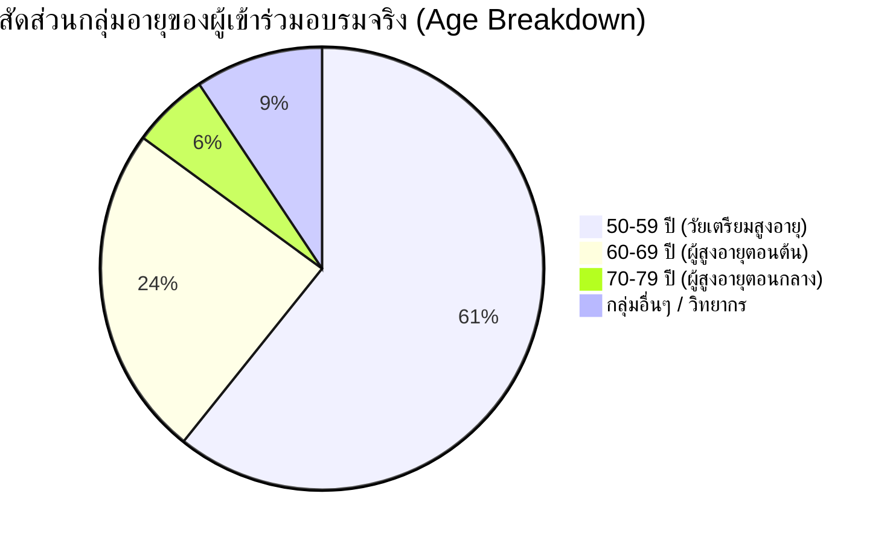

* **สัดส่วนกลุ่มเป้าหมายหลัก**: ผู้มีอายุ **50 ปีขึ้นไปมีสัดส่วนสูงถึง 90.7%** (โดยเป็นกลุ่มอายุ 50–59 ปี 60.7%, 60–69 ปี 24.3%, และ 70–79 ปี 5.6%)
* **พื้นที่จังหวัด**: **จังหวัดแพร่ (98.1%)** และ เชียงใหม่ (1.9%)
* **อำเภอใน จ.แพร่**:
  1. **อ.ลอง**: 52 คน (ต.ปากกาง 50 คน, ต.ห้วยอ้อ 1 คน, ต.หัวทุ่ง 1 คน)
  2. **อ.ร้องกวาง**: 17 คน (ต.ร้องเข็ม 11 คน, ต.ร้องกวาง 4 คน, ต.น้ำรัด 4 คน)
  3. **อ.หนองม่วงไข่**: 15 คน (ต.แม่คำมี 4 คน, ต.ตำหนักธรรม 4 คน, ต.วังหลวง 2 คน)
  4. **อ.เมืองแพร่**: 14 คน (ต.แม่หล่าย 8 คน, ต.ในเวียง 3 คน, ต.ทุ่งโฮ้ง 2 คน, ต.ป่าแมต 1 คน)
  5. **อ.สูงเม่น**: 5 คน (ต.สูงเม่น 3 คน, ต.ดอนมูล 1 คน)
  6. **อ.สอง**: 2 คน (ต.บ้านหนุน 1 คน, ต.เตาปูน 1 คน)

---

### 📱 สัดส่วนระบบปฏิบัติการและขนาดหน้าจอมือถือ (OS & Mobile Screen Sizes)

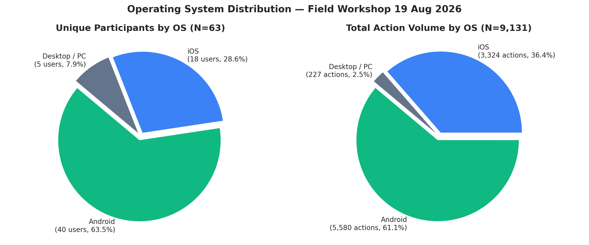
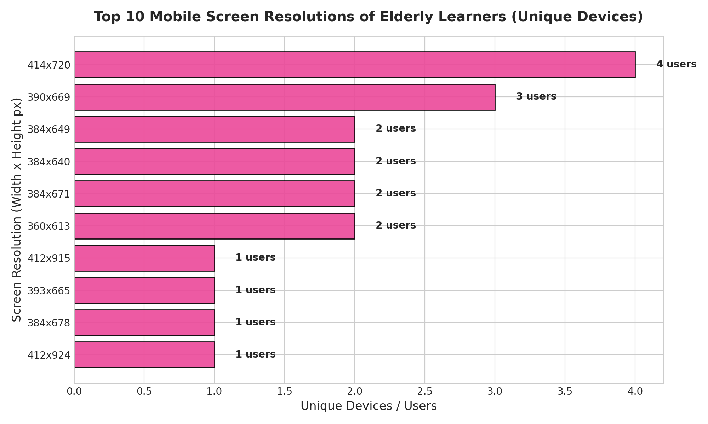

#### 1) สัดส่วนระบบปฏิบัติการ (OS Distribution)
* 🤖 **Android**: **40 คน (63.5%)** — สร้างกิจกรรม **5,580 Actions (61.1%)**
* 🍎 **iOS (iPhone/iPad)**: **18 คน (28.6%)** — สร้างกิจกรรม **3,324 Actions (36.4%)**
* 💻 **Desktop / PC (เครื่องวิทยากร/ทีมงาน)**: **5 คน (7.9%)** — สร้างกิจกรรม **227 Actions (2.5%)**
* **สัดส่วนผู้ใช้อุปกรณ์มือถือจริง**: **92.1% (58 ใน 63 คน)**

#### 2) ขนาดความละเอียดหน้าจอยอดนิยมของผู้สูงอายุ (Mobile Viewports)
1. `414x720 px` — **4 คน** (Android จอใหญ่มาตรฐาน)
2. `390x669 px` — **3 คน** (iPhone จอกลาง)
3. `384x649 px` — **2 คน** (Android ขยายฟอนต์ระบบ)
4. `384x640 px` — **2 คน** (Android จอเตี้ย / Navigation bar สูง)
5. `384x671 px` — **2 คน** (Android จอมาตรฐาน)
6. `360x613 px` — **2 คน** (Android จอเล็ก / มีแถบเบราว์เซอร์กินพื้นที่)
7. `412x924 px` — **1 คน** (Android จอยาวรุ่นใหม่)
8. `430x775 px` — **1 คน** (iPhone Pro Max)
9. `320x541 px` — **1 คน** (จอขนาดเล็กพิเศษ)

---

## 🎯 6. ประสิทธิผลการเรียนรู้และความแม่นยำในการเล่นเกม (Educational Effectiveness)

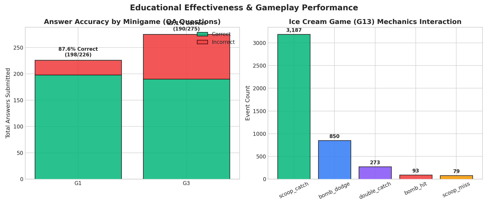

### 1) มินิเกม G1: Fact Check ตรวจสอบข่าวปลอม (Topic 1)
ผู้เรียนตอบคำถามตรวจสอบข่าวทั้งหมด **226 ครั้ง** ผ่านข้อคำถาม 5 ข้อ:

| รหัสคำถาม | หัวข้อ / ประเด็นข่าว | ผู้ตอบทั้งหมด | ตอบถูก | ตอบผิด | ความแม่นยำ (% ถูก) | การประเมินผล |
| :---: | :--- | :---: | :---: | :---: | :---: | :--- |
| `g1-q1` | ข่าวน้ำมะนาวรักษามะเร็งระยะสุดท้าย | 46 ครั้ง | 43 | 3 | **93.5%** | เข้าใจดีเยี่ยม |
| `g1-q2` | ข่าวแจกเงินดิจิทัลให้กดลิงก์แปลกปลอม | 45 ครั้ง | 43 | 2 | **95.6%** | เข้าใจดีเยี่ยม |
| `g1-q3` | ข่าวตัดต่อภาพเหตุการณ์น้ำท่วม | 45 ครั้ง | 42 | 3 | **93.3%** | เข้าใจดีเยี่ยม |
| `g1-q4` | **ข่าวสารปนเปื้อนในอาหาร (กึ่งจริงกึ่งเท็จ)** | 45 ครั้ง | 29 | 16 | **64.4%** | ⚠️ **ยากสำหรับผู้สูงอายุ** |
| `g1-q5` | ข่าวแอบอ้างหน่วยงานรัฐคืนเงินภาษี | 45 ครั้ง | 41 | 4 | **91.1%** | เข้าใจดีเยี่ยม |

> 📌 **ข้อสังเกตสำคัญ**: ข้อ `g1-q4` มีอัตราตอบผิดสูงถึง **35.6% (16 คน)** เนื่องจากเป็นข่าวที่มีข้อมูลจริงบางส่วนผสมกับข้อมูลเท็จ (Misleading Context) ทำให้ผู้สูงอายุแยกแยะได้ยากกว่าข่าวปลอมแบบสุดโต่ง ควรเพิ่มคำอธิบายเสริมในห้องเรียนหรือจุดเฉลย

---

### 2) มินิเกม G6: จำลองแชท LINE ลวงโอนเงิน (Topic 6)
ผู้เรียนเผชิญสถานการณ์จำลองการสนทนาและตัดสินใจตอบสนอง **129 ครั้ง**:

| สถานการณ์ | รูปแบบกลโกงทาง LINE | จำนวนการตอบ | ปลอดภัย (Safe) | เสี่ยง/ตกเป็นเหยื่อ | สัดส่วนความปลอดภัย |
| :---: | :--- | :---: | :---: | :---: | :---: |
| `g6-s1` | เพื่อนทักมาขอยืมเงินด่วนเพราะบัญชีมีปัญหา | 43 ครั้ง | 42 | 1 | **97.7%** |
| `g6-s2` | ลิงก์แจกคูปองส่วนลดจากแบรนด์ดังให้กรอก OTP | 43 ครั้ง | 41 | 2 | **95.3%** |
| `g6-s3` | ข้อความขู่จากเจ้าหน้าที่ตำรวจให้โอนเงินตรวจสอบ | 43 ครั้ง | 42 | 1 | **97.7%** |

> 📌 **ผลลัพธ์**: ความแม่นยำในการเลือกช้อยส์ปลอดภัยสูงถึง **96.9%** แสดงว่าผู้สูงอายุสามารถจดจำสัญญาณเตือนภัย (Red Flags) ของแก๊งคอลเซ็นเตอร์และมิจฉาชีพทาง LINE ได้ดีมาก

---

### 3) มินิเกม G3: การตรวจจับภาพและเสียง Deepfake AI (Topic 3)
ผู้เรียนตอบคำถามวิเคราะห์ภาพจริง vs ภาพ AI ทั้งหมด **275 ครั้ง**:

#### ก) ข้อคำถามภาพ AI (AI-Generated Images)
* `g3-ai-dance` (ภาพเต้น AI): **100% ถูก (22/22)**
* `g3-ai-doctor` (ภาพหมอปลอม AI): **94.1% ถูก (16/17)**
* `g3-ai-spokesperson` (โฆษก AI): **94.1% ถูก (16/17)**
* `g3-edited-naga` (ภาพพญานาคตัดต่อ): **95.0% ถูก (19/20)**
* `g3-ai-farmers` (ภาพชาวนา AI): **88.0% ถูก (22/25)**
* `g3-ai-market` (ภาพตลาด AI): **88.9% ถูก (16/18)**
* `g3-ai-cooking` (ภาพทำอาหาร AI): **84.2% ถูก (16/19)**

#### ข) ข้อคำถามภาพถ่ายจริง (Real Photographs)
* `g3-real-longneck` (ภาพถ่ายกะเหรี่ยงคอยาว): **80.0% ถูก (12/15)**
* `g3-real-elephant-vintage` (ภาพถ่ายช้างโบราณ): **60.0% ถูก (6/10)**
* `g3-real-lanterns` (ภาพโคมลอยจริง): **58.3% ถูก (7/12)**
* `g3-real-green-sky` (ภาพท้องฟ้าแปลกตา): **50.0% ถูก (9/18)**
* `g3-real-mountain-road` (ภาพถนนคดเคี้ยว): **46.2% ถูก (6/13)**
* `g3-real-songkran` (ภาพบรรยากาศสงกรานต์): **46.2% ถูก (6/13)**
* `g3-real-flower-market` (ภาพตลาดดอกไม้จริง): **31.6% ถูก (6/19)** — *ทายว่าเป็น AI 13 คน*
* `g3-real-rice-terrace` (ภาพนาขั้นบันไดสีสด): **26.7% ถูก (4/15)** — *ทายว่าเป็น AI 11 คน*
* `g3-real-firewood-cooking` (ภาพทำกับข้าวเตาฟืน): **26.7% ถูก (4/15)** — *ทายว่าเป็น AI 11 คน*

> 💡 **การค้นพบเชิงพฤติกรรมที่น่าสนใจยิ่ง (Hyper-Skepticism Effect)**:
> 1. ผู้สูงอายุมีความระมัดระวังภาพ AI สูงมาก (จับภาพ AI ได้ถูกต้องเกือบ 90-100%)
> 2. แต่เกิดผลข้างเคียงคือ **"หวาดระแวงภาพถ่ายจริงที่มีความสวยงามหรือสีสด"** โดยเข้าใจผิดคิดว่าเป็นภาพ AI ถึง 50-73%
> 3. *ข้อเสนอแนะ*: ในการอบรมควรอธิบายวิธีดูจุดบกพร่องของ AI (เช่น นิ้วมือ, ตัวหนังสือที่เบี้ยว, แสงสะท้อนที่ไม่สมเหตุสมผล) แทนที่จะตัดสินจากความสดหรือความสวยงามของภาพ

---

### 4) มินิเกม G13: ต่อไอศกรีมรู้ทันสื่อ (Ice Cream Tower Flow)
* **ลูกไอศกรีมที่ตักถูก (`scoop_catch`)**: **3,187 ครั้ง** (เฉลี่ย 88.5 ครั้งต่อผู้เล่น)
* **การหลบระเบิดสำเร็จ (`bomb_dodge`)**: **850 ครั้ง**
* **คอมโบต่อเนื่อง (`double_catch`)**: **273 ครั้ง**
* **การพลาดชนระเบิด (`bomb_hit`)**: **93 ครั้ง** (คิดเป็นเพียง **2.8%** เมื่อเทียบกับยอดตักสำเร็จ)
* **ลูกไอศกรีมตกหล่น (`scoop_miss`)**: **79 ครั้ง**

> 📌 **การประเมินทักษะการควบคุม (Motor Skills)**: ผู้สูงอายุสามารถควบคุมการเคลื่อนที่ซ้าย-ขวาบนหน้าจอมือถือได้ดีเยี่ยม มีอัตราการโดนระเบิดต่ำมาก และสร้างความสนุกสนานตื่นตัวในห้องเรียนได้อย่างมีนัยสำคัญ

---

## 📺 7. สถิติวิดีโอและการทำงานของระบบเครือข่าย (Video Engagement & Network Resilience)

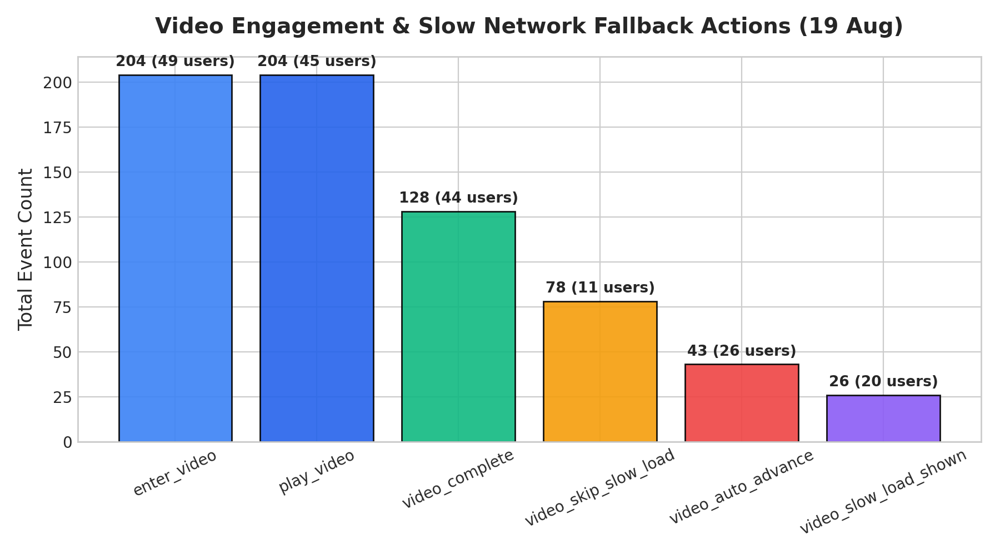

### 📊 สรุปพฤติกรรมการรับชมวิดีโอและระบบรับมือเน็ตช้า (Slow Network Fallback)
* **การเข้าสู่หน้าวิดีโอ (`enter_video`)**: **204 ครั้ง** จากผู้เรียน 49 คน
* **การกดเล่นวิดีโอ (`play_video`)**: **204 ครั้ง** จากผู้เรียน 45 คน
* **การดูวิดีโอจบสมบูรณ์ (`video_complete`)**: **128 ครั้ง** จากผู้เรียน 44 คน
* **การข้ามไปเกมถัดไปอัตโนมัติ (`video_auto_advance`)**: **43 ครั้ง** จากผู้เรียน 26 คน
* **การตรวจจับเน็ตช้าในพื้นที่ (`video_slow_load_shown`)**: **26 ครั้ง** จากผู้เรียน 20 คน
* **วิดีโอโหลดสำเร็จหลังรอ (`video_slow_load_resolved`)**: **20 ครั้ง** จากผู้เรียน 14 คน
* **ผู้เรียนกดปุ่มข้ามฉุกเฉิน (`video_skip_slow_load`)**: **78 ครั้ง** จากผู้เรียน 11 คน (ระบบทำงานถูกต้อง ผู้เรียนไม่ติดค้างที่หน้าจอดำ)

> 🛡️ **ความเสถียรของฟีเจอร์ Sprint 03B**: ระบบ Fallback สำหรับกรณีเน็ตในพื้นที่หน่วงสามารถช่วยผู้เรียน 11 คนที่ไม่สามารถโหลดสตรีมวิดีโอได้ ให้สามารถกดข้ามเข้าสู่เกมและดำเนินกิจกรรมต่อได้จนจบ 100% โดยไม่มีใครถูกบล็อกค้าง

---

## ⏱️ 8. พฤติกรรมและระยะเวลาการใช้งานราย Session (Session Engagement Distribution)

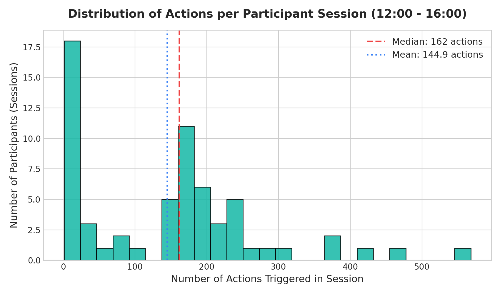

* **ระยะเวลาใช้งานเฉลี่ย (Mean Session Duration)**: **17.02 นาที**
* **ระยะเวลาใช้งานมัธยฐาน (Median Session Duration)**: **13.67 นาที**
* **ช่วงเวลาใช้งานกลุ่ม 75th Percentile**: **16.33 นาที**
* **ปริมาณกิจกรรมเฉลี่ย (Mean Actions per Session)**: **144.94 Actions**
* **ปริมาณกิจกรรมมัธยฐาน (Median Actions per Session)**: **162.00 Actions**

---

## 📋 9. สรุปบทเรียนและข้อเสนอแนะสำหรับการลงพื้นที่น่าน (24–25 ส.ค. 2026)

| ประเด็น | สิ่งที่พบจากการทดสอบจริง 19 ส.ค. | ข้อเสนอแนะเพื่อนำไปปรับใช้ในรอบถัดไป |
| :--- | :--- | :--- |
| **1. การ Onboarding** | Flow ยินยอม PDPA แบบเลือกจังหวัด/อำเภอ/ตำบล ทำงานได้ดีมาก ผู้เรียนกรอกได้เองถึง 81.4% | คงรูปแบบเดิมไว้สำหรับ จ.น่าน โดยเตรียมตัวเลือกตำบล/อำเภอของ จ.น่าน ให้ครบถ้วน |
| **2. ความต่อเนื่องของบทเรียน** | อัตรา Retention สูงมาก (84.8% จาก G1 ไปถึง G13) แสดงว่ารูปแบบคลิปสั้น + เกมได้ผลดี | รักษารูปแบบการจัดกิจกรรมแบบมีวิทยากรนำทีละบทเรียนตามลำดับเดิม |
| **3. ข้อคำถาม G1 (กึ่งจริงกึ่งเท็จ)** | ข้อ `g1-q4` มีคนตอบผิด 35.6% | วิทยากรควรเน้นย้ำเทคนิคการสังเกตข่าวที่มีความจริงปนความเท็จ (Half-truth news) |
| **4. ความเข้าใจเรื่อง Deepfake (G3)** | ผู้สูงอายุระแวงภาพถ่ายจริงที่มีสีสดสวยว่าเป็น AI (ผิด 50-73%) | เสริมเทคนิค "จับโป๊ะ AI" จากจุดผิดปกติทางกายวิภาค (นิ้ว, ตา, เงา) แทนการดูแค่ความสดของภาพ |
| **5. การรองรับเน็ตช้า** | ระบบ Slow Load Banner & Emergency Skip ช่วยชีวิตผู้เรียนได้ 11 คน | ตรวจสอบให้แน่ใจว่า Asset และสคริปต์สำรองถูก Pre-cache ไว้อย่างสมบูรณ์ก่อนเริ่มงาน |
| **6. ขนาดหน้าจอผู้สูงอายุ** | จอขนาดเล็ก (360px) และเครื่องที่มีการขยายฟอนต์ใหญ่แสดงผลได้ถูกต้อง ไม่พบล้นขอบ | คงมาตรฐาน Zero-scroll UI และ Viewport Scale ตาม Design Tokens ปัจจุบัน |

---
*รายงานฉบับนี้สร้างขึ้นโดยระบบวิเคราะห์ข้อมูลอัตโนมัติของโครงการ NAPLAB Media Literacy App*
