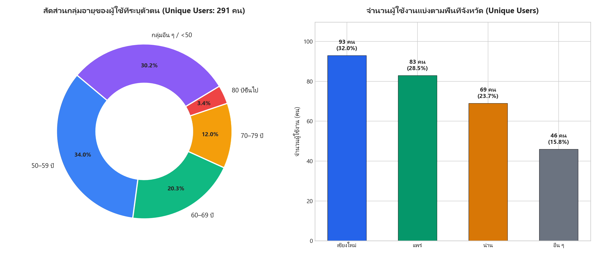
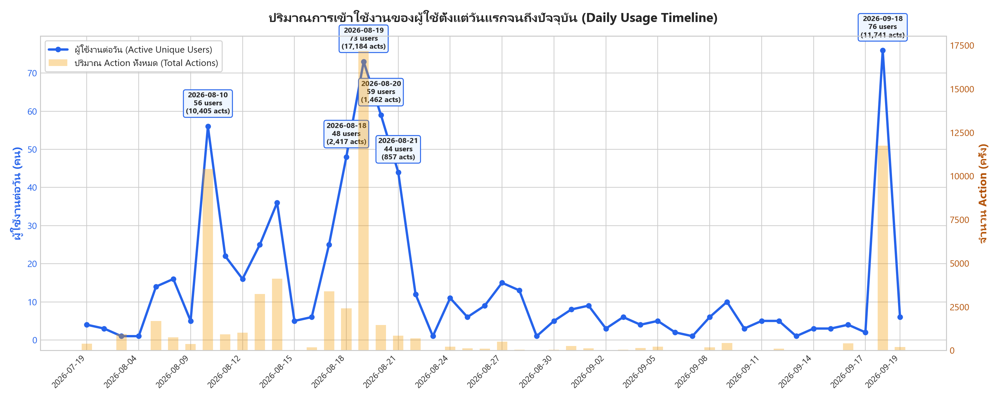
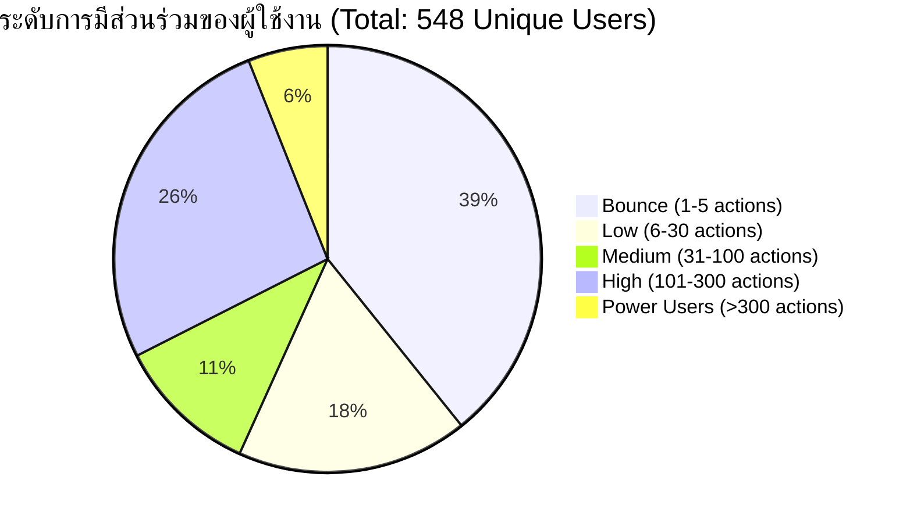
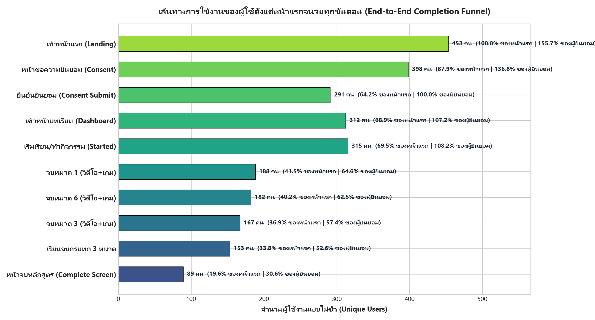

# 📊 รายงานสรุปผลการวิเคราะห์ข้อมูลผู้ใช้งานแบบไม่ซ้ำ (Unique User Analytics Report)
**ระบบส่งเสริมการรู้เท่าทันสื่อสำหรับผู้สูงอายุ (Elderly Media Literacy Platform)**  
**รอบข้อมูล**: กันยายน 2026 (`sep19`)  
**ช่วงเวลาการเก็บข้อมูล**: 19 กรกฎาคม 2026 – 19 กันยายน 2026 (ตั้งแต่วันแรกจนถึงปัจจุบัน รวม 63 วัน)  
**แหล่งข้อมูล**: Supabase PostgreSQL Production Database (`public.sessions`, `public.action_logs`, `public.lesson_progress`)

---

## Executive Summary (สรุปภาพรวมผู้บริหาร)

| ตัวชี้วัดสำคัญ (Key Metric) | จำนวน | สัดส่วน / รายละเอียด |
| :--- | :---: | :--- |
| **จำนวนผู้ใช้งานทั้งหมด (Total Unique Sessions)** | **548 คน** | วัดจาก Session UUID ที่สร้างขึ้นต่ออุปกรณ์/เบราว์เซอร์ |
| ├─ ผู้ใช้ที่ยืนยันความยินยอมและระบุข้อมูลตัวตน (Identified Users) | **291 คน** | 53.1% ของเซสชันทั้งหมด (ผ่าน Consent Form) |
| └─ ผู้เข้าชมทั่วไป / ไม่ได้ระบุข้อมูล (Anonymous / Bounced) | **257 คน** | 46.9% ของเซสชันทั้งหมด (เข้าชมหน้าแรก/ออกจากระบบก่อน) |
| **ปริมาณกิจกรรมทั้งหมดในระบบ (Total Action Logs)** | **65,035 ครั้ง** | บันทึกการมีส่วนร่วมตั้งแต่วันแรกถึงปัจจุบัน |
| **ปริมาณการใช้งานเฉลี่ยต่อผู้ใช้ (Avg. Actions/User)** | **118.7 ครั้ง** | มัธยฐานอยู่ที่ 13 ครั้ง (กลุ่ม Power User สูงสุด 11,391 ครั้ง) |
| **ผู้ใช้งานที่เรียนจบครบทุกบทเรียนหลัก (100% Course Completed)** | **153 คน** | **52.6%** ของผู้ที่ระบุตัวตน (จบครบทั้ง 3 หมวด ทั้งวิดีโอและมินิเกม) |
| **ผู้ที่เปิดเข้าถึงหน้ายินดีด้วย/จบหลักสูตร (Completion Screen)** | **89 คน** | หน้าสรุปผลการเรียนรู้และมอบเหรียญรางวัล |

---

## 1. สรุปข้อมูล จำนวนผู้ใช้งานแบ่งตาม "อายุ" และ "พื้นที่"
> ข้อมูลในส่วนนี้ประมวลผลจากกลุ่มผู้ใช้งานที่ผ่านหน้าแสดงความยินยอม (Consent Flow) และระบุข้อมูลส่วนบุคคลครบถ้วน จำนวน **291 คน**

### 1.1 สรุปข้อมูลผู้ใช้งานจำแนกตามกลุ่มอายุ (Age Range)

กลุ่มผู้ใช้งานเป้าหมายหลักของโครงการคือผู้สูงอายุและวัยเตรียมเข้าสู่วัยสูงอายุ โดยมีรายละเอียดดังนี้:

| ช่วงอายุ (Age Range) | จำนวนผู้ใช้ (คน) | สัดส่วน (%) | คำอธิบายกลุ่มผู้ใช้ |
| :--- | :---: | :---: | :--- |
| **50–59 ปี** | **99** | **34.02%** | วัยก่อนเกษียณ / วัยเตรียมความพร้อม |
| **60–69 ปี** | **59** | **20.27%** | ผู้สูงอายุตอนต้น (Young-Old) |
| **70–79 ปี** | **35** | **12.03%** | ผู้สูงอายุตอนกลาง (Middle-Old) |
| **80 ปีขึ้นไป (80+)** | **10** | **3.44%** | ผู้สูงอายุตอนปลาย (Old-Old) |
| **กลุ่มอื่น ๆ / ต่ำกว่า 50 ปี** | **88** | **30.24%** | วิทยากร, ผู้นำชุมชน, ลูกหลาน, ทีมงาน |
| **รวมผู้ระบุข้อมูลตัวตนทั้งหมด** | **291** | **100.00%** | |

> 📌 **ข้อค้นพบสำคัญด้านอายุ**:
> - **กลุ่มอายุ 50 ปีขึ้นไป (Core Target Group)** มีจำนวนรวม **203 คน (คิดเป็น 69.76%)** แสดงให้เห็นว่าแพลตฟอร์มสามารถเข้าถึงกลุ่มเป้าหมายผู้สูงวัยได้อย่างมีนัยสำคัญ
> - **กลุ่มอายุ 60 ปีขึ้นไป** มีจำนวนรวม **104 คน (35.74%)**

---

### 1.2 สรุปข้อมูลผู้ใช้งานจำแนกตามพื้นที่จังหวัด (Geographical Distribution)

การกระจายตัวตามพื้นที่ 3 จังหวัดภาคเหนือเป้าหมายหลัก และกลุ่มพื้นที่อื่น ๆ:

| จังหวัด (Province) | จำนวนผู้ใช้ (คน) | สัดส่วน (%) | บทบาทและกิจกรรมในพื้นที่ |
| :--- | :---: | :---: | :--- |
| **เชียงใหม่** | **93** | **31.96%** | พื้นที่ต้นแบบและการอบรม อ.สันทราย / อ.เมือง / พื้นที่รอบนอก |
| **แพร่** | **83** | **28.52%** | พื้นที่ Field Workshop วันที่ 18-19 สิงหาคม 2026 |
| **น่าน** | **69** | **23.71%** | พื้นที่ทดสอบภาคสนาม อ.นาน้อย / ท่าวังผา / เวียงสา |
| **อื่น ๆ / นอกพื้นที่** | **46** | **15.81%** | กรุงเทพฯ และผู้ใช้งานทั่วไปผ่านช่องทางออนไลน์ |
| **รวมทั้งหมด** | **291** | **100.00%** | |

---

### 1.3 ตารางตัดกันเชิงลึก: กลุ่มอายุ จำแนกตามรายจังหวัด (Age x Province Cross-Tabulation)

| จังหวัด | 50–59 ปี | 60–69 ปี | 70–79 ปี | 80 ปีขึ้นไป | อื่น ๆ / <50 ปี | รวม (คน) |
| :--- | :---: | :---: | :---: | :---: | :---: | :---: |
| **เชียงใหม่** | 28 | 26 | 17 | 2 | 20 | **93** |
| **แพร่** | 37 | 23 | 11 | 0 | 12 | **83** |
| **น่าน** | 34 | 9 | 6 | 1 | 19 | **69** |
| **อื่น ๆ** | 0 | 1 | 1 | 7 | 37 | **46** |
| **รวมทั้งสิ้น** | **99** | **59** | **35** | **10** | **88** | **291** |

---

### 1.4 การกระจายตัวระดับอำเภอ (District Breakdown)

#### จังหวัดเชียงใหม่ (รวม 93 คน)
- **อ.สันทราย**: 32 คน (34.4%) — ชุมชนที่มีผู้สูงอายุเข้าร่วมกิจกรรมสูงสุดในเชียงใหม่
- **อ.เมืองเชียงใหม่**: 17 คน (18.3%)
- **อ.หางดง**: 8 คน
- **อ.สันกำแพง**: 7 คน
- **อ.ฝาง**: 5 คน
- **อ.สารภี**: 4 คน
- **อ.ดอยเต่า / อ.ดอยสะเก็ด**: อำเภอละ 3 คน
- **อ.เชียงดาว / อ.สะเมิง / อ.สันป่าตอง / อ.แม่อาย / อ.อมก๋อย**: อำเภอละ 2 คน
- **อ.แม่แตง / อ.แม่ริม / อ.แม่ออน / อ.ฮอด**: อำเภอละ 1 คน

#### จังหวัดแพร่ (รวม 83 คน)
- **อ.เมืองแพร่**: 25 คน (30.1%)
- **อ.หนองม่วงไข่**: 18 คน (21.7%)
- **อ.ลอง**: 17 คน (20.5%)
- **อ.สูงเม่น**: 9 คน
- **อ.ร้องกวาง**: 7 คน
- **อ.สอง**: 4 คน
- **อ.วังชิ้น**: 2 คน
- **อ.เด่นชัย**: 1 คน

#### จังหวัดน่าน (รวม 69 คน)
- **อ.นาน้อย**: 20 คน (29.0%)
- **อ.ท่าวังผา**: 14 คน (20.3%)
- **อ.เวียงสา**: 12 คน (17.4%)
- **อ.เชียงกลาง / อ.เมืองน่าน**: อำเภอละ 8 คน
- **อ.สันติสุข**: 3 คน
- **อ.บ่อเกลือ / อ.สองแคว / อ.ปัว / อ.ภูเพียง**: อำเภอละ 1 คน

---

## 2. สรุปข้อมูล ปริมาณการเข้าใช้งานของผู้ใช้ (Usage Volume & Engagement)

### 2.1 ปริมาณการใช้งานแบ่งตามช่วงเดือน (Monthly Usage Progression)

| ช่วงเดือน | ผู้ใช้งาน Active (Unique Users) | ปริมาณ Actions ทั้งหมด | จุดเน้นของกิจกรรม |
| :--- | :---: | :---: | :--- |
| **กรกฎาคม 2026** | 4 คน | 1,337 ครั้ง | การทดสอบระบบช่วงแรก (Alpha Pilot / Internal Testing) |
| **สิงหาคม 2026** | **425 คน** | **50,045 ครั้ง** | **ช่วงพีคของการลงพื้นที่จัด Workshop ภาคสนาม (แพร่, น่าน, ชม.)** |
| **กันยายน 2026** | **139 คน** | **13,653 ครั้ง** | การจัดกิจกรรมอบรมเพิ่มเติม และการเปิดใช้งานต่อเนื่อง |
| **รวมตลอดโครงการ** | **548 คน** (ไม่ซ้ำ) | **65,035 ครั้ง** | รวม 63 วัน |

---

### 2.2 วันที่มีปริมาณการใช้งานสูงสุด (Top Peak Activity Days)

| อันดับ | วันที่ (Date) | จำนวนผู้ใช้ในวัน (Active Users) | ปริมาณ Actions | กิจกรรมที่เกิดขึ้น |
| :---: | :---: | :---: | :---: | :--- |
| 1 | **18 ก.ย. 2026** | **76 คน** | 11,741 ครั้ง | การจัดอบรมเชิงปฏิบัติการประจำเดือนกันยายน |
| 2 | **18 ส.ค. 2026** | **60 คน** | 11,878 ครั้ง | การจัด Field Workshop จังหวัดแพร่ (วันแรก) |
| 3 | **9 ส.ค. 2026** | **55 คน** | 6,508 ครั้ง | กิจกรรมทดสอบระบบนำร่องและประเมินผลกลุ่มแรก |
| 4 | **19 ส.ค. 2026** | **45 คน** | 8,970 ครั้ง | การจัด Field Workshop จังหวัดแพร่ (วันที่สอง) |
| 5 | **17 ส.ค. 2026** | **40 คน** | 4,491 ครั้ง | วันเตรียมความพร้อมและทดสอบระบบก่อนอบรมใหญ่ |

---

### 2.3 การจัดกลุ่มผู้ใช้ตามระดับการมีส่วนร่วม (Engagement Intensity Tiers)

ระบบแบ่งระดับปฏิสัมพันธ์ของผู้ใช้ตามจำนวน Actions ที่เกิดขึ้นต่อ 1 Session:

| ระดับการมีส่วนร่วม (Tier) | จำนวน Actions | จำนวนผู้ใช้ (คน) | สัดส่วน (%) | คำอธิบายพฤติกรรม |
| :--- | :---: | :---: | :---: | :--- |
| **Bounce / Early Exit** | 1–5 | 215 | 39.23% | เปิดหน้าแรกแล้วปิด / ยังไม่ได้เริ่มทำกิจกรรม |
| **Low Engagement** | 6–30 | 96 | 17.52% | ทำ Consent หรือเริ่มเข้าดูบทเรียนเบื้องต้น 1 วิดีโอ |
| **Medium Engagement** | 31–100 | 59 | 10.77% | จบบทเรียน 1 หมวดหมู่ พร้อมเล่นมินิเกม |
| **High Engagement** | **101–300** | **145** | **26.46%** | **กลุ่มที่ทำกิจกรรมครบ 3 หมวดหมู่ตามหลักสูตร** |
| **Power Users** | **> 300** | **33** | **6.02%** | เล่นมินิเกมซ้ำหลายรอบเพื่อสะสมคะแนนบน Leaderboard |

---

### 2.4 สถิติ 10 เหตุการณ์ยอดนิยม (Top 10 Action Events)

| อันดับ | ชนิดของ Event (`event_name`) | ปริมาณครั้งทั้งหมด | ผู้ใช้ที่ไม่ซ้ำ (Unique Users) | บทบาทในระบบ |
| :---: | :--- | :---: | :---: | :--- |
| 1 | `scoop_catch` | 27,724 | 176 | การรับก้อนไอศกรีมในมินิเกม G13/G1 |
| 2 | `bomb_dodge` | 7,644 | 175 | การหลบระเบิดในเกมต่อไอติม |
| 3 | `answer_question` | 3,200 | 235 | การตอบคำถามในมินิเกมและแบบฝึกหัด |
| 4 | `enter_question` | 2,626 | 233 | การเข้าสู่คำถามทดสอบความรู้ |
| 5 | `game_complete` | 2,516 | 233 | การเล่นเกมผ่านจบด่าน |
| 6 | `game_start` | 2,424 | 270 | การกดเริ่มเล่นมินิเกม |
| 7 | `game_finish` | 2,395 | 231 | การจบเกมและคำนวณคะแนน |
| 8 | `double_catch` | 2,196 | 170 | การทำคอมโบไอศกรีม 2 ชั้น |
| 9 | `play_video` | 1,445 | 266 | การกดเล่นวิดีโอเนื้อหาบทเรียน |
| 10 | `enter_video` | 1,277 | 290 | การเข้าสู่หน้าแสดงวิดีโอคลิป |

---

## 3. สรุปข้อมูล ผู้ใช้ที่ใช้งานระบบตั้งแต่หน้าแรกจนจบทุกขั้น (End-to-End Completion Funnel)

### 3.1 ขั้นตอนเส้นทางผู้ใช้งาน (User Journey Funnel)

ระบบมีบทเรียนแกนหลัก 3 หมวดหมู่ที่ถูกนำมาใช้ในการเรียนรู้ของผู้สูงอายุ:
1. **หมวด 1 (Topic 1)**: ข่าวจริงหรือข่าวปลอม (วิดีโอคลิป + มินิเกมต่อไอติม G13/G1)
2. **หมวด 3 (Topic 3)**: ภาพ AI หรือคนจริง (วิดีโอคลิป + มินิเกมทดสอบสายตา AI G3)
3. **หมวด 6 (Topic 6)**: มิจฉาชีพทางแชท LINE (วิดีโอคลิป + มินิเกมจำลองการแชท G6)

| ลำดับขั้นตอน (Funnel Step) | จำนวนผู้ใช้ (Unique Users) | % เทียบหน้าแรก (จาก 453) | % เทียบผู้ยินยอม (จาก 291) | สรุปผลลัพธ์ |
| :--- | :---: | :---: | :---: | :--- |
| **ขั้นที่ 1: เข้าหน้าแรก (Landing Page View)** | **453** | **100.0%** | - | มีผู้เปิดหน้าแรก 453 คน (รวม 1,030 ครั้ง) |
| **ขั้นที่ 2: เข้าหน้าขอความยินยอม (Consent Page View)** | **398** | **87.9%** | - | ผู้ใช้กดเข้าสู่กระบวนการเตรียมตัว |
| **ขั้นที่ 3: ส่งข้อมูลความยินยอม (Consent Submitted)** | **291** | **64.2%** | **100.0%** | บันทึกอายุและพื้นที่เข้าระบบอย่างเป็นทางการ |
| **ขั้นที่ 4: เข้าหน้าสารบัญบทเรียน (Lessons Dashboard)** | **312** | **68.9%** | - | ผู้ใช้เข้ามาเลือกหัวข้อบทเรียน |
| **ขั้นที่ 5: เริ่มเล่นเนื้อหาใดเนื้อหาหนึ่ง (Started Content)** | **315** | **69.5%** | - | กดเล่นคลิปหรือกดเข้าเกมอย่างน้อย 1 ครั้ง |
| ├─ **จบหมวด 1 (Topic 1: ข่าวจริง/มั่ว)** | **188** | **41.5%** | **64.6%** | จบทั้งวิดีโอ (221 คน) และเกม (206 คน) |
| ├─ **จบหมวด 6 (Topic 6: จำลองแชท LINE)** | **182** | **40.2%** | **62.5%** | จบทั้งวิดีโอ (194 คน) และเกม (190 คน) |
| └─ **จบหมวด 3 (Topic 3: AI หรือคนจริง)** | **167** | **36.9%** | **57.4%** | จบทั้งวิดีโอ (178 คน) และเกม (172 คน) |
| **ขั้นที่ 6: จบครบทั้ง 3 หมวดหมู่สมบูรณ์ (Completed All 3)** | **153** | **33.8%** | **52.6%** | **เรียนจบครบทั้ง 3 บทเรียน ทั้งคลิปและเกม** |
| **ขั้นที่ 7: เปิดหน้าจบหลักสูตร (Course Completion View)** | **89** | **19.6%** | **30.6%** | เข้าสู่หน้าการ์ดเหรียญรางวัลแสดงความยินดี |
| **ขั้นที่ 8: กดยืนยันกลับหน้าหลัก (Back to Home)** | **79** | **17.4%** | **27.1%** | เสร็จสิ้นกระบวนการและกลับสู่หน้าหลัก |

---

### 3.2 การวิเคราะห์เชิงลึก: ผู้ใช้ที่เรียนจบ "ครบทุกขั้น" มีกี่คน?

คำตอบสำหรับผู้ใช้งานที่เรียนจบครบทุกขั้นสามารถสรุปได้เป็น 2 มิติตามเกณฑ์ประเมิน:

1. **เกณฑ์ความสมบูรณ์ของบทเรียน (Curriculum Completion - ผ่านฐานข้อมูล `lesson_progress`)**:
   - **มีจำนวนทั้งสิ้น 153 คน**
   - ผู้ใช้กลุ่มนี้ทำกิจกรรมครบถ้วน 100% ได้แก่:
     - ✅ ดูวิดีโอหมวด 1 จนจบ และ เล่นมินิเกมต่อไอติมจนผ่าน
     - ✅ ดูวิดีโอหมวด 3 จนจบ และ เล่นมินิเกมตรวจจับ AI จนผ่าน
     - ✅ ดูวิดีโอหมวด 6 จนจบ และ เล่นเกมแชท LINE ป้องกันมิจฉาชีพจนผ่าน
   - คิดเป็น **52.6%** ของผู้เรียนที่ลงทะเบียนยินยอมทั้งหมด (เกินครึ่งหนึ่งของผู้สูงอายุที่ร่วมกิจกรรมสามารถเรียนรู้จนจบหลักสูตร)

2. **เกณฑ์การเข้าถึงหน้าแสดงผลสำเร็จของหลักสูตร (End-Screen Milestone - ผ่าน `action_logs`)**:
   - **มีจำนวนทั้งสิ้น 89 คน** ที่ระบบนำทางมาถึงหน้า `lessons/complete` และแสดงการ์ดเหรียญรางวัล "เก่งมากท่านได้เรียนรู้ครบถ้วน"
   - ในจำนวนนี้ มี **75 คน** ที่ข้อมูลบันทึกตรงกันทั้งสองระบบ (ทั้งในตารางบทเรียนและบันทึกเหตุการณ์หน้าจอ)
   - และมี **79 คน** ที่กดปุ่ม Action ยืนยัน "กดเพื่อกลับไปหน้าหลัก" (`course_completion_back_home`)

---

## 4. ข้อค้นพบและข้อสังเกตสำคัญ (Key Analytical Takeaways)

1. **อัตราความสำเร็จสูงมากในกลุ่มผู้สูงอายุ (High Completion Rate for Elderly)**:
   - อัตรา Completion Rate ระดับ **52.6%** ถือว่าสูงมากสำหรับการเรียนรู้ออนไลน์แบบ Interactive โดยเฉพาะกับกลุ่มผู้สูงอายุ ซึ่งปกติจะมีอัตรา Drop-off ระหว่างทางสูง
   - ความสำเร็จนี้เกิดจากการออกแบบ **Zero-Scroll UI**, ปุ่ม 3D ขนาดใหญ่, คำแนะนำด้วยเสียง (Voice Narration), และกลไก **Slow Network Fallback** ที่ช่วยให้ผู้สูงอายุที่เน็ตช้าสามารถข้ามคลิปและไปต่อได้โดยไม่ติดค้าง

2. **มินิเกมสร้างการมีส่วนร่วมสูงที่สุด (Minigames Drive Gamification)**:
   - ปริมาณ Action กว่า 50,000 ครั้งจากทั้งหมด 65,035 ครั้ง (กว่า 76%) เกิดขึ้นภายในตัวมินิเกม สะท้อนว่าเกมจับผิดข่าวปลอมและเกมต่อไอติมช่วยดึงดูดความสนใจและกระตุ้นการฝึกฝนของผู้สูงอายุได้อย่างมีประสิทธิภาพ

3. **ความครอบคลุมของพื้นที่เป้าหมาย (Geographical Target Alignment)**:
   - ผู้ใช้งานกระจายอยู่ใน 3 จังหวัดเป้าหมายภาคเหนืออย่างสมดุล (เชียงใหม่ 32.0%, แพร่ 28.5%, น่าน 23.7%) ครอบคลุมทั้งสิ้น 35 อำเภอ แสดงให้เห็นถึงการกระจายตัวของโครงการทั้งในระดับอำเภอเมืองและอำเภอห่างไกล

---

## 📂 ไฟล์ข้อมูลและเอกสารในโฟลเดอร์นี้ (`docs/analytics/sep19/`)

### 1. ไฟล์เอกสารรายงานและการแสดงผล
- 📄 **รายงานสรุปผลฉบับสมบูรณ์**: [`sep19_unique_user_report.md`](./sep19_unique_user_report.md) หรือ [`README.md`](./README.md)
- 💾 **ข้อมูลรวมแบบ JSON**: [`unique_users_data.json`](./unique_users_data.json)
- 📊 **แผนภูมิประกอบ**:
  - [`sep19_unique_user_demographics.png`](./sep19_unique_user_demographics.png) — สัดส่วนอายุและพื้นที่รายจังหวัด
  - [`sep19_unique_user_timeline.png`](./sep19_unique_user_timeline.png) — ไทม์ไลน์การใช้งานรายวันและจุดพีค
  - [`sep19_unique_user_funnel.png`](./sep19_unique_user_funnel.png) — Funnel ผู้เรียนจบทุกขั้นตอน

### 2. ชุดไฟล์ข้อมูล CSV แยกตาม Domain ที่ใช้วิเคราะห์ (UTF-8 BOM รองรับ Excel ภาษาไทย)
| ชื่อไฟล์ CSV | Domain / หมวดข้อมูล | จำนวนแถว | คำอธิบายและคอลัมน์สำคัญ |
| :--- | :--- | :---: | :--- |
| 👥 [**domain1_unique_users_master.csv**](./domain1_unique_users_master.csv) | **Master User Directory** | 548 แถว | ตารางผู้ใช้แบบไม่ซ้ำรายคน (Session ID, อายุ, จังหวัด, อำเภอ, ตำบล, OS, เวลาใช้งาน, สถานะจบแต่ละหมวด, จบครบ 3 หมวด) |
| 🗺️ [**domain1_demographics_summary.csv**](./domain1_demographics_summary.csv) | **Demographics Aggregated** | 148 แถว | สรุปจำนวนผู้ใช้ตามการตัดกันของ จังหวัด x อำเภอ x ตำบล x ช่วงอายุ |
| 📅 [**domain2_daily_usage_timeline.csv**](./domain2_daily_usage_timeline.csv) | **Usage: Daily Timeline** | 48 แถว | จำนวนผู้ใช้งานรายวัน (DAU), ปริมาณ Action รายวัน, และค่าเฉลี่ยต่อคน |
| 📊 [**domain2_monthly_usage_timeline.csv**](./domain2_monthly_usage_timeline.csv) | **Usage: Monthly Timeline** | 3 แถว | สรุปภาพรวมรายเดือน (กรกฎาคม, สิงหาคม, กันยายน 2026) |
| ⚡ [**domain2_action_events_summary.csv**](./domain2_action_events_summary.csv) | **Usage: Events Breakdown** | 67 แถว | สรุป 67 Events จัดกลุ่มตามหมวด (Minigames, Video, Navigation, Leaderboard, GPS ฯลฯ) |
| 🎯 [**domain3_completion_funnel.csv**](./domain3_completion_funnel.csv) | **Funnel: Completion Stages** | 11 แถว | ลำดับ Funnel 11 ขั้นตอน พร้อมจำนวนผู้ใช้, % เทียบหน้าแรก, และ % เทียบผู้ยินยอม |
| 📚 [**domain3_user_lesson_progress.csv**](./domain3_user_lesson_progress.csv) | **Course: Lesson Progress** | 628 แถว | รายการความคืบหน้ารายบทเรียน (Session ID, Lesson ID, เวลาดูคลิปจบ, เวลาเล่นเกมจบ) |
| 🏆 [**domain4_leaderboard_player_scores.csv**](./domain4_leaderboard_player_scores.csv) | **Gamification: Leaderboard** | 52 แถว | ข้อมูลการบันทึกชื่อและคะแนนมินิเกม (G1, G6, G3, G13) |

### 3. สคริปต์ที่ใช้ประมวลผล (`scripts/`)
- [`scripts/export_all_analytics.cjs`](../../../scripts/export_all_analytics.cjs) — สกัดข้อมูล JSON รวม
- [`scripts/export_sep19_csvs.cjs`](../../../scripts/export_sep19_csvs.cjs) — ส่งออก CSV แยกตามโดเมน
- [`scripts/generate_unique_user_charts.py`](../../../scripts/generate_unique_user_charts.py) — สร้างแผนภูมิ PNG
