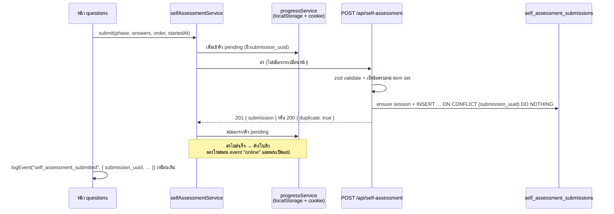
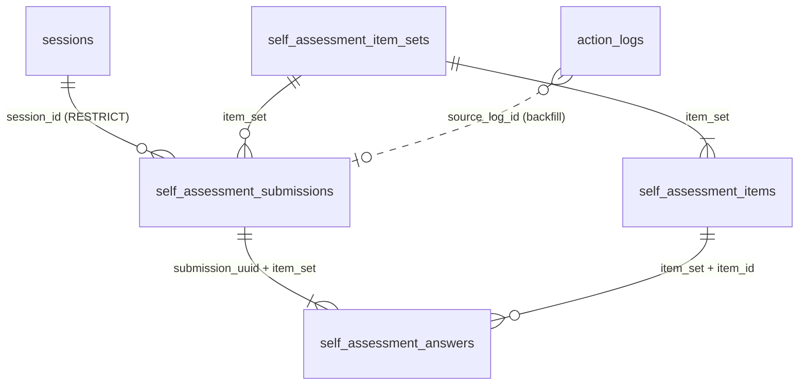

# รู้ทันสื่อ Interactive — สเปกการเก็บข้อมูลแบบทดสอบก่อน/หลังเรียน (โหมดวิจัย)

**Status:** 🏗 In Progress — ทีมตัดสินคำถามข้อ 9.1–9.3 แล้ว 2026-10-28; ออกแบบ schema ใหม่ (ข้อ 5) และสร้างตารางบน DB self-host `100.75.146.233` แล้ว 2026-10-28; **backend เสร็จ** (ดู [10 — Backend + คู่มือ Frontend](./10-research-pre-post-backend.md)) — frontend ยังไม่ต่อ | **เขียนเมื่อ:** 2026-10-28 | **อ้างอิงโค้ด ณ เวอร์ชัน:** `0.23.1`

> เอกสารนี้กำหนดว่าคำตอบแบบทดสอบก่อน/หลังเรียน (self-assessment) ในโหมดวิจัย (`APP_MODE=research`) ต้องถูกเก็บขึ้นเซิร์ฟเวอร์อย่างไร และต้อง implement อะไรเพิ่ม — โดยใช้ของเดิมจากระบบเก็บข้อมูลการเล่นเกมให้มากที่สุด และระบุชัดว่าส่วนไหนควรเขียนใหม่เพราะอะไร
>
> ⚠️ เอกสาร [06 — Pre-test & Post-test Specification](../gdd/06-quiz-spec.md) อธิบาย **แบบทดสอบปรนัยรุ่นเก่า** (`/pretest`, `/posttest`, ตาราง `quiz_*`, กลไก `isTestingGroup`) ซึ่งไม่ใช่ตัวที่โหมดวิจัยใช้อยู่ปัจจุบัน

---

## 1. สภาพปัจจุบัน (As-is)

### 1.1 แบบทดสอบที่ใช้จริงในโหมดวิจัย
- หน้าจอ: `src/app/self-assessment/[phase]/` — `phase` = `pre` | `post` (intro → `questions` → `complete`)
- ข้อคำถาม: `src/data/self-assessment-items.json` — 12 ข้อ (`sa-01` … `sa-12`) เป็น **ข้อความให้ประเมินตนเอง (Likert 5 ระดับ)** 1 = ไม่เห็นด้วยอย่างยิ่ง … 5 = เห็นด้วยอย่างยิ่ง — ไม่มีคำตอบถูก/ผิด
- ชุดคำถามเดียวกันทั้ง pre และ post, **สลับลำดับใหม่ทุกครั้งที่เปิดหน้า**
- คำตอบถูกเก็บโดยใช้ **รหัสข้อเป็น key** อยู่แล้ว (`answers[statement.id]`, event `self_assessment_answer` ส่ง `statement_id`) — การสลับลำดับไม่ทำให้รู้ไม่ได้ว่าตอบข้อไหน ดูข้อ 5.4
- จุดเข้า:
  - **Pre:** หลังยืนยันพื้นที่ใน `src/app/consent/location/page.tsx` → `/self-assessment/pre` (เฉพาะ `research`)
  - **Post:** จบเกมสุดท้ายในสาย Flow (`src/app/lessons/[id]/game/page.tsx`, `FLOW_POST_TEST_PATH`) → `/self-assessment/post` (เฉพาะ `research`)

### 1.2 ข้อมูลไปอยู่ที่ไหนตอนนี้
| ที่เก็บ | สิ่งที่เก็บ | ปัญหาสำหรับงานวิจัย |
|---|---|---|
| `progressService` → `progress.selfAssessment[phase]` (localStorage + cookie) | คำตอบ `{ "sa-01": 4, … }` | อยู่แค่ในเครื่องผู้ใช้ เซิร์ฟเวอร์ไม่เห็น |
| `action_logs` ผ่าน `loggingService.logEvent` | `self_assessment_intro_view`, `self_assessment_start`, `self_assessment_page_view`, `self_assessment_answer` (ทุกคลิก), `self_assessment_submitted` (`answers` + `order`), `self_assessment_complete_view`, `self_assessment_continue`, `self_assessment_dev_skip` | ดูข้อ 1.3 |
| ตาราง `quiz_attempts` / `quiz_answers` | **ไม่ถูกใช้** โดย self-assessment | — |

### 1.3 ทำไม `action_logs` อย่างเดียวไม่พอเป็นแหล่งข้อมูลหลักของงานวิจัย
1. **คิวออฟไลน์ทิ้งข้อมูลได้** — `loggingService` จำกัดคิวไว้ `MAX_OFFLINE_LOGS = 500` และ `shift()` ตัวเก่าทิ้งเมื่อเต็ม ระหว่างทำแบบทดสอบมี `self_assessment_answer` ยิงทุกคลิก จึงดันคิวเต็มได้เร็วตอนเน็ตหลุด
2. **คิวอยู่ใน localStorage อย่างเดียว** — ไม่มี cookie สำรองแบบ `progressService` ซึ่ง LINE in-app browser ล้างได้กะทันหัน (เหตุผลเดียวกับที่ AGENT.md ห้ามให้ progress ใช้ localStorage อย่างเดียว)
3. **ไม่มี idempotency** — ถ้า request สำเร็จแต่ response หาย log จะถูกคิวแล้วส่งซ้ำ → แถวซ้ำ
4. **เวลาเพี้ยนเมื่อส่งย้อนหลัง** — `POST /api/action-logs` ใช้ `created_at = NOW()` ฝั่งเซิร์ฟเวอร์ ไม่ได้ใช้ `created_at` ที่ client ส่งมา log ที่ซิงค์ทีหลังจึงได้เวลาตอนซิงค์ ไม่ใช่เวลาทำแบบทดสอบ
5. **ไม่มี validation** — `payload` เป็น JSONB อิสระ ไม่ตรวจค่า 1–5 หรือความครบ 12 ข้อ
6. **แยกข้อมูล dev skip ยาก** — `useDevSkip` สุ่มคำตอบแล้วส่ง `self_assessment_submitted` เหมือนของจริง ต้องไปจับคู่กับ event `self_assessment_dev_skip` เอาเอง

**สรุป:** เก็บ event เดิมไว้เป็น audit trail/พฤติกรรม แต่ต้องมี **ช่องทางบันทึกเฉพาะ** ที่ตรวจข้อมูล ไม่ทิ้ง ไม่ซ้ำ สำหรับใช้วิเคราะห์ผลวิจัย

---

## 2. เป้าหมายและขอบเขต

### 2.1 สิ่งที่ต้องได้
- ทุกครั้งที่ผู้ใช้กดส่งแบบทดสอบ (pre หรือ post) → ได้ **1 แถว** ในฐานข้อมูล ภายในเวลาไม่นานเมื่อมีเน็ต
- ข้อมูลไม่หายแม้เน็ตหลุดหรือปิดแอปก่อนส่งสำเร็จ (ส่งใหม่ได้เมื่อกลับมาเปิด)
- ส่งซ้ำกี่ครั้งก็ได้แถวเดียว
- จับคู่ pre ↔ post ของคนเดียวกันได้ด้วย `session_id` และดึงข้อมูลประชากร (อายุ, พื้นที่) จาก `sessions` ได้
- แยกข้อมูลทดสอบ (dev skip), เวอร์ชันชุดคำถาม และโหมดแอปออกจากกันได้
- ส่งออกเป็น CSV พร้อมวิเคราะห์ (แบบยาว = 1 แถว/ข้อ และแบบกว้าง = 1 แถว/คน)
- กู้ข้อมูลที่เก็บไปแล้วใน `action_logs` ตั้งแต่ v0.13.0 เข้าตารางใหม่ (backfill)

### 2.2 นอกขอบเขต
- การเปลี่ยนเนื้อหาข้อคำถาม/สเกล และ UI ของหน้าแบบทดสอบ
- การเก็บข้อมูลแบบทดสอบปรนัยรุ่นเก่า (`/pretest`, `/posttest`, ตาราง `quiz_*`) — **โหมดวิจัยรุ่นนี้ใช้เฉพาะแบบ Likert** (ตัดสินแล้ว ข้อ 9.2) สเปกนี้มีแค่งานตัดเส้นทางเก่าออกจากโหมดวิจัย (ข้อ 7.7)
- Dashboard วิเคราะห์ผลบนเว็บ (ใช้สคริปต์ export ไปก่อน)
- ข้อมูลการเล่นเกมแบบละเอียด (คะแนนรายรอบ) เพื่อวิเคราะห์ร่วมกับผล pre/post — **ตัดสิน 2026-10-28: รอบนี้ทำเฉพาะระบบ pre-test / post-test** ข้อมูลเกมยังอยู่ใน `action_logs` / `lesson_progress` ตามเดิม

---

## 3. ภาพรวมการทำงาน (To-be)



---

## 4. ใช้ของเดิมอะไรได้บ้าง / อะไรต้องทำใหม่

| เรื่อง | ของเดิมที่มี | การตัดสินใจ | เหตุผล |
|---|---|---|---|
| ตารางเก็บคำตอบ | `quiz_attempts` / `quiz_answers` | ❌ **สร้างตารางใหม่** | `quiz_answers.selected_option_id` เป็น FK ไป `quiz_options` (ปรนัย มีถูก/ผิด) ไม่เข้ากับ Likert; `quiz_attempts` มี `UNIQUE (session_id, test_type)` + upsert ทับ → ทำซ้ำแล้วข้อมูลรอบแรกหาย; ค่า `test_type` เป็น `pretest`/`posttest` ซึ่งปะปนกับข้อมูลชุดเก่า |
| กันส่งซ้ำ | `attempt_uuid` สร้างฝั่ง client + `ON CONFLICT (attempt_uuid) DO NOTHING` + ตอบ `{ duplicate: true }` ใน `src/app/api/game-results/route.ts` | ✅ **ใช้ pattern เดิม** | พิสูจน์แล้วกับ Leaderboard; ใช้ชื่อ `submission_uuid` |
| ตรวจข้อมูลขาเข้า | zod schema ใน `src/lib/validations.ts` + `safeParse` → 400 (แบบ `leaderboardResultSchema`) | ✅ **ใช้ pattern เดิม** | เพิ่ม `selfAssessmentSubmissionSchema` ในไฟล์เดียวกัน |
| ต่อ DB | `getDatabasePool()` จาก `src/lib/database.ts` | ✅ ใช้ตรงๆ | |
| กัน FK พังเมื่อแถว session ยังไม่ขึ้น | `INSERT INTO sessions … ON CONFLICT (id) DO NOTHING` ใน `src/app/api/action-logs/route.ts` | ✅ **ใช้ logic เดิม แต่แยกเป็น helper** | จะมี 2 route ใช้แล้ว → ย้ายไป `src/lib/sessionRows.ts` (`ensureSessionRow(pool, id)`) แล้วให้ `action-logs` เรียกตัวเดียวกัน |
| ส่งจาก client | `apiClient.post` ใน `src/services/apiClient.ts` | ✅ เพิ่มเมธอด `saveSelfAssessment()` | `post` โยน error เมื่อไม่ใช่ 2xx อยู่แล้ว ใช้ตัดสินว่าส่งสำเร็จหรือไม่ได้ |
| คิวส่งใหม่เมื่อออฟไลน์ | คิว + FIFO sync + trigger `online`/หน่วง 3 วิ ใน `src/services/loggingService.ts` | ⚠️ **ใช้โครง trigger เดิม แต่เขียนคิวใหม่** | คิวเดิมมีเพดาน 500 + ทิ้งตัวเก่า และอยู่ใน localStorage อย่างเดียว (ข้อ 1.3) — คิวใหม่ต้อง **ไม่ทิ้งเลย** และเก็บใน `progressService` ซึ่งมี cookie สำรอง |
| เก็บสถานะฝั่ง client | `progressService` (hybrid localStorage + cookie) | ✅ ใช้ เพิ่ม field ใหม่ | ทนการล้าง storage ของ LINE ได้ดีที่สุดในโปรเจกต์ |
| Rate limit | `isRateLimited()` ใน `game-results/route.ts` | ➖ ไม่จำเป็นในรอบแรก | idempotency กันซ้ำอยู่แล้ว และตารางนี้ไม่มีอันดับให้ปั่น ถ้าต้องการภายหลังให้ย้ายฟังก์ชันไป `src/lib/rateLimit.ts` ก่อนใช้ร่วม |
| สคริปต์ export | `scripts/export-action-logs.cjs` (`parseArgs`, `csvEscape`, `toCsv`, `--from/--to/--format/--out`) | ✅ **ใช้โครงเดิม** | สร้าง `scripts/export-self-assessment.cjs` ด้วยรูปแบบ argument เดียวกัน |
| Event log | `self_assessment_*` events | ✅ คงไว้ + เพิ่ม field | เพิ่ม `submission_uuid` ใน payload ของ `self_assessment_submitted` เพื่ออ้างไขว้กับตารางใหม่ |

---

## 5. ฐานข้อมูล

### 5.1 โครงสร้างข้อมูล (ออกแบบใหม่ 2026-10-28)
ใช้ตารางเดิม **`sessions`** (ผู้เข้าร่วม, อายุ/พื้นที่, กุญแจจับคู่ pre ↔ post) และ **`action_logs`** (event พฤติกรรม + ต้นทาง backfill) ตามเดิม **ไม่แก้สองตารางนี้** แล้วเพิ่ม 4 ตาราง + 3 view สำหรับ pre/post โดยเฉพาะ — ตาราง `quiz_*` เดิมใช้แทนไม่ได้ (ไม่มีที่เก็บลำดับที่แสดง, ไม่กันส่งซ้ำ, upsert ทับ, บันทึกครึ่งชุดได้ และ DB จริงไม่มี `UNIQUE (session_id, test_type)` ที่ route ต้องใช้)



| ตาราง | 1 แถว = | หน้าที่ |
|---|---|---|
| `self_assessment_item_sets` | ชุดคำถาม 1 เวอร์ชัน (`sa-v1`) | `item_count` ใช้ตรวจว่าตอบครบ |
| `self_assessment_items` | ข้อคำถาม 1 ข้อในชุด | เก็บข้อความจริงของ `(item_set, item_id)` — DB อธิบายตัวเองได้แม้ไฟล์ JSON ถูกแก้ภายหลัง |
| `self_assessment_submissions` | การกดส่ง 1 ครั้ง | `submission_uuid` (กันส่งซ้ำ), session, phase, เวลา client/server, โหมด/เวอร์ชันแอป, dev skip, ที่มา (`client`/`backfill`) |
| `self_assessment_answers` | คำตอบ 1 ข้อ | `value` 1–5 + `shown_position` (ลำดับที่แสดงบนจอ) |

DDL ฉบับเต็มอยู่ท้าย [`docs/supabase-schema.sql`](../supabase-schema.sql) (รวม seed `sa-v1` จาก `src/data/self-assessment-items.json`) — ส่วนสำคัญ:

```sql
CREATE TABLE IF NOT EXISTS public.self_assessment_submissions (
    submission_uuid UUID PRIMARY KEY,                   -- client crypto.randomUUID(); idempotency key
    session_id UUID NOT NULL REFERENCES public.sessions(id) ON DELETE RESTRICT,
    phase TEXT NOT NULL CHECK (phase IN ('pre', 'post')),
    item_set TEXT NOT NULL REFERENCES public.self_assessment_item_sets(item_set) ON DELETE RESTRICT,
    started_at TIMESTAMPTZ,                             -- client clock: questions page opened
    submitted_at TIMESTAMPTZ NOT NULL,                  -- client clock: submit pressed
    received_at TIMESTAMPTZ NOT NULL DEFAULT NOW(),     -- server clock
    app_mode TEXT CHECK (app_mode IN ('normal', 'research')),  -- NULL only for backfill
    app_version TEXT,
    is_dev_skip BOOLEAN NOT NULL DEFAULT false,
    source TEXT NOT NULL DEFAULT 'client' CHECK (source IN ('client', 'backfill')),
    source_log_id UUID,                                 -- action_logs.id the backfill row came from
    client_meta JSONB NOT NULL DEFAULT '{}'::jsonb CHECK (jsonb_typeof(client_meta) = 'object'),
    UNIQUE (submission_uuid, item_set),
    CHECK (started_at IS NULL OR started_at <= submitted_at),
    CHECK (source = 'backfill' OR app_mode IS NOT NULL)
);

CREATE UNIQUE INDEX IF NOT EXISTS uq_sa_submissions_once_per_phase
    ON public.self_assessment_submissions(session_id, phase)
    WHERE source = 'client' AND NOT is_dev_skip;

CREATE TABLE IF NOT EXISTS public.self_assessment_answers (
    submission_uuid UUID NOT NULL,
    item_set TEXT NOT NULL,
    item_id TEXT NOT NULL,
    value SMALLINT NOT NULL,
    shown_position SMALLINT NOT NULL CHECK (shown_position >= 1),   -- 1 = first on screen
    PRIMARY KEY (submission_uuid, item_id),
    UNIQUE (submission_uuid, shown_position),
    FOREIGN KEY (submission_uuid, item_set)
        REFERENCES public.self_assessment_submissions(submission_uuid, item_set) ON DELETE CASCADE,
    FOREIGN KEY (item_set, item_id)
        REFERENCES public.self_assessment_items(item_set, item_id) ON DELETE RESTRICT,
    CHECK (value BETWEEN 1 AND 5)
);
```

หมายเหตุการออกแบบ:
- **คำตอบ 1 แถวต่อข้อ (ไม่ใช่ JSONB ก้อนเดียว)** — DB บังคับเองว่าค่าอยู่ใน 1–5, รหัสข้อมีจริงในชุด, คำตอบใช้ `item_set` เดียวกับ submission (FK สองคอลัมน์) และไม่มีสองข้อที่ตำแหน่งซ้ำกัน; query วิเคราะห์ไม่ต้องแปลง JSON
- **ความครบ 12 ข้อ** DB บังคับไม่ได้ (constraint นับแถวข้ามตารางไม่ได้) — API ตรวจก่อนบันทึก (ข้อ 6) และ view ติดธง `is_complete`
- **Pre และ Post ทำได้อย่างละครั้งเดียว** — กันทั้งฝั่ง client (ข้อ 7.5) และ DB (`uq_sa_submissions_once_per_phase`); ครั้งที่สองถูกปฏิเสธ **ไม่ทับครั้งแรก** (ต่างจาก `quiz_attempts` ที่ upsert ทับ); index ไม่นับแถว dev skip และ backfill เพราะข้อมูลเก่าใน `action_logs` มีการทำซ้ำอยู่แล้ว
- **แยก `submitted_at` (client) กับ `received_at` (server)** — ข้อมูลที่ค้างคิวออฟไลน์ยังได้เวลาทำจริง แก้ข้อ 1.3 (4); ส่วนต่างใช้ตรวจนาฬิกาเครื่องเพี้ยนได้
- **`item_set`** — สร้างชุดใหม่ (`sa-v2` …) ทุกครั้งที่แก้ข้อความ/เพิ่ม/ลบข้อใน `self-assessment-items.json` ห้ามแก้ข้อความในชุดเดิม
- **`source_log_id` (UNIQUE เมื่อไม่ว่าง)** — backfill รันซ้ำได้โดยไม่เกิดแถวซ้ำ และอ้างกลับไปแถวต้นทางใน `action_logs` ได้
- **`client_meta`** — ข้อมูลเครื่องที่แนบมากับ event เดิม (`userAgent`, `screenSize`) เก็บเป็นข้อมูลประกอบ ไม่ใช้วิเคราะห์หลัก
- **กันข้อมูลหาย/รั่ว** — FK ไป `sessions` เป็น `RESTRICT` (ลบ session ที่มีคำตอบไม่ได้); ทุกตารางเปิด RLS + `REVOKE … FROM anon, authenticated` เข้าถึงผ่าน API ฝั่ง server เท่านั้น

### 5.2 View สำหรับวิเคราะห์
ทุก view สร้างด้วย `WITH (security_invoker = true)` และ REVOKE จาก anon/authenticated — **จำเป็น** เพราะ DB ของ Supabase ตั้ง default privilege ให้ anon ได้สิทธิ์บน relation ใหม่ทุกตัว และ view ของ `postgres` ปกติจะข้าม RLS ของตารางต้นทาง (อ่านผ่าน `/rest/v1/…` ด้วย anon key ได้)

| View | 1 แถว = | ใช้ทำอะไร |
|---|---|---|
| `self_assessment_primary` | ชุดแรกของแต่ละ session ต่อ phase (ไม่รวม dev skip) | ฐานของการวิเคราะห์ — แถว `client` มีได้แถวเดียวต่อ phase อยู่แล้ว กติกา "ใช้ครั้งแรก" จึงมีผลเฉพาะ backfill |
| `self_assessment_scores` | 1 ชุดใน `primary` | `answered`, `total`, `mean`, `is_complete`, `is_straight_line` (ตอบเลขเดียวทุกข้อ) |
| `self_assessment_pairs` | 1 คนที่มีทั้ง pre และ post ครบชุด | `pre_total`, `post_total`, `diff` + ธง straight-line ของแต่ละฝั่ง |

### 5.3 Migration
- DDL ทั้งหมด + seed `sa-v1` อยู่ท้าย `docs/supabase-schema.sql` — รันซ้ำได้ (`IF NOT EXISTS` / `CREATE OR REPLACE` / `ON CONFLICT DO NOTHING`) ทดสอบกับ Postgres (PGlite) แล้ว: รันซ้ำ 2 รอบ, กันส่งซ้ำ, กันทำซ้ำต่อ phase, ปฏิเสธค่า/รหัสข้อ/ชุดผิด, ลบ session ไม่ได้, anon อ่านตารางและ view ไม่ได้
- **สร้างแล้วบน DB self-host `100.75.146.233` (โหมดวิจัย) เมื่อ 2026-10-28** — ยังไม่สร้างบน Supabase หลัก (cloud) และ `100.75.225.202`
- สคริปต์ `scripts/migrate-self-assessment.cjs` (รูปแบบ `scripts/migrate-db.cjs`) สำหรับ DB อื่นที่ต้องใช้ภายหลัง
- อัปเดต [03 — Data Schema](./03-data-schema.md) ให้มีตารางเหล่านี้

### 5.4 การผูกคำตอบกับข้อคำถาม (เมื่อสลับลำดับ)
เนื่องจากหน้าแบบทดสอบสลับลำดับข้อทุกครั้ง ข้อมูลต้องบอกได้เสมอว่า "ค่านี้ตอบข้อไหน" — กติกาคือ:

1. **key ของ `answers` คือรหัสข้อ (`sa-01` … `sa-12`) ไม่ใช่ตำแหน่งบนจอ** — `{"sa-07": 4}` แปลว่าข้อ sa-07 ได้ 4 ไม่ว่า sa-07 จะแสดงเป็นข้อที่เท่าไร (โค้ดปัจจุบันทำแบบนี้อยู่แล้ว: `answers[statement.id]`)
2. **ลำดับที่แสดงเก็บเป็นข้อมูลเสริม** — client ส่ง `item_order` มา แล้ว server แปลงเป็น `shown_position` ของแต่ละแถวใน `self_assessment_answers` สำหรับตรวจผลของลำดับ (order effect) หรือคนที่ตอบเลขเดียวกันรวดทั้งหน้า ไม่ใช่ตัวบอกว่าตอบข้อไหน
3. **รหัสข้อ + `item_set` ระบุข้อความคำถามได้แน่นอน** — ข้อความเก็บอยู่ใน `self_assessment_items` — ห้ามแก้ข้อความของรหัสเดิมโดยไม่สร้าง `item_set` ใหม่ (ข้อ 7.1) ไม่เช่นนั้น `sa-07` ในข้อมูลสองช่วงจะหมายถึงคนละคำถาม
4. **ห้ามเปลี่ยนรูปแบบเป็น array ตามลำดับ** (เช่น `[4, 2, 5, …]`) ทั้งใน API, ตาราง และ event — server ต้องปฏิเสธ `answers` ที่ key ไม่ตรงรหัสข้อ (ข้อ 6 ขั้นตอน 2)
5. ไฟล์ export (ข้อ 8.2) ตั้งชื่อคอลัมน์ตามรหัสข้อ (`pre_sa-01`) และแนบตาราง `item_id → ข้อความคำถาม` จาก `self_assessment_items` ของ `item_set` นั้นไปด้วย

ตัวอย่างแถวใน `self_assessment_answers` (สลับลำดับแล้ว sa-07 ขึ้นเป็นข้อแรก):

| submission_uuid | item_set | item_id | value | shown_position |
|---|---|---|---|---|
| `3f2a…` | sa-v1 | sa-07 | 4 | 1 |
| `3f2a…` | sa-v1 | sa-01 | 5 | 2 |
| … | … | … | … | … |

---

## 6. API: `POST /api/self-assessment`

ไฟล์ใหม่ `src/app/api/self-assessment/route.ts` — โครงตาม `src/app/api/game-results/route.ts`

**Request body** (validate ด้วย `selfAssessmentSubmissionSchema` ใน `src/lib/validations.ts`):
```ts
export const selfAssessmentSubmissionSchema = z.object({
  submission_uuid: z.string().uuid(),
  session_id: z.string().uuid(),
  phase: z.enum(["pre", "post"]),
  item_set: z.string().min(1),
  answers: z.record(z.string(), z.number().int().min(1).max(5)),
  item_order: z.array(z.string()).min(1),
  started_at: z.string().datetime().optional(),
  submitted_at: z.string().datetime(),
  app_mode: z.enum(["normal", "research"]),
  app_version: z.string().optional(),
  is_dev_skip: z.boolean(),
});
```

**ขั้นตอนฝั่ง server**
1. `request.json()` พัง → 400; `safeParse` ไม่ผ่าน → 400 (ข้อความ error ภาษาไทยแบบ route เดิม)
2. ตรวจกับชุดคำถามจริง: `item_set` ต้องเป็นชุดที่รู้จัก และ key ของ `answers` กับ `item_order` ต้องเป็นเซ็ตเดียวกับ id ของชุดนั้นครบทุกข้อ ไม่ขาดไม่เกิน ไม่ซ้ำ → ไม่ตรง 400 (DB บังคับความครบไม่ได้ ข้อนี้จึงเป็นด่านเดียว)
   - ถ้าเปลี่ยน item set ในอนาคต ข้อมูลเก่าที่ค้างในคิวจะถูกปฏิเสธ → ให้ map `item_set → รายการ id` ไว้ใน `src/lib/selfAssessmentPhase.ts` แล้วตรวจกับชุดที่ client อ้าง แทนการบังคับเฉพาะชุดล่าสุด
3. `ensureSessionRow(pool, session_id)` (helper ที่แยกจาก `action-logs`)
4. ใน transaction เดียว (`pool.connect()` → `BEGIN` … `COMMIT`, `ROLLBACK` เมื่อ error):
   - `INSERT INTO self_assessment_submissions … ON CONFLICT DO NOTHING RETURNING submission_uuid, phase, received_at` — ไม่ระบุ conflict target เพื่อให้ครอบทั้ง PK (`submission_uuid`) และ `uq_sa_submissions_once_per_phase` (ทดสอบแล้วว่าใช้กับ partial unique index ได้)
   - ได้แถว → `INSERT INTO self_assessment_answers` 12 แถว (`value` จาก `answers[item_id]`, `shown_position` = ตำแหน่งใน `item_order` + 1) — แถว submission กับคำตอบจึงขึ้นพร้อมกันหรือไม่ขึ้นเลย
5. ได้แถว → `201 { submission }`; ไม่ได้ → `200 { duplicate: true }` (ทั้งกรณีส่ง uuid ซ้ำ และกรณี session นี้ทำ phase นั้นแล้ว — แยกด้วยการ query `submission_uuid` ก็ได้ถ้าต้องการ `reason` แต่ client ปฏิบัติเหมือนกันคือเอาออกจากคิว); DB error → 500 (`console.error` แบบเดิม)

**ไม่มี endpoint ที่คืนคำตอบ** — ข้อมูลวิจัยดึงผ่านสคริปต์ export ฝั่งทีม (ลดความเสี่ยงข้อมูลรั่วผ่าน API สาธารณะ) — ตอน implement เพิ่ม `GET /api/self-assessment?session_id=` ที่คืนแค่ `{ pre, post }` (ทำแล้วหรือยัง) ให้ frontend ใช้กันทำซ้ำกรณี storage ในเครื่องถูกล้าง ดู [10 — Backend ข้อ 2.2](./10-research-pre-post-backend.md#22-get-apiself-assessmentsession_iduuid--สถานะ-ไม่มีคำตอบ)

---

## 7. ฝั่ง Client

### 7.1 ค่าคงที่ชุดคำถาม — `src/lib/selfAssessmentPhase.ts`
```ts
/** เปลี่ยนทุกครั้งที่แก้ข้อความ/เพิ่ม/ลบข้อใน src/data/self-assessment-items.json */
export const SELF_ASSESSMENT_ITEM_SET = "sa-v1";
```

### 7.2 Service ใหม่ — `src/services/selfAssessmentService.ts`
เขียนใหม่ (ไม่ต่อเติม `loggingService`) เพราะกติกาคิวต่างกันโดยสิ้นเชิง: ห้ามทิ้ง, ห้ามมีเพดาน, ต้องอยู่รอดการล้าง localStorage

> **ที่ implement จริง (2026-10-28):** คิวเก็บใน key แยก `naplab_ml_sa_pending` (localStorage ทั้งหมด + cookie 3 ตัวแรก) แทน field ใน `UserProgress` — เพื่อไม่ให้ cookie `naplab_ml_progress` โตจนเกินเพดาน และ `resetAll()` ไม่ลบคิวโดยไม่ต้องแก้ `resetAll()`; ฟังก์ชันกันทำซ้ำคือ `selfAssessmentService.hasCompleted(phase)` — API จริงอยู่ที่ [10 — Backend ข้อ 3](./10-research-pre-post-backend.md#3-client-data-layer--selfassessmentservice)

```ts
export interface SelfAssessmentSubmission { /* field ตรงกับ schema ข้อ 6 */ }

export const selfAssessmentService = {
  /** สร้าง submission + ใส่คิวใน progress ก่อน แล้วค่อยลองส่ง (ไม่ await ในหน้า UI) */
  submit(input: { phase; answers; itemOrder; startedAt?; isDevSkip }): SelfAssessmentSubmission,
  /** ส่งทุกตัวที่ค้างในคิวตามลำดับ ลบเมื่อได้ 2xx (รวม duplicate) เก็บไว้เมื่อ error */
  syncPending(): Promise<void>,
};
```

กติกา:
- **คิวเก็บใน `progressService`** เป็น field ใหม่ `selfAssessmentPending: SelfAssessmentSubmission[]` ใน `UserProgress` (มี cookie สำรอง) — `progress.selfAssessment[phase]` เดิมคงไว้เหมือนเดิมสำหรับ UI ไม่ต้อง migrate ข้อมูลเก่าในเครื่อง
- **เขียนคิวก่อนส่งเสมอ** แล้วค่อยเรียก API — ปิดแอประหว่างส่งก็ยังมีของในคิว
- ลบออกจากคิว **เฉพาะ** เมื่อได้ 201 หรือ `{ duplicate: true }`; 400 (ข้อมูลผิดรูป ส่งใหม่ก็ไม่ผ่าน) ให้ย้ายไป `selfAssessmentRejected` + `logEvent("self_assessment_sync_rejected", …)` เพื่อไม่ให้ค้างวนตลอดไป; 5xx/เน็ตหลุด → เก็บไว้ลองใหม่
- **Trigger การ sync** ยืมแบบ `loggingService`: listener `online` + เรียกหลังโหลดหน้า และเรียกเพิ่มใน `AppLayout` ตอน mount เพื่อเก็บของค้างจากการเปิดครั้งก่อน; มี flag `isSyncing` กันซ้อน
- **ขนาด cookie:** 1 submission ≈ 500–600 bytes (12 คำตอบ + ลำดับ + uuid + เวลา) — ปกติคิวมี 0–2 ตัว ถ้าเกิน 3 ตัวให้เก็บส่วนเกินใน localStorage อย่างเดียวและ log เตือน เพื่อไม่ให้ cookie `naplab_ml_progress` เกินเพดาน ~4 KB จนเขียนไม่ลง
- `resetAll()` ใน `progressService` **ต้องไม่ทิ้งคิวที่ยังไม่ส่ง** — โหมดวิจัยไม่มีปุ่ม reset แล้ว (ข้อ 7.6) แต่โหมดปกติยังมี ให้ sync ก่อน reset หรือย้ายคิวไปเก็บต่อ

### 7.3 แก้หน้า `src/app/self-assessment/[phase]/questions/page.tsx`
- จำ `startedAt` ตอน mount (`useState(() => new Date().toISOString())`)
- ใน `finish()` เรียก `selfAssessmentService.submit({ phase, answers, itemOrder, startedAt, isDevSkip })` คู่กับ `progressService.saveProgress` เดิม — **ไม่ await** การเปลี่ยนหน้า (ผู้สูงอายุต้องไม่เห็นหน้าจอรอ)
- `useDevSkip` handler ส่ง `isDevSkip: true`
- เพิ่ม `submission_uuid` และ `is_dev_skip` ใน payload ของ `self_assessment_submitted`
- ค่า `app_mode` มาจาก `progressService.getAppMode()`, `app_version` ใช้แหล่งเดียวกับเลขเวอร์ชันบนหน้าแรก (`src/app/page.tsx`)

### 7.4 `src/services/apiClient.ts`
```ts
async saveSelfAssessment(submission: SelfAssessmentSubmission) {
  return this.post("/api/self-assessment", submission);
},
```

### 7.5 Pre-test และ Post-test ทำได้อย่างละครั้งเดียว (ข้อ 9.3)
- นิยาม "ทำแล้ว" ของ phase ใดๆ: `progress.selfAssessment[phase]` มีค่า **หรือ** มี submission ของ phase นั้นค้างใน `selfAssessmentPending`
- เพิ่ม helper `hasCompletedAssessment(progress, phase)` ใน `src/lib/selfAssessmentPhase.ts` และปลายทางเมื่อทำแล้ว:

  | phase | ทำแล้ว → ไปที่ | เหตุผล |
  |---|---|---|
  | `pre` | `/lessons` | ปลายทางเดียวกับหลังทำ pre เสร็จ |
  | `post` | `/lessons/complete` | ปลายทางเดียวกับหลังทำ post เสร็จ (`complete/page.tsx`) |

- ใช้ helper ที่จุดเข้าเหล่านี้:
  1. `src/app/consent/location/page.tsx` — โหมดวิจัย: pre ทำแล้ว → `/lessons` แทน `/self-assessment/pre`
  2. `src/app/lessons/[id]/game/page.tsx` (จบเกมสุดท้ายของ Flow ในโหมดวิจัย) — post ทำแล้ว → ข้าม `FLOW_POST_TEST_PATH` ไป `/lessons/complete` เลย (ผู้ใช้เล่น Flow ซ้ำได้ แต่ไม่ต้องเห็นหน้าแบบทดสอบอีก)
  3. หน้า intro และ questions ของทั้งสอง phase — ทำแล้ว → `router.replace(ปลายทางตามตาราง)` (กันเปิดจากลิงก์ตรง/ประวัติเบราว์เซอร์/ปุ่มย้อนกลับ) + `logEvent("self_assessment_already_done", { phase })`
  4. หน้า `complete` — ไม่ต้องกัน (เป็นหน้าหลังส่ง)
- ฝั่ง DB มี `uq_sa_submissions_once_per_phase` เป็นด่านสุดท้ายกรณี client guard หลุด (เช่น storage ถูกล้างแต่ cookie session ยังอยู่)

### 7.6 ซ่อนปุ่ม reset ในโหมดวิจัย (ข้อ 9.1)
- `src/components/AppLayout.tsx`: ห่อปุ่ม "รีเซ็ต" ในเมนู (ที่เรียก `handleResetAll`) ด้วย `appMode !== "research"` แบบเดียวกับปุ่มกระดานคะแนน
- เหตุผล: `resetAll()` ลบ session → `session_id` ใหม่ → จับคู่ pre ↔ post ไม่ได้ และเปิดช่องให้ทำ pre ซ้ำด้วย session ใหม่
- ปุ่ม dev skip ไม่กระทบ (คุมด้วย `DEV_SKIP_ENABLED` ไม่ใช่ปุ่ม reset)

### 7.7 ตัดเส้นทางแบบทดสอบปรนัยเก่าออกจากโหมดวิจัย (ข้อ 9.2)
- `src/app/self-assessment/[phase]/complete/page.tsx`: ลบ branch `session?.isTestingGroup ? "/pretest" : "/lessons"` → ไป `/lessons` เสมอ
- `src/proxy.ts`: ⚠️ guard เดิมที่ผูกกับ `isTestingGroup` จะ **redirect `/lessons` → `/pretest`** ถ้า cookie session มี `isTestingGroup: true` ค้างอยู่ (เช่นเครื่องที่เคยเปิดลิงก์ `/pretest` ในงานอบรมก่อนหน้า) — ผู้เข้าร่วมวิจัยจะถูกบังคับไปทำข้อสอบปรนัยทั้งที่ไม่ได้ใช้แล้ว ให้ข้ามบล็อก guard ข้อ 1–3 ทั้งหมดเมื่อ `getServerAppMode() === "research"` และ redirect `/pretest` → `/self-assessment/pre`, `/posttest` → `/lessons`
- โหมดปกติคงพฤติกรรมเดิมไว้ (ไม่อยู่ในขอบเขต)

---

## 8. Backfill และ Export

### 8.1 `scripts/backfill-self-assessment.cjs` — ดึงข้อมูลที่เก็บไปแล้วจาก `action_logs`
- อ่าน `action_logs` ที่ `event_name = 'self_assessment_submitted'`
- `submission_uuid` = `source_log_id` = `action_logs.id` (uuid เดิม) → รันซ้ำได้ไม่เกิดแถวซ้ำ (`ON CONFLICT DO NOTHING`)
- คำตอบรายข้อจาก `payload.answers`, `shown_position` จากตำแหน่งใน `payload.order`; `phase` จาก `payload.phase`; `client_meta` จาก `payload.userAgent` / `payload.screenSize`
- ข้าม (และนับไว้ในรายงาน) แถวที่ `answers` ไม่ครบชุด หรือมีค่านอก 1–5 — constraint ของตารางจะปฏิเสธอยู่แล้ว
- `is_dev_skip = true` ถ้ามี event `self_assessment_dev_skip` ของ session + phase เดียวกันก่อนหน้าภายใน ~5 วินาที
- ตัดแถวซ้ำที่เกิดจากคิวออฟไลน์ส่งซ้ำ: session + phase + `answers` เหมือนกันทุกค่า + `order` เหมือนกัน → เก็บแถวที่เก่าที่สุด
- `started_at` จาก `self_assessment_start` ล่าสุดก่อนหน้าใน session + phase เดียวกัน (ถ้ามี)
- `submitted_at = action_logs.created_at`, `source = 'backfill'`, `app_mode = NULL`, `item_set = 'sa-v1'`
- pre/post ที่ซ้ำใน session เดียวกัน (ก่อนมีกติกาทำครั้งเดียว) ให้นำเข้าทุกแถว — `uq_sa_submissions_once_per_phase` ไม่นับแถว backfill และ view `self_assessment_primary` เลือกครั้งแรกให้ สรุปจำนวน session ที่ทำซ้ำแยกตาม phase ไว้ในรายงานผลการรัน
- ⚠️ ข้อจำกัดที่ต้องบอกทีมวิจัย: เวลาของ log ที่เคยค้างคิวออฟไลน์คือเวลาที่ซิงค์ ไม่ใช่เวลาทำจริง (ข้อ 1.3 (4)) และข้อมูลที่หลุดจากคิวเต็ม/storage ถูกล้างกู้ไม่ได้
- ณ `0.23.1` ไฟล์คำถามมี commit เดียว (`ace7281`) จึงใช้ `sa-v1` ได้ทั้งหมด — ก่อนรันให้เช็ค `git log -- src/data/self-assessment-items.json` อีกครั้ง ถ้ามีการแก้ข้อความหลังจากนี้ ต้องแบ่ง `item_set` ตามช่วงเวลา

### 8.2 `scripts/export-self-assessment.cjs` — ส่งออกให้ทีมวิจัย
ใช้โครง `parseArgs` / `csvEscape` / `toCsv` และ argument แบบ `scripts/export-action-logs.cjs`:
```
node scripts/export-self-assessment.cjs [--from=2026-11-01] [--to=2026-11-30] [--shape=long|wide]
                                        [--include-dev-skip] [--all-attempts] [--format=csv|json] [--out=path]
```
- `--shape=long` (ค่าเริ่มต้น): `self_assessment_answers` JOIN `self_assessment_primary` (+ ข้อความจาก `self_assessment_items`)
- `--shape=wide`: 1 แถวต่อ `session_id` จาก `self_assessment_primary` JOIN `sessions` → คอลัมน์ `session_id, age_range, selected_district, selected_sub_district, pre_submitted_at, pre_duration_sec, pre_sa-01 … pre_sa-12, post_submitted_at, post_duration_sec, post_sa-01 … post_sa-12, has_pair`
- ค่าเริ่มต้นไม่รวม dev skip และใช้เฉพาะครั้งแรกต่อ phase (`--all-attempts` เพื่อเอาทุกครั้ง)

---

## 9. การตัดสินใจและความเสี่ยงที่เหลือ

### 9.1 การจับคู่ pre ↔ post หลุดเมื่อ session เปลี่ยน — ✅ ตัดสินแล้ว 2026-10-28
- ปุ่ม reset ใน `AppLayout.tsx` เรียก `progressService.resetAll()` ซึ่ง**ลบ session** → ได้ `session_id` ใหม่ → post-test ไม่มีคู่
- **คำตัดสิน:** ซ่อนปุ่ม reset ในโหมดวิจัย → ข้อ 7.6
- ความเสี่ยงที่ยังเหลือ: เปิดลิงก์ข้ามเบราว์เซอร์ (LINE ↔ Chrome) หรือผู้ใช้ล้างข้อมูลเบราว์เซอร์เอง ยังได้ session ใหม่ ดู [06 — Session Specification ข้อ 5](./06-session-specification.md) — ไฟล์ export มีคอลัมน์ `has_pair` ให้นับจำนวนที่หลุด

### 9.2 แบบทดสอบปรนัยรุ่นเก่า — ✅ ตัดสินแล้ว 2026-10-28
- **คำตัดสิน:** โหมดวิจัยรุ่นปัจจุบันใช้ **เฉพาะแบบ Likert** ไม่มีแบบทดสอบปรนัย
- งาน: ตัดเส้นทาง `/pretest` ออกจากโหมดวิจัย รวมถึง guard ใน `proxy.ts` → ข้อ 7.7; ปรับ [06-quiz-spec.md](../gdd/06-quiz-spec.md) เป็นเอกสาร legacy

### 9.3 ทำซ้ำได้กี่ครั้ง / ใช้ครั้งไหนวิเคราะห์ — ✅ ตัดสินแล้ว 2026-10-28
- **คำตัดสิน:** Pre-test และ Post-test ทำได้อย่างละครั้งเดียวต่อ session ผู้ใช้ทำซ้ำไม่ได้ → ข้อ 7.5 + `uq_sa_submissions_once_per_phase` (ข้อ 5.1)
- กติกา "ใช้ครั้งแรก" (view `self_assessment_primary`) เหลือไว้สำหรับข้อมูล backfill ที่เก็บก่อนมีกติกานี้เท่านั้น

### 9.4 ความยินยอม (PDPA) — ✅ ตัดสินแล้ว 2026-10-28
- **คำตัดสิน:** ใช้ข้อความหน้า consent เดิม — ระบบไม่เก็บข้อมูลส่วนบุคคลสำคัญ (ไม่มีชื่อจริง เบอร์โทร LINE ID หรือพิกัด) คำตอบแบบประเมินเป็นทัศนคติแบบ Likert ผูกกับ `session_id` สุ่ม
- รายการว่าระบบเก็บข้อมูลอะไรไว้ที่ไหน (DB และในเครื่องผู้ใช้) อยู่ที่ [03 — Data Schema: Personal Data Inventory](./03-data-schema.md#ข้อมูลส่วนบุคคลเก็บที่ไหนบ้าง-personal-data-inventory) — ต้องอัปเดตทุกครั้งที่เพิ่มช่องทางเก็บข้อมูล

### 9.5 ใครเข้าถึงข้อมูลได้ — ✅ ใช้แนวทางเดิม 2026-10-28
ข้อมูลออกได้ทางสคริปต์ export ที่ต้องมี `DATABASE_URL` เท่านั้น — ไฟล์ CSV ที่ส่งออกไม่ควร commit เข้า repo (ต่างจาก `docs/analytics/` ที่เป็นข้อมูลการใช้งาน)

---

## 10. งานที่ต้องทำ (Implementation checklist)

> ติดตามงานที่ [US-DATA-03](../agile/user-stories/US-DATA-03.md) ([Sprint 06](../agile/sprint-backlog/sprint-06.md)) — แตกเป็น Task-DATA03-00…20 รวมเรื่องที่ต้องตัดสินก่อนเริ่มและข้อแก้ DDL จากการตรวจ 2026-10-28 (view `security_invoker`, FK `RESTRICT`, CHECK) — รายการด้านล่างคงไว้เป็นภาพรวม ให้ติ๊กที่ US-DATA-03

**ฐานข้อมูล**
- [x] DDL ตาราง + index + view + seed `sa-v1` (ข้อ 5) ใน `docs/supabase-schema.sql` — ทดสอบกับ PGlite แล้ว
- [x] สร้างบน DB โหมดวิจัย `100.75.146.233` (2026-10-28 ผ่าน MCP)
- [x] `scripts/migrate-self-assessment.cjs` สำหรับ DB อื่นภายหลัง ✅ 2026-10-28

**Server**
- [x] `selfAssessmentSubmissionSchema` ใน `src/lib/validations.ts` ✅ 2026-10-28
- [x] `SELF_ASSESSMENT_ITEM_SET` (+ map item set → id) ใน `src/lib/selfAssessmentPhase.ts` ✅ 2026-10-28
- [x] แยก `ensureSessionRow()` ไป `src/lib/sessionRows.ts` และให้ `src/app/api/action-logs/route.ts` ใช้ตัวเดียวกัน ✅ 2026-10-28
- [x] `src/app/api/self-assessment/route.ts` (ข้อ 6) ✅ 2026-10-28

**Client**
- [x] `apiClient.saveSelfAssessment()` ✅ 2026-10-28
- [x] `src/services/selfAssessmentService.ts` + field `selfAssessmentPending` / `selfAssessmentRejected` ใน `UserProgress` ✅ 2026-10-28 (คิวอยู่ใน key แยก ดูข้อ 7.2)
- [ ] เรียก `syncPending()` ตอน mount ใน `AppLayout.tsx` + listener `online`
- [ ] แก้หน้า questions (ข้อ 7.3) และกัน `resetAll()` ทิ้งคิว
- [ ] Pre/Post ทำได้อย่างละครั้งเดียว: `hasCompletedAssessment()` + guard ที่หน้า consent, จบ Flow ในหน้าเกม, หน้า intro/questions (ข้อ 7.5)
- [ ] ซ่อนปุ่ม reset ในโหมดวิจัย (ข้อ 7.6)
- [ ] ตัดเส้นทางปรนัยเก่า: branch `isTestingGroup` ในหน้า complete + ข้าม guard `proxy.ts` ในโหมดวิจัย (ข้อ 7.7)

**สคริปต์**
- [x] `scripts/backfill-self-assessment.cjs` แล้วรัน 1 ครั้งกับ DB จริง (เก็บจำนวนแถวที่ได้/ตัดซ้ำ/dev skip ไว้ในรายงาน) — สคริปต์ ✅ 2026-10-28; รันบน `100.75.146.233` แล้ว (5 ชุด / 60 คำตอบ)
- [x] `scripts/export-self-assessment.cjs` ✅ 2026-10-28

**Test** (`npm test`, `npm run test:e2e`)
- [x] Unit — schema: ผ่านเมื่อครบ 12 ข้อค่า 1–5; ไม่ผ่านเมื่อค่า 0/6/ทศนิยม, ขาดข้อ, เกินข้อ, key ไม่ใช่รหัสข้อ (เช่น `"0"`, `"1"`), uuid ผิด ✅ 2026-10-28
- [x] Unit — ลำดับสลับ: สร้าง submission จาก `item_order` ที่สลับแล้ว → `answers["sa-07"]` ยังเป็นค่าที่ตอบข้อ sa-07 ✅ 2026-10-28
- [x] Unit — service: POST ล้มเหลว → ยังอยู่ในคิว; 201 หรือ duplicate → ออกจากคิว; 400 → ย้ายไป rejected; เรียก sync ซ้อนกันไม่ส่งซ้ำ (`vi.mock` ตัว `apiClient` และ `localStorage.clear()` ก่อนแต่ละเคสแบบ `src/tests/unit/local-leaderboard.test.ts`) ✅ 2026-10-28
- [ ] E2E — ต่อจาก `src/tests/e2e/journey.spec.ts` (ที่เช็ค redirect ไป `/self-assessment/pre` อยู่แล้ว): ตอบครบแล้วกดส่ง → ดัก `POST /api/self-assessment` ว่า body ถูกต้อง; จำลอง offline → กลับ online แล้วถูกส่ง
- [ ] E2E — โหมดวิจัย: ส่ง pre แล้วเปิด `/self-assessment/pre` ใหม่ → ถูกพาไป `/lessons`; ส่ง post แล้วเปิด `/self-assessment/post` ใหม่ หรือเล่น Flow จบอีกรอบ → ถูกพาไป `/lessons/complete`; เมนูไม่มีปุ่ม reset; cookie session ที่มี `isTestingGroup: true` เปิด `/lessons` แล้วไม่ถูกพาไป `/pretest`

**เอกสาร**
- [ ] ~~03 — Data Schema~~ ✅ 2026-10-28, [04 — Application Flow](./04-application-flow.md) (เส้นทาง `/self-assessment/*` ในโหมดวิจัย), [06-quiz-spec.md](../gdd/06-quiz-spec.md) (ระบุว่าเป็น legacy)
- [ ] เปลี่ยนสถานะเอกสารนี้เป็น 🟢 เมื่อ implement และตรวจครบ + บันทึกใน `docs/changelog.md`

## 11. เกณฑ์ตรวจรับ (Acceptance Criteria)
1. ทำ pre-test ใน deployment `APP_MODE=research` → ภายใน 5 วินาที (มีเน็ต) มี 1 แถว `phase='pre'` ใน `self_assessment_submissions` และ 12 แถวใน `self_assessment_answers` ที่ `value` ตรงกับที่ตอบ และ `shown_position` ตรงกับลำดับบนจอ
2. ปิดเน็ตก่อนกดส่ง → ไปหน้าถัดไปได้ปกติไม่มีหน้าจอรอ; เปิดเน็ต (หรือปิดแล้วเปิดแอปใหม่) → แถวขึ้น DB โดย `submitted_at` เป็นเวลาที่กดส่งจริง
3. ส่ง request เดิมซ้ำ (submission_uuid เดียวกัน) → ยังมีแถวเดียว และ client เอาออกจากคิว
4. ทำครบ pre → เรียน → post → export `--shape=wide` ได้ 1 แถวที่ `has_pair = true`
5. ใช้ปุ่ม dev skip → แถวมี `is_dev_skip = true` และไม่อยู่ในผล export ค่าเริ่มต้น
6. รัน backfill 2 ครั้ง → จำนวนแถว `source='backfill'` เท่าเดิม
7. ทุกแถวใน `self_assessment_answers` ระบุ `item_id` เป็นรหัสข้อ และ `shown_position` ตรงกับลำดับที่แสดงบนจอของการทำครั้งนั้น
8. โหมดวิจัย: ส่ง pre แล้ว เปิด `/self-assessment/pre` อีกครั้ง (ลิงก์ตรงหรือปุ่มย้อนกลับ) → ไป `/lessons` และ DB ยังมี pre แถวเดียว; ยิง API ด้วย `submission_uuid` ใหม่ของ session เดิม → `200 { duplicate: true }` ไม่เกิดแถวใหม่
8a. โหมดวิจัย: ส่ง post แล้ว เปิด `/self-assessment/post` อีกครั้ง หรือเล่น Flow จนจบเกมสุดท้ายอีกรอบ → ไป `/lessons/complete` โดยไม่เห็นหน้าแบบทดสอบ และ DB ยังมี post แถวเดียว (API ตอบ duplicate เหมือนข้อ 8)
9. โหมดวิจัย: เมนูไม่มีปุ่ม reset และไม่มีเส้นทางใดพาไปหน้าแบบทดสอบปรนัย `/pretest` / `/posttest`
