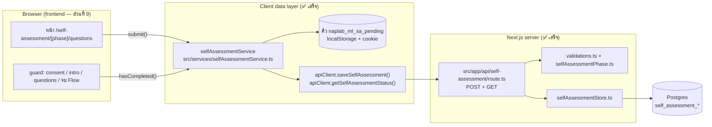

# รู้ทันสื่อ Interactive — Backend แบบทดสอบก่อน/หลังเรียน (โหมดวิจัย) + คู่มือต่องาน Frontend

**Status:** 🟢 Backend เสร็จ + unit test ผ่าน (2026-10-28) — 🔍 Frontend ต่อแล้ว + E2E ผ่าน (2026-10-28, ส่วนที่ 9) รอตรวจรับบน deployment จริง (9.6) | **อ้างอิงโค้ด ณ เวอร์ชัน:** `0.24.0` | **User Story:** [US-DATA-03](../agile/user-stories/US-DATA-03.md)

> เอกสารนี้อธิบายว่า backend ของการเก็บผลแบบประเมินตนเองก่อน/หลังเรียน (self-assessment) **ถูกสร้างไว้อย่างไร** และ **frontend ต้องเรียกอะไรตรงไหน** — เขียนให้ dev หรือ AI agent ที่มาทำหน้าจอต่ออ่านจบแล้วทำได้เลย
>
> เหตุผลเชิงออกแบบ (ทำไมต้องมีตารางใหม่, ทำไมคิวต้องไม่ทิ้งข้อมูล ฯลฯ) อยู่ใน [09 — สเปกการเก็บข้อมูล](./09-research-pre-post-data-collection.md) ส่วนเอกสารนี้คือ "ของที่มีอยู่จริงในโค้ด"

---

## 1. ภาพรวม



| ชั้น | ไฟล์ | หน้าที่ |
|---|---|---|
| DB | `docs/supabase-schema.sql` (ท้ายไฟล์) | ตาราง `self_assessment_item_sets` / `_items` / `_submissions` / `_answers` + view 3 ตัว — รายละเอียด [สเปก 09 ข้อ 5](./09-research-pre-post-data-collection.md#5-ฐานข้อมูล) |
| Validation | `src/lib/validations.ts` | `selfAssessmentSubmissionSchema`, `selfAssessmentStatusQuerySchema` |
| ชุดคำถาม | `src/lib/selfAssessmentPhase.ts` | `SELF_ASSESSMENT_ITEM_SET` (`"sa-v1"`), `SELF_ASSESSMENT_ITEM_SETS`, `findItemSetProblem()`, `isSelfAssessmentPhase()` |
| Session row | `src/lib/sessionRows.ts` | `ensureSessionRow()`, `isUuid()` — ใช้ร่วมกับ `/api/action-logs` และ `/api/page-views` |
| DB access | `src/lib/selfAssessmentStore.ts` | `saveSelfAssessmentSubmission()`, `getSelfAssessmentStatus()` |
| API | `src/app/api/self-assessment/route.ts` | `POST` บันทึก, `GET` สถานะ |
| Client API | `src/services/apiClient.ts` | `saveSelfAssessment()`, `getSelfAssessmentStatus()`, `ApiHttpError` |
| Client queue | `src/services/selfAssessmentService.ts` | `submit()`, `syncPending()`, `hasCompleted()`, `getPending()`, `getRejected()`, `fetchServerStatus()` |
| สคริปต์ทีม | `scripts/migrate-self-assessment.cjs`, `backfill-self-assessment.cjs`, `export-self-assessment.cjs` | สร้างตาราง, ย้ายข้อมูลเก่าจาก `action_logs`, ส่งออก CSV/JSON |

---

## 2. API

### 2.1 `POST /api/self-assessment` — บันทึกการส่งแบบทดสอบ 1 ครั้ง

**Request body** (`selfAssessmentSubmissionSchema`)

| field | type | หมายเหตุ |
|---|---|---|
| `submission_uuid` | uuid | สร้างฝั่ง client ครั้งเดียวต่อการกดส่ง — ใช้กันส่งซ้ำ |
| `session_id` | uuid | `progressService.getOrCreateSession().sessionId` |
| `phase` | `"pre"` \| `"post"` | |
| `item_set` | string | `SELF_ASSESSMENT_ITEM_SET` (`"sa-v1"`) |
| `answers` | `{ [itemId]: 1..5 }` | **key = รหัสข้อ** (`"sa-07"`) ไม่ใช่ตำแหน่งบนจอ — ต้องครบทุกข้อของชุด |
| `item_order` | string[] | รหัสข้อตามลำดับที่แสดงบนจอ — ต้องครบทุกข้อ ไม่ซ้ำ |
| `started_at` | ISO datetime? | เวลาเปิดหน้าคำถาม (ถ้าเวลานี้อยู่หลัง `submitted_at` server จะทิ้งค่านี้แต่ยังเก็บคำตอบ) |
| `submitted_at` | ISO datetime | เวลากดส่ง (นาฬิกาเครื่อง) |
| `app_mode` | `"normal"` \| `"research"` | |
| `app_version` | string? | `package.json` version |
| `is_dev_skip` | boolean | ส่งจากปุ่ม dev skip (คำตอบสุ่ม) |
| `client_meta` | object? | `{ userAgent, screenSize }` |

**Response**

| status | body | ความหมาย | client ทำอะไร |
|---|---|---|---|
| `201` | `{ submission: { submission_uuid, phase, received_at } }` | บันทึกแล้ว | เอาออกจากคิว |
| `200` | `{ duplicate: true, reason: "same_submission" }` | uuid นี้เคยบันทึกแล้ว (ส่งซ้ำ) | เอาออกจากคิว |
| `200` | `{ duplicate: true, reason: "phase_already_done" }` | session นี้ทำ phase นี้ไปแล้ว — **ไม่ทับของเดิม** | เอาออกจากคิว |
| `400` | `{ error, reason? }` | JSON พัง / schema ไม่ผ่าน / คำตอบไม่ครบหรือไม่ตรงชุด | ย้ายไป rejected (ส่งใหม่ก็ไม่ผ่าน) |
| `500` | `{ error }` | DB มีปัญหา (ไม่ส่งรายละเอียด error ออกไป) | เก็บไว้ในคิว ลองใหม่ภายหลัง |

**ขั้นตอนฝั่ง server** (`saveSelfAssessmentSubmission`) — ทั้งหมดใน transaction เดียว:
1. `ensureSessionRow()` — สร้างแถว `sessions` แบบ `age_range='unknown'` ถ้ายังไม่มี (consent อาจยังซิงค์ไม่ถึง)
2. `INSERT … self_assessment_submissions … ON CONFLICT DO NOTHING` — ไม่ระบุ target จึงครอบทั้ง PK และ `uq_sa_submissions_once_per_phase`
3. ไม่ได้แถว → `ROLLBACK` แล้วแยกเหตุผลว่าซ้ำ uuid หรือ phase นี้ทำแล้ว
4. ได้แถว → `INSERT` คำตอบ 12 แถวในคำสั่งเดียว (`unnest`) โดย `shown_position = ตำแหน่งใน item_order + 1` → `COMMIT`
5. error ระหว่างทาง → `ROLLBACK` ทั้งหมด (ไม่มี submission ที่ไม่มีคำตอบ)

ทุกแถวที่ dev skip (`is_dev_skip = true`) ไม่ถูกนับในกติกา "ทำได้ครั้งเดียว" และไม่อยู่ในผล export ค่าเริ่มต้น

### 2.2 `GET /api/self-assessment?session_id=<uuid>` — สถานะ (ไม่มีคำตอบ)

- `200 { status: { pre: boolean, post: boolean } }` — นับแถวที่ไม่ใช่ dev skip (รวม backfill)
- `400` session_id หายหรือไม่ใช่ uuid, `500` DB มีปัญหา
- **ไม่มี endpoint ใดคืนคำตอบ** — ข้อมูลวิจัยออกทางสคริปต์ export เท่านั้น (ต่างจากสเปก 09 เดิมที่ "ไม่มี GET" เลย: เพิ่มเพราะ frontend ต้องการรู้ว่าทำแล้วหรือยังในกรณีที่ storage ในเครื่องถูกล้าง แต่ cookie session ยังอยู่)

---

## 3. Client data layer — `selfAssessmentService`

```ts
import { selfAssessmentService } from "@/services/selfAssessmentService";

selfAssessmentService.submit({ phase, answers, itemOrder, startedAt, isDevSkip }): SelfAssessmentSubmission
selfAssessmentService.syncPending(): Promise<{ sent, duplicates, rejected, remaining }>
selfAssessmentService.hasCompleted(phase): boolean
selfAssessmentService.getPending(): SelfAssessmentSubmission[]
selfAssessmentService.getRejected(): SelfAssessmentSubmission[]
selfAssessmentService.fetchServerStatus(): Promise<{ pre: boolean; post: boolean } | null>
```

| เมธอด | ทำอะไร | ข้อควรรู้ |
|---|---|---|
| `submit()` | สร้าง submission (uuid, session_id, item_set, เวลา, app_mode, app_version, client_meta) → **เขียนลงคิวก่อน** → เริ่มส่งเบื้องหลัง → คืนค่าทันที | ไม่ต้อง `await` — เปลี่ยนหน้าได้เลย ผู้สูงอายุต้องไม่เห็นหน้าจอรอ; เรียกได้เฉพาะฝั่ง browser |
| `syncPending()` | ส่งคิวทีละตัวเรียงตามเวลา | 201/200 → ออกจากคิว; 4xx (ยกเว้น 408/429) → ย้ายไป rejected + log `self_assessment_sync_rejected`; error อื่น/ออฟไลน์ → **หยุด** เก็บที่เหลือไว้ตามลำดับ; เรียกซ้อนกันได้ (ใช้รอบเดียวกัน) |
| `hasCompleted(phase)` | phase นี้ทำแล้วหรือยัง **สำหรับ session ปัจจุบัน** | `progress.selfAssessment[phase]` มีค่า หรือมี submission ของ phase นี้ค้างในคิว — synchronous ใช้ redirect ก่อน render ได้ |
| `fetchServerStatus()` | ถามสถานะจาก server | คืน `null` ถ้าเรียกไม่ได้ (ออฟไลน์) — ใช้เสริม ไม่ใช่แทน `hasCompleted()` |

**ที่เก็บคิว**
- `localStorage["naplab_ml_sa_pending"]` เก็บทั้งหมด + cookie `naplab_ml_sa_pending` เก็บ 3 ตัวแรก (กัน cookie เกิน ~4 KB) — อ่านกลับโดยรวมสองที่ตาม `submission_uuid` จึงรอดกรณี LINE ล้าง localStorage
- `localStorage["naplab_ml_sa_rejected"]` เก็บตัวที่ server ปฏิเสธ (ไว้ตรวจสอบ)
- **ต่างจากสเปก 09 ข้อ 7.2** ที่ให้ใส่ใน `UserProgress`: แยก key เพราะ cookie `naplab_ml_progress` เก็บ progress ทั้งก้อนอยู่แล้ว ถ้าเพิ่มคิวเข้าไปอาจเกินเพดาน cookie จนเขียน progress ไม่ลง และ `progressService.resetAll()` จะไม่ลบคิวนี้ (submission ที่ค้างยังผูกกับ session เดิมและต้องส่งให้ถึง)

**trigger การ sync อัตโนมัติ** (เหมือน `loggingService`): event `online` + 3 วินาทีหลัง module ถูกโหลด — **frontend ต้อง import service นี้ใน `AppLayout`** เพื่อให้ trigger ทำงานทุกหน้า (ส่วนที่ 9.1)

---

## 4. สคริปต์ฝั่งทีม

ทุกตัวใช้ `DATABASE_URL` (อ่านจาก `.env` ได้)

| สคริปต์ | ใช้ทำอะไร | ตัวอย่าง |
|---|---|---|
| `migrate-self-assessment.cjs` | สร้างตาราง/view/seed `sa-v1` บน DB ที่มีตารางหลักแล้ว — ใช้บล็อกท้าย `docs/supabase-schema.sql` รันซ้ำได้ | `node scripts/migrate-self-assessment.cjs` / `--print` ดู SQL |
| `backfill-self-assessment.cjs` | ย้าย `self_assessment_submitted` ใน `action_logs` เข้าตารางใหม่ — ค่าเริ่มต้นเป็น dry run | `node scripts/backfill-self-assessment.cjs` แล้ว `--apply` |
| `export-self-assessment.cjs` | ส่งออกให้ทีมวิจัย | `--shape=long` (1 แถว/ข้อ + ข้อความคำถาม + อายุ/พื้นที่), `--shape=wide` (1 แถว/คน `pre_sa-01…`, `post_…`, total, `has_pair`, `diff_total`, `demographics_unknown`), `--shape=items`; `--from/--to`, `--include-dev-skip`, `--all-attempts`, `--format=json`, `--out=` |

กติกา backfill: ใช้ `action_logs.id` เป็นทั้ง `submission_uuid` และ `source_log_id`; ตัดแถวซ้ำจากคิวออฟไลน์ (session + phase + คำตอบ + ลำดับเหมือนกัน); dev skip = มี event `self_assessment_dev_skip` ของ session+phase เดียวกันก่อนหน้า ≤ 5 วินาที; `started_at` จาก `self_assessment_start` ล่าสุดก่อนหน้า; ข้ามแถวที่คำตอบไม่ครบ/ค่านอก 1–5/ไม่มี session — **ไฟล์ที่ export เป็นข้อมูลวิจัย ห้าม commit เข้า repo**

---

## 5. สถานะการ deploy (2026-10-28)

| DB | ตาราง `self_assessment_*` | หมายเหตุ |
|---|---|---|
| self-host `100.75.146.233` (โหมดวิจัย) | ✅ สร้างแล้ว + seed `sa-v1` | ✅ backfill แล้ว 2026-10-28: 5 ชุด / 60 คำตอบจาก `action_logs` (2 คู่ pre↔post; `action_logs` ไม่ถูกแก้) |
| self-host `100.75.225.202` | ❌ | ไม่มีข้อมูล self-assessment |
| Supabase หลัก (cloud) | ❌ | ยังไม่แตะ |

ถ้า deploy โค้ดนี้ไปที่ DB ที่ยังไม่มีตาราง `POST /api/self-assessment` จะตอบ 500 และ client จะเก็บไว้ในคิวรอ (ไม่หาย) — รัน `migrate-self-assessment.cjs` แล้วคิวจะส่งเองรอบถัดไป

---

## 6. เปลี่ยนชุดคำถาม (item set)

ห้ามแก้ข้อความของ `sa-v1` ตรงๆ ให้:
1. แก้ `src/data/self-assessment-items.json` ตามต้องการ
2. `src/lib/selfAssessmentPhase.ts`: เปลี่ยน `SELF_ASSESSMENT_ITEM_SET` เป็น `"sa-v2"` และ **คง** id ของ `sa-v1` ไว้ใน `SELF_ASSESSMENT_ITEM_SETS` (คิวเก่าในเครื่องผู้ใช้ยังอ้าง `sa-v1`)
3. เพิ่ม `INSERT` ของ `sa-v2` ลง `self_assessment_item_sets` / `self_assessment_items` ทั้งใน `docs/supabase-schema.sql` และ DB จริง **ก่อน** deploy โค้ด
4. export แยกตามชุด (`--shape=wide` จะหยุดถ้าข้อมูลปนหลายชุด)

---

## 7. Test

| ไฟล์ | ครอบอะไร |
|---|---|
| `src/tests/unit/self-assessment-api.test.ts` | schema + `findItemSetProblem` (ค่า 0/6/3.5, ขาด/เกินข้อ, key เป็นตำแหน่ง, ลำดับซ้ำ, ชุดไม่รู้จัก); store และ route บน **schema จริงจาก `docs/supabase-schema.sql` ใน PGlite** — บันทึก 12 แถว + `shown_position`, ส่งซ้ำ, ทำซ้ำต่อ phase, dev skip, นาฬิกาเพี้ยน, rollback, สถานะ, 201/200/400/500 |
| `src/tests/unit/self-assessment-service.test.ts` | คิว: เขียนก่อนส่ง, ส่งไม่ผ่านยังอยู่, รอด localStorage ถูกล้าง, duplicate ออกจากคิว, หยุดที่ error แรกเพื่อคงลำดับ, 400 → rejected + log, sync ซ้อนไม่ส่งซ้ำ, `hasCompleted`, `resetAll()` ไม่ลบคิว |
| `src/tests/unit/self-assessment-scripts.test.ts` | migrate รันซ้ำได้, backfill (รูปแบบข้อมูลเหมือน 5 แถวจริงบน 233 + เคสขอบ) เขียนครั้งเดียวรันซ้ำไม่เพิ่ม, export long/wide/กรองวันที่ |

รัน: `npx vitest run src/tests/unit/self-assessment-*.test.ts` (ใช้ `@electric-sql/pglite` เป็น devDependency — ไม่ต้องมี DB จริง)

---

## 8. ข้อจำกัดที่รู้อยู่

- DB บังคับ "ตอบครบทุกข้อ" ไม่ได้ (ข้ามแถว) — API (`findItemSetProblem`) เป็นด่านเดียว ส่วน view `self_assessment_scores` ติดธง `is_complete` ไว้
- `phase_already_done` ทำให้การส่งครั้งที่สองของ phase เดียวกัน (เช่น storage ถูกล้างแล้วทำใหม่ด้วย session เดิม) **ไม่ถูกเก็บ** — ตามคำตัดสินสเปก 09 ข้อ 9.3
- เปิดแอปข้ามเบราว์เซอร์ (LINE ↔ Chrome) ได้ session ใหม่ → pre/post ไม่มีคู่ (`has_pair = false` ใน export)
- เวลาของแถว backfill ที่เคยค้างคิวออฟไลน์คือเวลาซิงค์

---

## 9. คู่มือต่องาน Frontend (สำหรับ dev / AI agent ที่มาทำต่อ)

> **ขอบเขต:** Task-DATA03-10 ถึง 14 และ 19 ใน [US-DATA-03](../agile/user-stories/US-DATA-03.md) — แก้เฉพาะหน้าจอ/route guard **ไม่ต้องแก้ไฟล์ใน `src/lib/selfAssessment*`, `src/services/selfAssessmentService.ts`, `src/app/api/self-assessment/`** ถ้าจำเป็นต้องแก้ ให้แก้ test คู่กันและอัปเดตเอกสารนี้

### กติกาที่ห้ามพลาด
1. **ห้าม `await` การส่ง** ในหน้า UI — เรียก `selfAssessmentService.submit()` แล้วเปลี่ยนหน้าทันที
2. **`answers` ต้องใช้รหัสข้อเป็น key** (`answers[statement.id]`) และ `itemOrder` ต้องเป็นลำดับที่แสดงจริง (`statements.map(s => s.id)`) — ห้ามเปลี่ยนเป็น array ตามตำแหน่ง
3. **เรียก `submit()` ครั้งเดียวต่อการกดส่ง** — ทุกครั้งที่เรียกจะได้ uuid ใหม่ (กดซ้ำ = submission ใหม่ ซึ่ง server จะตอบ `phase_already_done`)
4. คง `progressService.saveProgress({ selfAssessment })` เดิมไว้ — UI และ `hasCompleted()` ยังใช้
5. ทุกอย่างในส่วนนี้ทำเฉพาะ `progressService.getAppMode() === "research"` (หรือ `getServerAppMode()` ฝั่ง server) — โหมดปกติคงพฤติกรรมเดิม

### 9.1 `src/components/AppLayout.tsx` (Task-10, Task-13)
- `import "@/services/selfAssessmentService";` (หรือ import `selfAssessmentService` แล้วเรียก `void selfAssessmentService.syncPending()` ใน `useEffect` ตอน mount) — ให้ trigger sync อัตโนมัติทำงานทุกหน้า
- ซ่อนปุ่ม "รีเซ็ตข้อมูล" (ที่เรียก `handleResetAll`, ราว ๆ บรรทัด 351) ด้วย `appMode !== "research"` แบบเดียวกับปุ่มกระดานคะแนน (บรรทัด ~335)

### 9.2 `src/app/self-assessment/[phase]/questions/page.tsx` (Task-11)
```tsx
import { selfAssessmentService } from "@/services/selfAssessmentService";

const [startedAt] = useState(() => new Date().toISOString());

const finish = (finalAnswers: Record<string, number>, isDevSkip = false) => {
  const progress = progressService.getProgress();
  progressService.saveProgress({
    ...progress,
    selfAssessment: { ...progress.selfAssessment, [phase]: finalAnswers },
  });
  const itemOrder = statements.map((s) => s.id);
  const submission = selfAssessmentService.submit({ phase, answers: finalAnswers, itemOrder, startedAt, isDevSkip });
  loggingService.logEvent("self_assessment_submitted", {
    phase,
    answers: finalAnswers,
    order: itemOrder,
    submission_uuid: submission.submission_uuid,
    is_dev_skip: isDevSkip,
  });
  router.push(`/self-assessment/${phase}/complete`);
};

useDevSkip(() => {
  /* …เติมคำตอบสุ่มเหมือนเดิม… */
  loggingService.logEvent("self_assessment_dev_skip", { phase });
  finish(filled, true);
});
```
- กันกดปุ่มส่งซ้ำระหว่างเปลี่ยนหน้า (เช่น state `submitting` แล้ว disable ปุ่ม)
- **ที่ทำจริง:** state `submitting` disable ปุ่ม + หยุด guard ทำครั้งเดียวของหน้านี้ (หลัง `saveProgress()` แล้ว `hasCompleted()` เป็น true ทันที); ตอนเปิดหน้า `router.prefetch(".../complete", { kind: PrefetchKind.FULL })` เพื่อให้กดส่งตอนเน็ตหลุดแล้วยังไปหน้าถัดไปได้ (`router.push` ไป route dynamic ต้องโหลดจาก server — ถ้าไม่ prefetch จะได้หน้า error ของเบราว์เซอร์) เมื่อกลับมาออนไลน์ Next.js จะ reload หน้านั้นหนึ่งครั้ง และอาจส่ง submission เดิมซ้ำ (uuid เดิม → server ตอบ `same_submission`)

### 9.3 Pre/Post ทำได้ครั้งเดียว (Task-12)
ใช้ `selfAssessmentService.hasCompleted(phase)` ที่จุดเหล่านี้ (โหมดวิจัยเท่านั้น):

| ไฟล์ | เงื่อนไข | ไปที่ |
|---|---|---|
| `src/app/consent/location/page.tsx` (บรรทัด ~342 `router.push(... "/self-assessment/pre" ...)`) | `hasCompleted("pre")` | `/lessons` |
| `src/app/lessons/[id]/game/page.tsx` (บรรทัด ~146 สาขา research ก่อน `goToScore(FLOW_POST_TEST_PATH)`) | `hasCompleted("post")` | `/lessons/complete` (ข้ามหน้าแบบทดสอบ) |
| `src/app/self-assessment/[phase]/page.tsx` (intro) และ `questions/page.tsx` | `hasCompleted(phase)` | `router.replace(phase === "pre" ? "/lessons" : "/lessons/complete")` + `logEvent("self_assessment_already_done", { phase })` |
| `complete/page.tsx` | — | ไม่ต้องกัน |

- ตรวจใน `useEffect` แรกของหน้า (ก่อนผู้ใช้ตอบ) และอย่า render คำถามระหว่างตรวจ เพื่อไม่ให้เห็นหน้าคำถามแวบหนึ่ง
- **ที่ทำจริง:** hook `useSelfAssessmentDoneGuard(phase, paused)` ใน `src/lib/useSelfAssessmentDoneGuard.ts` (ใช้ที่หน้า intro + questions) — คืน true ระหว่าง SSR/hydration และเมื่อทำแล้ว (หน้า render เป็นพื้นว่าง) แล้ว `router.replace()` + log; ยังไม่ได้ใช้ `fetchServerStatus()`
- (ไม่บังคับ) ถ้า `hasCompleted()` เป็น false แต่อยากกันกรณี storage ถูกล้าง: `const s = await selfAssessmentService.fetchServerStatus(); if (s?.[phase]) …` — ได้ `null` เมื่อออฟไลน์ ให้ถือว่า "ยังไม่ทำ" (server จะตอบ `phase_already_done` เองถ้าซ้ำ)

### 9.4 ตัดเส้นทางแบบทดสอบปรนัยเก่าออกจากโหมดวิจัย (Task-14)
- `src/app/self-assessment/[phase]/complete/page.tsx`: `router.push(session?.isTestingGroup ? "/pretest" : "/lessons")` → `router.push("/lessons")`
- `src/proxy.ts`: เมื่อ `getServerAppMode() === "research"` ให้ข้าม guard ข้อ 2–3 (`isTestingGroup`) ทั้งหมด และ redirect `/pretest` → `/self-assessment/pre`, `/posttest` → `/lessons` — guard ข้อ 1 (ต้อง consent ก่อน) คงไว้

### 9.5 E2E ที่ต้องเพิ่ม (Task-19) — ต่อจาก `src/tests/e2e/journey.spec.ts`
- ตอบครบแล้วกดส่ง → `page.waitForRequest("**/api/self-assessment")` body มี `answers` 12 ข้อ key `sa-xx` และ `item_order` ตรงกับลำดับบนจอ
- `context.setOffline(true)` ก่อนกดส่ง → ไปหน้าถัดไปได้ → `setOffline(false)` → มี POST ตามมา
- ส่ง pre แล้วเปิด `/self-assessment/pre` → ถูกพาไป `/lessons`; ส่ง post แล้วเปิด `/self-assessment/post` → `/lessons/complete`
- โหมดวิจัย: เมนูไม่มี "รีเซ็ตข้อมูล"; cookie session ที่มี `isTestingGroup: true` เปิด `/lessons` แล้วไม่ถูกพาไป `/pretest`
- ใน E2E ให้ mock `POST /api/self-assessment` ด้วย `page.route()` ถ้าไม่มี DB ทดสอบ
- **ที่ทำจริง:** `src/tests/e2e/self-assessment.spec.ts` (mock `/api/**` ทั้งหมด) — ต้องรันกับ server โหมดวิจัย: `npm run build` → `APP_MODE=research npx next start -p 3100` → `E2E_BASE_URL=http://localhost:3100 npx playwright test self-assessment` (`E2E_BASE_URL` เพิ่มใน `playwright.config.ts`); บน server โหมดปกติทุกเคสจะ skip

### 9.6 ตรวจรับ
เมื่อทำครบ ให้เทียบ [US-DATA-03 Acceptance Criteria](../agile/user-stories/US-DATA-03.md#-acceptance-criteria) ข้อ 1–11 บน deployment โหมดวิจัยที่ต่อ DB `100.75.146.233` (ตรวจแถวด้วย view `self_assessment_scores` / `self_assessment_pairs`) แล้วติ๊กใน US — ห้ามติ๊กจากการอ่านโค้ดอย่างเดียว (AGENT.md กติกา agile ข้อ 1)
