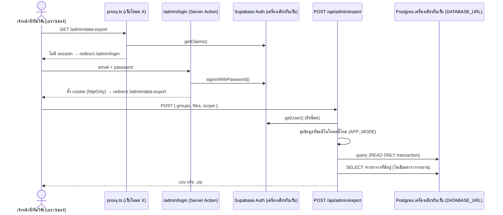

# 12 — หน้าดึงข้อมูล (Data Export) สำหรับทีมวิจัย: Spec + แผนพัฒนา

**Status:** 🔍 In QA — ดึงข้อมูลโดยอ่านตารางที่มีอยู่แล้วผ่าน Edge Function `ml_functions` (ไม่สร้างตารางเก็บรายงาน) โค้ดลงแล้ว 2026-11-06 **แต่ยังไม่ได้ทดสอบกับ Supabase Auth / Edge Runtime จริง** และยังไม่ได้ deploy ที่ 202, 233 — ดู [ข้อ 15](#15-สถานะการ-implement-2026-11-06) | **เขียนเมื่อ:** 2026-11-06 (ฉบับแก้ 6) | **อ้างอิงโค้ด ณ เวอร์ชัน:** `0.28.0` (`development`)
**เกี่ยวข้อง:** [09 — เก็บข้อมูลก่อน/หลังเรียน](./09-research-pre-post-data-collection.md) (§9.5 ใครเข้าถึงข้อมูลได้) · [10 — Backend แบบทดสอบก่อน/หลังเรียน](./10-research-pre-post-backend.md) · [03 — Data Schema](./03-data-schema.md) · [08 — เพิ่มเกมเข้า Leaderboard](./08-leaderboard-add-game.md) · `docs/supabase-schema.sql`

---

## 1. สรุปสั้น

ตอนนี้ข้อมูลออกจากเซิร์ฟเวอร์ได้ทางเดียวคือ **สคริปต์ Node ใน `scripts/`** ที่ต้องมี `DATABASE_URL` ในเครื่องคนรัน — ทีมวิจัยดึงข้อมูลเองไม่ได้

เอกสารนี้กำหนด **หน้าเว็บสำหรับดึงข้อมูลเป็น `.csv`** ที่
- เข้าได้ทาง URL ตรงเท่านั้น (`/admin/data-export`) — ไม่มีลิงก์/ปุ่มจากส่วนไหนของแอป
- **แต่ละเว็บดึงจากฐานข้อมูลของเซิร์ฟเวอร์ตัวเองตามโหมด:**

  | เว็บ | `APP_MODE` | ดึงจาก | ชุดข้อมูลเฉพาะโหมด |
  |---|---|---|---|
  | เว็บโหมดปกติ | `normal` | DB เซิร์ฟเวอร์ปกติ `100.75.225.202` | คะแนน Leaderboard (ไฟล์แยก) |
  | เว็บโหมดวิจัย | `research` | DB เซิร์ฟเวอร์วิจัย `100.75.146.233` | แบบประเมินตนเองก่อน/หลังเรียน |

- **เจ้าหน้าที่ใช้ได้ทั้ง 2 เว็บ** — เปิดหน้าเดียวกันบนเว็บโหมดปกติเพื่อดึงข้อมูล 202 และบนเว็บโหมดวิจัยเพื่อดึงข้อมูล 233; login ด้วย **Supabase Auth ของเซิร์ฟเวอร์นั้น** (บัญชีสร้างโดยเจ้าหน้าที่ใน Supabase Studio ของทั้ง 2 เครื่อง — คนที่มีสิทธิ์มีไม่กี่คน จึงสร้างซ้ำ 2 ที่ได้ไม่ยุ่งยาก)
- ติ๊กเลือกกลุ่มข้อมูลได้ และเลือกได้ว่าจะดึง **ทุกคน** หรือ **เฉพาะ session id เดียว** — ทุกชุดข้อมูลแสดงบนทั้ง 2 เว็บ **ชุดที่เว็บนั้นไม่มี (เช่น แบบประเมินบนเว็บโหมดปกติ) checkbox กดไม่ได้และมีหมายเหตุต่อท้าย** ว่าเว็บนี้ไม่มีข้อมูลชุดนี้ และมีที่เว็บไหน
- **ข้อมูลรายคนรวมเป็น `participants.csv` ไฟล์เดียว 1 แถวต่อ 1 คน** — เช่น ติ๊ก อายุ + ที่อยู่ + แบบประเมินก่อน/หลัง ได้ไฟล์เดียวที่มีคอลัมน์ `session_id`, อายุ, ที่อยู่, ผลก่อน/หลังเรียน
- ข้อมูลที่เป็นหลายแถวต่อคน (Event log, การใช้งานแยกรายวัน/เดือน, คะแนน Leaderboard) ได้ **ไฟล์ `.csv` แยก** — ทุกแถวยังมี `session_id`

### การตัดสินใจ (2026-11-06)

| รหัส | เรื่อง | ผล |
|---|---|---|
| D1 | เพศ (gender) | **ตัดออกทั้งหมด** — ระบบไม่เคยเก็บเพศ ไม่มีคอลัมน์เพศ ไม่เพิ่มคำถามเพศ |
| D2 | รูปแบบไฟล์ | **ข้อมูลรายคนรวมเป็น `.csv` ไฟล์เดียว** 1 แถว/คน คอลัมน์ตามกลุ่มที่ติ๊ก (ข้อ [8](#8-ไฟล์หลัก-participantscsv-1-แถวต่อคน)) |
| D3 | คะแนน Leaderboard | **ไฟล์ `.csv` แยก** — มีเฉพาะบนเว็บโหมดปกติ (โหมดวิจัยไม่มี Leaderboard — ข้อ 3.2) |
| D4 | บัญชีผู้ใช้ | **เจ้าหน้าที่สร้างบัญชีเองใน Supabase Studio** ของทั้ง 2 เครื่อง (คนที่มีสิทธิ์มีไม่กี่คน) — แอปไม่มีหน้าสมัคร (ข้อ [5.2](#52-เจ้าหน้าที่เพิ่มบัญชีผู้ใช้-d4)) |
| D5 | ขอบเขตเซิร์ฟเวอร์ | **หน้า export เปิดบนทั้ง 2 เว็บ: โหมดปกติดึงจาก 202, โหมดวิจัยดึงจาก 233** — แต่ละเว็บอ่านเฉพาะ DB ของตัวเอง (`DATABASE_URL` เดิมของ container) ไม่ดึงข้ามเครื่อง; ต้องการข้อมูลทั้ง 2 ชุด = ดึงจากแต่ละเว็บ |
| D7 | ชุดข้อมูลที่เว็บนั้นไม่มี | **แสดง checkbox แต่กดไม่ได้ + หมายเหตุต่อท้าย** (ไม่ซ่อน) — ข้อ [6](#6-หน้า-export-ui) |
| D6 | ตัวกรองช่วงวันที่ | **ไม่ทำในรอบนี้** — ดึงทั้งหมดแล้วกรองใน Excel |

---

## 2. ความต้องการ (Requirements) และวิธีตอบโจทย์

| รหัส | ความต้องการ | วิธีตอบโจทย์ใน spec นี้ |
|---|---|---|
| R1 | เข้าถึงได้ทาง URL path เท่านั้น ไม่มีทางกดเข้าจากหน้าเว็บ | `/admin/data-export` ไม่มีลิงก์ใดชี้ไป, `noindex` + `X-Robots-Tag` (ข้อ [5.7](#57-ซ่อนหน้าจากผู้ใช้ทั่วไป-r1)) |
| R2 | หน้าดึงข้อมูลต้องมีระบบ login คุ้ม | `proxy.ts` + Server Component เช็ค session ทุก request, API เช็คซ้ำ (ข้อ [5](#5-ระบบ-login-supabase-auth)) |
| R3 | login ต่อกับ Supabase Auth | `@supabase/ssr` + `signInWithPassword` กับ Supabase Auth ของเซิร์ฟเวอร์นั้น |
| R4 | ติ๊กเลือกข้อมูลที่จะดึงได้ | ฟอร์ม checkbox ครบทุกชุดบนทั้ง 2 เว็บ — ชุดที่เว็บนั้นไม่มีกดไม่ได้ + หมายเหตุ (ข้อ [6](#6-หน้า-export-ui)) |
| R5 | ชุดข้อมูล: แบบประเมินก่อน/หลัง, ประชากร (อายุ, ที่อยู่), Event log, การใช้งานรายวัน/เดือน, Event breakdown, Completion funnel, ความคืบหน้าบทเรียนรายคน, คะแนน Leaderboard | ข้อ [8](#8-ไฟล์หลัก-participantscsv-1-แถวต่อคน)–[9](#9-ไฟล์แยก-หลายแถวต่อคน) — ไม่มีเพศ (D1); แบบประเมินเฉพาะโหมดวิจัย, Leaderboard เฉพาะโหมดปกติ |
| R6 | ดึงได้ทั้งรายคน (session id) และทุกคน | `scope = all \| session` ใช้กับทุกไฟล์ |
| R7 | ทุกแถวใช้ session id ระบุเจ้าของ | คอลัมน์แรกของทุกไฟล์คือ `session_id` — ข้อยกเว้นเดียว: แถว leaderboard เก่าที่ผูก session ไม่ได้ (ข้อ [9.3](#93-leaderboardcsv--คะแนน-leaderboard-เฉพาะโหมดปกติ)) |
| R8 | ส่งออกเป็น `.csv` | ได้ไฟล์เดียว → `.csv` ตรง; ได้หลายไฟล์ → `.zip` ที่ข้างในเป็น `.csv` (ข้อ [10](#10-รูปแบบไฟล์-csv-และการส่งออก)) |
| R9 | โหมดปกติดึงจาก 202, โหมดวิจัยดึงจาก 233 | ใช้ `DATABASE_URL` ของ container ซึ่งชี้ DB ของเครื่องตัวเองอยู่แล้ว + ตรวจกันตั้งค่าผิด (ข้อ [5.3](#53-environment-variables-ฝั่ง-server-อ่านตอน-runtime--ตั้งใน-portainer-แล้ว-restart-ไม่ต้อง-rebuild)) |

---

## 3. สิ่งที่พบจากโค้ด/ระบบปัจจุบันที่กระทบ spec

1. **จังหวัดไม่อยู่ในตาราง `sessions`** — มีแค่ `selected_district`, `selected_sub_district`; จังหวัดอยู่ใน payload ของ event `consent_submitted` ใน `action_logs`
2. **สองโหมดมี flow ต่างกัน** (`src/app/lessons/page.tsx`, `src/app/lessons/[id]/game/page.tsx`, `src/lib/flow.ts`):
   - **วิจัย**: ลงทะเบียน → แบบประเมินก่อนเรียน → เข้าสาย "เนื้อเรื่อง" อัตโนมัติ (`FLOW_SEQUENCE = topic-1 → topic-6 → topic-3`) → แบบประเมินหลังเรียน → หน้าจบ; **ไม่มี** หน้าเลือกบทเรียน (`lessons_dashboard_view`), เกมสนุก, Leaderboard
   - **ปกติ**: ลงทะเบียน → หน้าเลือกโหมด (เนื้อเรื่อง/อิสระ/เกมสนุก) → สายเนื้อเรื่องจบด้วยเกม G13 + Leaderboard; **ไม่มี** แบบประเมินก่อน/หลัง
3. **`player_info` (คะแนน leaderboard) ไม่มี session id** — `player_uuid` เป็น UUID สุ่มแยกจาก session (`leaderboardPlayerService.createProfile`) และ event `leaderboard_score_saved` มี session id แต่ไม่มี `attempt_uuid` → ผูกคะแนนเก่ากับ session ได้แค่แบบจับคู่จาก (เกม, คะแนน, เวลา)
4. **Docker image เดียวใช้กับทั้ง 2 เครื่อง** แต่ `NEXT_PUBLIC_*` ถูกฝังตอน build → ห้ามใช้ `NEXT_PUBLIC_SUPABASE_*` กับงานนี้ (ใช้ env ฝั่ง server อ่านตอน runtime แบบเดียวกับ `APP_MODE`); และเพราะ image เดียวกัน **โค้ดที่แก้ `player_info` ต้องรันได้กับ DB ทั้ง 2 เครื่อง** → migration ต้องลงทั้งคู่
5. **`@supabase/ssr@0.5.2` เก่า** — แนวทางปัจจุบันของ Supabase (ตรวจ 2026-11-06) ให้ใช้ `supabase.auth.getClaims()` ฝั่ง server และ refresh token ใน `proxy.ts` (Next.js 16) → ต้องอัปเกรด `@supabase/ssr` และ `@supabase/supabase-js`
6. **`src/lib/supabase.ts` ยังไม่มีใคร import** และ fallback จาก service key ไป anon key เงียบๆ — ไม่ใช้ไฟล์นี้ (สร้าง helper ใหม่)
7. **`proxy.ts` redirect ทุก path ที่ไม่รู้จักไป `/consent`** ถ้ายังไม่ลงทะเบียน → ต้องเพิ่มกิ่ง `/admin` ก่อน onboarding guard
8. `getServerAppMode()` (`src/lib/appMode.ts`) รับ cookie override `naplab_ml_dev_app_mode` เฉพาะ dev build / `NEXT_PUBLIC_ENABLE_DEV_HUB=true` — **หน้า export ต้องอ่าน `APP_MODE` จาก env ตรง ไม่รับ cookie override** เพราะโหมดเป็นตัวกำหนดว่าข้อมูลมาจากไหน (dev ทดสอบสลับโหมดด้วยการตั้ง env)
9. `scripts/export_sep19_csvs.cjs` คำนวณ funnel ด้วยตัวหาร hard-code (`453`, `291`) — ไม่นำมาใช้ต่อ; `scripts/export-self-assessment.cjs` (`longQuery`, `toWide`) มี unit test แล้ว นำ logic มาใช้ต่อได้
10. ⚠️ `scripts/export_logs.js` มี connection string + รหัสผ่าน DB ฝังอยู่และ commit เข้า git แล้ว → เปลี่ยนรหัสผ่านและแก้ไปใช้ `DATABASE_URL` (Task DX-00)

---

## 4. ภาพรวมสถาปัตยกรรม



หลักการ:
- **แต่ละเว็บเป็นอิสระต่อกัน** — เว็บโหมดปกติ (202) และเว็บโหมดวิจัย (233) รันโค้ดเดียวกัน แต่ใช้ Supabase Auth + DB ของเครื่องตัวเอง ไม่มีการต่อข้ามเครื่อง
- **`APP_MODE` กำหนดชุดข้อมูลที่เปิดให้เลือก** — registry ของกลุ่ม/ไฟล์ระบุว่าแต่ละชุดใช้ได้ในโหมดใด (ข้อ [8](#8-ไฟล์หลัก-participantscsv-1-แถวต่อคน)–[9](#9-ไฟล์แยก-หลายแถวต่อคน))
- **เบราว์เซอร์ไม่คุยกับ Supabase หรือ DB ตรง** — login, ตรวจสิทธิ์, query ทำฝั่ง server ทั้งหมด → env อ่านตอน runtime ได้ และ cookie เป็น `httpOnly`
- **อ่านข้อมูลผ่าน `pg` Pool เดิม** (`src/lib/database.ts`, `DATABASE_URL`) ใน transaction แบบ `READ ONLY` — ไม่ผ่าน PostgREST, ไม่ต้องเปิด RLS policy ใดๆ ให้ `authenticated`
- Supabase Auth ใช้ **ยืนยันตัวตน + สิทธิ์** เท่านั้น

### ไฟล์ที่จะเพิ่ม/แก้

| ไฟล์ | หน้าที่ |
|---|---|
| `src/lib/supabase/server.ts` (ใหม่) | `createSupabaseServerClient()` — `createServerClient` ต่อ request, cookie `getAll`/`setAll`, บังคับ `httpOnly`, `secure`, `sameSite: "lax"` |
| `src/lib/supabase/proxy.ts` (ใหม่) | `updateAdminSession(request)` — refresh token + คืน response ที่มี cookie ใหม่ ใช้จาก `proxy.ts` |
| `src/lib/adminAuth.ts` (ใหม่) | `getExportMode()` (อ่าน `APP_MODE` ตรง), `isDataExportEnabled()` (ตั้งค่า Supabase ครบ), `requireDataExporter()` (page, `getClaims`), `requireDataExporterFresh()` (API, `getUser`) |
| `src/lib/export/registry.ts` (ใหม่) | รายการกลุ่ม/ไฟล์ + โหมดที่ใช้ได้ + ป้ายชื่อ + พจนานุกรมคอลัมน์ (ใช้ร่วม server/client) |
| `src/lib/export/queries.ts` (ใหม่) | SQL ทั้งหมด: ข้อมูลเกี่ยวกับ DB (`readDbFacts`), ชุดคน (`selectSessions`), กลุ่มคอลัมน์ของไฟล์หลัก และไฟล์แยก — แต่ละฟังก์ชันคืนข้อมูลตาม `session_id` |
| `src/lib/export/run.ts` (ใหม่) | `datasetAvailability`, `dbMatchesMode`, `runExport` (รวมกลุ่มเป็น `participants.csv` 1 แถว/คน + ไฟล์แยก), `buildReadme` |
| `src/lib/export/csv.ts` (ใหม่) | CSV (BOM, CRLF, escape, กัน formula injection) — zip ใช้ `fflate` ใน route ตรง |
| `src/proxy.ts` (แก้) | กิ่ง `/admin` ก่อน onboarding guard |
| `src/app/admin/layout.tsx` (ใหม่) | layout แยก ไม่ใช้ `AppLayout`, `metadata.robots = noindex,nofollow` |
| `src/app/admin/login/page.tsx` + `actions.ts` (ใหม่) | ฟอร์ม login + Server Action `signIn`, `signOut` |
| `src/app/admin/data-export/page.tsx` (ใหม่) | Server Component ตรวจสิทธิ์ → render `DataExportForm` พร้อมโหมด |
| `src/components/admin/DataExportForm.tsx` (ใหม่) | Client Component ฟอร์ม + ดาวน์โหลด |
| `src/app/api/admin/export/route.ts` (ใหม่) | `POST` ส่งออกไฟล์ |
| `src/app/admin/page.tsx`, `src/app/admin/actions.ts` (ใหม่) | `/admin` → `/admin/data-export`; Server Actions `signIn` (rate limit) / `signOut` |
| `src/components/admin/AdminLoginForm.tsx` (ใหม่) | ฟอร์ม login (Client Component) |
| `src/components/AppLayout.tsx` (แก้) | `/admin` ไม่สร้าง session ผู้เรียนและไม่แสดง header/progress ของผู้สูงอายุ (แบบเดียวกับ `/dev`) |
| `next.config.ts` (แก้) | header `no-store` + `X-Robots-Tag` ให้ `/admin`, `/api/admin`; Service Worker ใช้ `NetworkOnly` กับ `/admin` |
| `src/lib/validations.ts` (แก้) | zod schema ของ request export; `player_info` รับ `session_id` (optional) |
| `src/app/api/game-results/route.ts`, `src/services/apiClient.ts`, `src/app/lessons/[id]/leaderboard/page.tsx` (แก้) | ส่ง/บันทึก `session_id` กับคะแนน + `attempt_uuid` ใน log (ข้อ [11.2](#112-player_infosession_id--backfill-ทั้ง-2-db)) |
| `supabase/functions/ml_functions/` | Edge Function อ่านตารางที่มีอยู่แล้ว แล้วคืนไฟล์ให้ `POST /api/admin/export` |
| `docs/supabase-schema.sql` + `scripts/migrate-data-export.cjs` + `scripts/backfill-leaderboard-session.cjs` | คอลัมน์ `player_info.session_id` เท่านั้น — ไม่มีตารางเก็บรายงาน |

---

## 5. ระบบ Login (Supabase Auth)

### 5.1 ตั้งค่า Supabase Auth (ทำบน **ทั้ง 2 เครื่อง** โดยผู้ดูแลเซิร์ฟเวอร์)
1. ยืนยันว่า Supabase self-host มี service Auth (GoTrue) รันอยู่ และ container แอปเรียก URL ของ Supabase (Kong) ของเครื่องตัวเองได้
2. **ปิดการสมัครเอง** (`DISABLE_SIGNUP=true` ใน `.env` ของ Supabase self-host หรือปิดใน Studio) — ถ้าเปิดไว้ ใครก็สมัครได้
3. ปิด anonymous sign-in และ provider อื่น (เหลือ email/password)
4. (แนะนำ) JWT expiry สั้น เช่น 900 วินาที — การถอนสิทธิ์มีผลกับหน้าเว็บเมื่อ token หมดอายุ (API ใช้ `getUser()` จึงมีผลทันที)

### 5.2 เจ้าหน้าที่เพิ่มบัญชีผู้ใช้ (D4)
**บัญชีแยกกันต่อเครื่อง** — คนที่ต้องดึงทั้งข้อมูลโหมดปกติและโหมดวิจัยต้องมีบัญชีใน Studio ของทั้ง 202 และ 233 (ใช้อีเมลเดียวกันได้ แต่เป็นคนละบัญชี/รหัสผ่านตั้งแยก)

> **เปลี่ยน 2026-11-06 (quick fix):** ตัดการตรวจ `app_metadata.role = "data_exporter"` ออก — **ทุกบัญชีใน Supabase Auth ของเครื่องนั้นดึงข้อมูลได้** (ยกเว้นเซสชันแบบไม่ระบุตัวตน/anonymous ที่ถูกปฏิเสธเสมอ) เพราะโครงสร้าง Supabase ปัจจุบันยังไม่มีการกำหนด role
> ⚠️ ผลคือ "มีบัญชี = มีสิทธิ์" → **ต้องปิดการสมัครเอง (ข้อ 5.1 ข้อ 2) บนทุกเครื่องที่เปิดหน้านี้** และห้ามใช้ Supabase Auth เครื่องนั้นกับระบบอื่นที่ให้คนทั่วไปสมัคร — ถ้าภายหลังต้องแยกสิทธิ์ ให้นำการตรวจ role กลับมา (ดู git history ของ `src/lib/supabase/server.ts` ใน `271a762`)

ทำใน Supabase Studio ของเครื่องที่ต้องการให้สิทธิ์:
1. Authentication → Users → **Add user** → ใส่อีเมล + รหัสผ่านชั่วคราว, ติ๊ก **Auto confirm user**
2. ส่งอีเมล/รหัสให้ผู้ใช้ทางช่องทางส่วนตัว พร้อมบอกว่าเป็นบัญชีของเว็บไหน
3. **ถอนสิทธิ์:** **Sign out user แล้วลบ user** ใน Studio — ลบ user อย่างเดียวไม่ทำให้ token ที่ออกไปแล้วหมดอายุทันที (API ดึงข้อมูลตรวจกับ Auth server ทุกครั้งจึงหยุดทันที แต่หน้าเว็บอาจยังเปิดค้างได้จน token หมดอายุ)
4. ลืมรหัสผ่าน: เจ้าหน้าที่ตั้งรหัสใหม่ใน Studio (แอปไม่มีหน้ารีเซ็ตรหัส)

### 5.3 Environment variables (ฝั่ง server, อ่านตอน runtime — ตั้งใน Portainer แล้ว restart ไม่ต้อง rebuild)

| ตัวแปร | เว็บโหมดปกติ (202) | เว็บโหมดวิจัย (233) | หมายเหตุ |
|---|---|---|---|
| `APP_MODE` | `normal` | `research` | มีอยู่แล้ว — กำหนดชุดข้อมูลที่เปิดให้ดึง |
| `DATABASE_URL` | DB ของ 202 | DB ของ 233 | มีอยู่แล้ว — **ต้องชี้ DB ของเครื่องตัวเอง** |
| `SUPABASE_URL` | Supabase ของ 202 | Supabase ของ 233 | ใหม่ — URL ที่ **container** เข้าถึงได้ (เบราว์เซอร์ไม่ต้องเข้าถึง) |
| `SUPABASE_PUBLISHABLE_KEY` | key ของ 202 | key ของ 233 | ใหม่ — publishable key หรือ anon key ถ้า self-host รุ่นนั้นยังไม่มี publishable key |

- หน้าเปิดได้เมื่อตั้ง `SUPABASE_URL` + `SUPABASE_PUBLISHABLE_KEY` ครบ — ขาด → `/admin/*`, `/api/admin/*` ตอบ 404 (ไม่บอกว่ามีหน้านี้อยู่) + log ฝั่ง server ครั้งเดียวว่าตั้งค่าไม่ครบ → **ปิดหน้านี้บนเครื่องใดก็ได้ด้วยการไม่ตั้ง 2 ตัวนี้**
- **กันตั้งค่าผิดเครื่อง** (เช่น เว็บโหมดวิจัยแต่ `DATABASE_URL` ชี้ DB ของ 202): `meta` ตรวจว่า DB มีหลักฐานของโหมดนั้น — โหมดวิจัยต้องมีตาราง `self_assessment_submissions`; ถ้าไม่ตรง หน้าแสดงคำเตือนสีแดง "ฐานข้อมูลอาจไม่ใช่ของเซิร์ฟเวอร์โหมดวิจัย" และปิดปุ่มดาวน์โหลด
- **ไม่ใช้** `NEXT_PUBLIC_SUPABASE_*` และ **ไม่ใช้** `SUPABASE_SERVICE_ROLE_KEY` ในเบราว์เซอร์
- การดึงไฟล์ (ค่าเริ่มต้น) ให้เว็บเรียก Edge Function `POST {SUPABASE_URL}/functions/v1/ml_functions/read-database/exportDataset` ด้วย access token ของผู้ใช้ที่ login แล้ว ฟังก์ชันตรวจ `app_metadata.role = data_exporter` แล้วเปิด transaction อ่านอย่างเดียวผ่าน `SUPABASE_DB_URL`
- `SUPABASE_DB_URL` ตั้งที่ container ของ Edge Function (ไม่ใช่ที่เว็บ) ต้องเป็นการเชื่อมต่อตรง/session ไป Postgres เช่น `postgresql://postgres:<รหัส>@db:5432/postgres` — **อย่าใช้พอร์ต pooler 6543** เพราะการดึงค้าง transaction เดียว
- `APP_MODE` ของ Edge Function ต้องตรงกับเว็บเครื่องนั้น
- `DATA_EXPORT_DIRECT=true` ที่เว็บ = ไม่เรียกฟังก์ชัน อ่าน `DATABASE_URL` ในโปรเซส Next แทน ใช้ตอนพัฒนาที่ยังไม่ได้รัน Edge Runtime ผลลัพธ์ชุดเดียวกัน และก็ไม่เขียนตารางรายงาน
- เพิ่มตัวแปรใหม่ใน `.env.example` (ค่าตัวอย่างปลอม), `docker/docker-compose.yml`, `docker/docker-compose.portainer.yml`

### 5.4 Package
- อัปเกรด `@supabase/ssr` และ `@supabase/supabase-js` เป็นเวอร์ชันล่าสุดที่มี `auth.getClaims()` — **pin เวอร์ชันตรง (ไม่มี `^`)** + commit `package-lock.json`
- เพิ่ม `fflate` (zip) — pin เวอร์ชัน

### 5.5 Flow และการตรวจสิทธิ์

| จุด | ตรวจอะไร | ใช้ |
|---|---|---|
| `proxy.ts` กิ่ง `/admin/*` | `isDataExportEnabled()` (ไม่ใช่ → rewrite 404), refresh token, ไม่มี session และไม่ใช่ `/admin/login` → redirect `/admin/login?next=…` | `getClaims()` |
| `/admin/data-export` | มี session ที่ไม่ใช่ anonymous (ไม่ตรวจ role ตั้งแต่ 2026-11-06 — ข้อ 5.2); เซสชัน anonymous → หน้าแจ้ง + ปุ่มออกจากระบบ | `getClaims()` |
| `POST /api/admin/export` | `isDataExportEnabled()` (ไม่ใช่ → 404) + สิทธิ์สดจาก Auth server + header `Origin` ตรงกับ host (กัน CSRF) + ชุดข้อมูลที่ขอใช้ได้ใน `APP_MODE` นี้ | `getUser()` |
| `/admin/login` | login อยู่แล้วและมีสิทธิ์ → redirect ไปหน้า export | `getClaims()` |

- route handler ต้องเช็ค `isDataExportEnabled()` เอง (กิ่ง `/api` ใน proxy ผ่านไปโดยไม่ตรวจ)
- **ห้ามใช้ `getSession()` ตัดสินสิทธิ์ฝั่ง server**
- `next` ต้องขึ้นต้นด้วย `/admin/` เท่านั้น (กัน open redirect)
- login ผิดได้ข้อความเดียว "อีเมลหรือรหัสผ่านไม่ถูกต้อง"
- **Rate limit ฝั่งแอป** ตาม IP ผู้ใช้ (`x-forwarded-for`) เช่น 5 ครั้ง / 15 นาที — เพราะ GoTrue เห็นทุก request มาจาก IP ของ container เดียว (รูปแบบเดียวกับ rate limit ใน `src/app/api/game-results/route.ts`)
- ออกจากระบบ: Server Action `signOut` → `supabase.auth.signOut()` → `/admin/login`

### 5.6 Cookie
- ชื่อตามค่าเริ่มต้นของ `@supabase/ssr` แต่บังคับ `httpOnly: true`, `secure: true` (ยกเว้น dev), `sameSite: "lax"`, `path: "/"`
- 2 เว็บอยู่คนละ host → cookie แยกกันเอง (login เว็บหนึ่งไม่ทำให้เข้าอีกเว็บได้)
- กิ่ง `/admin` ใน proxy ไม่อ่าน/ไม่แก้ cookie ของผู้สูงอายุ (`naplab_ml_session`, `naplab_ml_progress`)
- ทุก response ใต้ `/admin`, `/api/admin` ตั้ง `Cache-Control: no-store`

### 5.7 ซ่อนหน้าจากผู้ใช้ทั่วไป (R1)
- ไม่มีลิงก์/ปุ่มจาก UI ใดๆ (drawer, dev hub, หน้า facilitator) — unit test grep ว่าไม่มี `"/admin` ใน `src/` นอก `src/app/admin/`, `src/components/admin/`, `src/proxy.ts`, `src/lib/`
- `metadata.robots = { index: false, follow: false }` + header `X-Robots-Tag: noindex, nofollow`
- **ไม่ใส่ใน `robots.txt`** (การ Disallow คือการประกาศ path)
- ตัด `/admin` ออกจาก PWA navigation fallback/precache ถ้ามี
- การซ่อน URL **ไม่ใช่** มาตรการความปลอดภัย — ความปลอดภัยมาจาก login + สิทธิ์ (R2)

---

## 6. หน้า Export (UI)

ผู้ใช้คือเจ้าหน้าที่/ทีมวิจัย (ใช้คอมพิวเตอร์) → **ยกเว้นกติกา portrait-first** (แบบ Facilitator Mode) แต่ยังต้องตามกติกาตัวอักษร (`text-*` ตาม [07-typography](../wiki/design/07-typography.md)), contrast ≥ 4.5:1, touch target ≥ 48px, ใช้คีย์บอร์ดได้ทั้งหมด

ตัวอย่างบนเว็บโหมดวิจัย — ทั้ง 2 เว็บแสดงรายการชุดข้อมูล **ครบเหมือนกันทุกข้อ** ต่างกันแค่ข้อไหนกดได้ (บนเว็บโหมดปกติ: แบบประเมิน + ตัวกรองแบบประเมินกดไม่ได้, คะแนน Leaderboard กดได้):

```
┌────────────────────────────────────────────────────────────────┐
│ ดึงข้อมูล · [โหมดวิจัย — เซิร์ฟเวอร์ 233]       researcher@…  [ออกจากระบบ] │
│ 312 sessions · 6,950 events · ข้อมูล ณ 06/11/2026 14:05            │
├────────────────────────────────────────────────────────────────┤
│ 1) ข้อมูลของใคร                                                   │
│   (•) ทุกคน   ( ) เฉพาะ session id: [___________________________] │
│   [ ] เฉพาะคนที่ลงทะเบียนแล้ว                                        │
│   [ ] เฉพาะคนที่ทำแบบประเมินครบทั้งก่อนและหลังเรียน                     │
│                                                                │
│ 2) ข้อมูลรายคน → รวมเป็นไฟล์เดียว participants.csv (1 แถว/คน)        │
│   [x] อายุ                                                      │
│   [x] ที่อยู่ (จังหวัด/อำเภอ/ตำบล)                                    │
│   [x] แบบประเมินตนเองก่อน/หลังเรียน   [x] รวมคำตอบรายข้อ            │
│   [ ] สรุปการใช้งาน (วันแรก/ล่าสุด, จำนวนวัน/เดือนที่ใช้, จำนวน event)  │
│   [ ] จำนวน event แยกตามประเภท                                     │
│   [ ] Completion funnel                                         │
│   [ ] ความคืบหน้าบทเรียน                                            │
│                                                                │
│ 3) ไฟล์แยก (หลายแถวต่อคน)                                          │
│   [ ] Event log ทุก event                      ~6,950 แถว          │
│   [ ] การใช้งานแยกรายวัน + รายเดือน            → 2 ไฟล์             │
│   [▒] คะแนน Leaderboard                                          │
│       ⓘ เว็บนี้ไม่มีข้อมูลชุดนี้ — มีเฉพาะเว็บโหมดปกติ (202)            │
│                                                                │
│ ตัวอย่างคอลัมน์ participants.csv:                                   │
│   session_id, age_range, province, district, sub_district, …     │
│                    [คำอธิบายคอลัมน์]  [ ดาวน์โหลด participants.csv ] │
│ ✓ ดาวน์โหลดแล้ว: participants.csv 312 แถว                          │
└────────────────────────────────────────────────────────────────┘
```

พฤติกรรม:
- **ป้ายโหมดเด่นชัดที่หัวหน้า** (สีต่างกันระหว่างโหมด) เพื่อกันดึงผิดเว็บ — ชื่อไฟล์ก็มีโหมดกำกับ (ข้อ 10)
- โหลดหน้า → server อ่านข้อมูลเครื่อง (ข้อ 7.1) แสดงจำนวน session/event และผลตรวจความสอดคล้องของ DB (ข้อ 5.3)
- **แสดงทุกกลุ่ม/ไฟล์บนทั้ง 2 เว็บ** — ชุดที่เว็บนั้นไม่มี (ตาม `available` ใน `meta` + `registry.ts`):
  - checkbox เป็น `disabled` และ **ไม่ถูกติ๊กเสมอ** (แม้ค่าที่จำไว้ใน `localStorage` จะเคยติ๊ก) — ไม่ถูกนับใน "เลือกทั้งหมด" และไม่ถูกส่งไปกับ request
  - **หมายเหตุต่อท้าย checkbox** (บรรทัดถัดไป, ไอคอน ⓘ + ข้อความ ไม่ใช้สีอย่างเดียว, contrast ≥ 4.5:1, `text-caption`) ข้อความตามสาเหตุ:
    | สาเหตุ | ข้อความ |
    |---|---|
    | ชุดนี้มีเฉพาะอีกโหมด | "เว็บนี้ไม่มีข้อมูลชุดนี้ — มีเฉพาะเว็บโหมดวิจัย (233)" / "… — มีเฉพาะเว็บโหมดปกติ (202)" |
    | โหมดถูกแต่ตาราง/ข้อมูลไม่มีใน DB นี้ | "เว็บนี้ไม่มีข้อมูลชุดนี้ — ไม่พบตารางในฐานข้อมูลของเซิร์ฟเวอร์นี้" |
  - checkbox ผูก `aria-describedby` กับหมายเหตุ เพื่อให้ screen reader อ่านเหตุผลด้วย; ข้อความ label ยังอ่านได้ชัด (ไม่จางจนต่ำกว่า contrast ขั้นต่ำ)
  - ตัวเลือกย่อยของชุดนั้น (เช่น "รวมคำตอบรายข้อ") และตัวกรองที่ขึ้นกับชุดนั้น ("เฉพาะคนที่ทำแบบประเมินครบ") ก็ `disabled` พร้อมหมายเหตุเดียวกัน
- ตัวเลือก "เฉพาะคนที่ทำแบบประเมินครบ" กดได้เมื่อชุดแบบประเมินใช้ได้และถูกติ๊กเท่านั้น
- ถ้า `meta` โหลดไม่สำเร็จ → ปิดทุก checkbox + ข้อความ "โหลดข้อมูลเซิร์ฟเวอร์ไม่สำเร็จ ลองรีเฟรช" (ไม่เดาว่าชุดไหนมี)
- API ยังตรวจซ้ำฝั่ง server เสมอ — ขอชุดที่ไม่มีได้ 422 (ข้อ 7.2) แม้หน้าเว็บจะกันไว้แล้ว
- ช่อง session id: ตรวจรูปแบบ UUID ก่อนส่ง, ตัดช่องว่างหัวท้าย; ไม่พบ → "ไม่พบ session นี้บนเซิร์ฟเวอร์นี้ (อาจอยู่บนเว็บอีกโหมด)"
- แสดงตัวอย่างหัวคอลัมน์ของ `participants.csv` ตามที่ติ๊ก (จาก `registry.ts`, ไม่รวมคอลัมน์ที่ขึ้นกับข้อมูล เช่น `ev_*`)
- ปุ่มบอกว่าจะได้ไฟล์อะไร: ได้ไฟล์เดียว → ชื่อไฟล์ `.csv`; หลายไฟล์ → `.zip (n ไฟล์)`; ระหว่างรอ disabled + "กำลังเตรียมไฟล์…"; สำเร็จแสดงจำนวนแถว (header `X-Export-Row-Counts`)
- "คำอธิบายคอลัมน์" เปิดพจนานุกรมคอลัมน์ชุดเดียวกับใน `README.txt`
- จำค่าที่ติ๊กล่าสุดใน `localStorage` (try/catch) — **ไม่จำ session id**
- ดาวน์โหลดด้วย `fetch` (POST) → `Blob` → `<a download>`

---

## 7. API

### 7.1 ข้อมูลเครื่อง ("meta") — คำนวณใน Server Component ของหน้า ไม่มี API แยก
> ที่ implement จริง: หน้า `/admin/data-export` อ่านข้อมูลนี้จาก DB ตอน render แล้วส่งเป็น props (`ExportPageMeta` ใน `src/lib/export/registry.ts`) — ไม่มี `GET /api/admin/export/meta` (ลด endpoint ที่ต้องกันสิทธิ์; รีเฟรชหน้า = ได้ค่าใหม่)

```ts
{
  generatedAt: "2026-11-06T07:05:00.000Z",
  sessionCount: 312,
  eventCount: 6950,
  datasets: [                       // ครบทั้ง 10 ชุดเสมอ
    { id: "age", available: true },
    { id: "leaderboard", available: false, reason: "other_mode" },
    …
  ],
  dbMatchesMode: true,              // false = เว็บวิจัยแต่ DB ไม่มีตารางแบบประเมิน
  leaderboardWithoutSession: null   // เว็บปกติ: จำนวนคะแนนเก่าที่ผูก session ไม่ได้
}
```
- `reason`: `other_mode` (มีเฉพาะอีกโหมด — ตาม `onlyIn` ใน registry) หรือ `missing_in_db` (โหมดถูกแต่ไม่พบตาราง/คอลัมน์)
- `dbMatchesMode = false` → หน้าแสดงคำเตือนสีแดงและปิดปุ่มดาวน์โหลด; API ตอบ 422 `db_mode_mismatch`

### 7.2 `POST /api/admin/export`
Request (zod, `.strict()`):
```json
{
  "scope": { "type": "all" },
  "row_filter": { "registered_only": false, "self_assessment_pair_only": false },
  "groups": ["age", "location", "self_assessment"],
  "group_options": { "self_assessment_items": true },
  "files": []
}
```
- `scope`: `{ "type": "all" }` หรือ `{ "type": "session", "session_id": <uuid> }`
- `groups` (ไฟล์หลัก): `age | location | self_assessment* | usage_summary | event_breakdown | completion_funnel | lesson_progress`
- `files` (ไฟล์แยก): `event_log | usage_detail | leaderboard**`
- \* โหมดวิจัยเท่านั้น · \*\* โหมดปกติเท่านั้น — ขอชุดที่ไม่มีในโหมดนี้ → 422
- `groups` และ `files` รวมกันต้องมีอย่างน้อย 1
- `row_filter.self_assessment_pair_only` ใช้ได้เมื่อเลือก `self_assessment` เท่านั้น

Response:
| กรณี | Status | Body |
|---|---|---|
| ได้ไฟล์เดียว | 200 | `text/csv; charset=utf-8`, `Content-Disposition: attachment; filename="…"` |
| หลายไฟล์ | 200 | `application/zip` |
| ตั้งค่า Supabase ไม่ครบ | 404 | (ว่าง) |
| ไม่ได้ login | 401 | `{ "error": "unauthenticated" }` |
| ไม่มีสิทธิ์ / `Origin` ไม่ตรง | 403 | `{ "error": "forbidden" }` |
| request ไม่ถูกต้อง | 400 | `{ "error": "invalid_request", "details": … }` |
| ไม่พบ session id | 404 | `{ "error": "session_not_found" }` |
| ชุดข้อมูลไม่มีในโหมดนี้ / DB ไม่ตรงโหมด | 422 | `{ "error": "dataset_unavailable", "dataset": "…" }` / `{ "error": "db_mode_mismatch" }` |
| DB error / timeout | 500 | `{ "error": "export_failed" }` (ไม่ส่ง error ดิบของ DB) |

Headers: `Cache-Control: no-store`, `X-Robots-Tag: noindex`; สำเร็จเพิ่ม `X-Export-Row-Counts: {"participants.csv":312,…}`

การทำงานภายใน:
1. `isDataExportEnabled()` → ตรวจสิทธิ์ (`getUser`) + `Origin` + validate + ชุดข้อมูลตรงโหมด
2. ยืม 1 connection จาก pool เดิม → `BEGIN READ ONLY ISOLATION LEVEL REPEATABLE READ`, `SET LOCAL statement_timeout = '60s'` → ตรวจ DB ตรงโหมด → ทุกไฟล์มาจาก snapshot เดียวกัน
3. หาชุด session (ข้อ [8.1](#81-แถวมีใครบ้าง)) → รันทุกกลุ่ม/ไฟล์ที่เลือก กรองด้วยชุดนั้น
4. สร้าง `participants.csv` + ไฟล์แยก → `.csv` หรือ `.zip` (จัดไฟล์ที่เว็บ หลังได้ผลจาก Edge Function)
5. ไม่บันทึกสำเนารายงานและไม่เขียนตาราง audit — ใครดึงดูจาก log ของ Edge Runtime / access log ของเว็บ
- `export const runtime = "nodejs"`, `export const dynamic = "force-dynamic"`

---

## 8. ไฟล์หลัก `participants.csv` (1 แถวต่อคน)

ได้เมื่อติ๊กกลุ่มรายคนอย่างน้อย 1 กลุ่ม — ตัวอย่างตามที่ต้องการ (เว็บโหมดวิจัย, ติ๊ก อายุ + ที่อยู่ + แบบประเมิน, ไม่เอาคำตอบรายข้อ):

```
session_id,age_range,province,district,sub_district,sa_item_set,sa_pre_submitted_at,sa_pre_duration_sec,sa_pre_total,sa_pre_straight_line,sa_post_submitted_at,sa_post_duration_sec,sa_post_total,sa_post_straight_line,sa_diff,sa_has_pair
3f0c1a2b-…,60-69,เชียงใหม่,เมืองเชียงใหม่,สุเทพ,sa-v1,2026-11-02T09:14:03+07:00,95,41,false,2026-11-02T10:02:47+07:00,80,52,false,11,true
9a77e0c4-…,70-79,แพร่,เมืองแพร่,ในเวียง,sa-v1,2026-11-02T09:20:11+07:00,120,38,false,,,,,,false
```

### 8.1 แถวมีใครบ้าง
- ทุก `session_id` ที่มีใน `sessions` **หรือ** `action_logs` (session ที่มีแต่ log ก็นับ) — ไม่รวม `session_id` NULL
- `scope = session` → เฉพาะ session นั้น
- `registered_only` → เฉพาะ session ที่มี event `consent_submitted`
- `self_assessment_pair_only` (โหมดวิจัย) → เฉพาะ session ที่มี submission ทั้ง `pre` และ `post` ครบทุกข้อ (ตาม view `self_assessment_pairs`)
- **ตัวกรองแถวใช้กับไฟล์แยกด้วย** — ไฟล์ทุกไฟล์ในการดึงครั้งเดียวกันมีชุดคนเดียวกัน
- เรียงตามเวลาที่พบครั้งแรก
- คนที่ไม่มีข้อมูลในกลุ่มที่เลือก → คอลัมน์กลุ่มนั้นเป็นค่าว่าง (ยังมีแถว)

### 8.2 คอลัมน์ — เรียงตามลำดับกลุ่มด้านล่างเสมอ (ไม่ขึ้นกับลำดับที่ติ๊ก)

คอลัมน์ที่มีเสมอ: `session_id`

**กลุ่ม `age` — อายุ** (ทั้ง 2 โหมด)
| คอลัมน์ | ที่มา |
|---|---|
| `age_range` | `sessions.age_range` (`unknown` → ว่าง), fallback `payload.age_range` ของ `consent_submitted` แรก |

**กลุ่ม `location` — ที่อยู่** (ทั้ง 2 โหมด)
| คอลัมน์ | ที่มา |
|---|---|
| `province` | `payload.province` ของ `consent_submitted` แรก |
| `district`, `sub_district` | `payload` แรก, fallback `sessions.selected_district` / `selected_sub_district` |

**กลุ่ม `self_assessment` — แบบประเมินตนเองก่อน/หลังเรียน** (โหมดวิจัยเท่านั้น; logic เดียวกับ `scripts/export-self-assessment.cjs`: ไม่รวม dev-skip, ใช้ submission แรกต่อ session ต่อ phase — port `longQuery`/`toWide` เป็น TypeScript และ test เทียบผลกับสคริปต์)
| คอลัมน์ | ความหมาย |
|---|---|
| `sa_item_set` | ชุดคำถาม (ปัจจุบัน `sa-v1`) |
| `sa_pre_submitted_at`, `sa_pre_duration_sec`, `sa_pre_total`, `sa_pre_straight_line` | ก่อนเรียน: เวลาส่ง, เวลาที่ใช้, คะแนนรวม, ตอบค่าเดียวกันทุกข้อหรือไม่ |
| `sa_post_submitted_at`, `sa_post_duration_sec`, `sa_post_total`, `sa_post_straight_line` | หลังเรียน |
| `sa_diff` | `sa_post_total − sa_pre_total` (ว่างถ้าไม่ครบคู่) |
| `sa_has_pair` | มีทั้งก่อนและหลังครบทุกข้อ |
| `sa_pre_01` … `sa_pre_12`, `sa_post_01` … `sa_post_12` | คำตอบรายข้อ 1–5 (เมื่อ `self_assessment_items = true`) — ข้อความคำถามอยู่ในพจนานุกรมคอลัมน์ |

ถ้าข้อมูลมีมากกว่า 1 `item_set` → คอลัมน์รายข้อใช้ชื่อ `sa_<item_set>_pre_<nn>` แยกชุด (ไม่ error แบบสคริปต์เดิม)

**กลุ่ม `usage_summary` — สรุปการใช้งาน** (ทั้ง 2 โหมด; รายละเอียดรายวัน/เดือนอยู่ในไฟล์แยก `usage_detail`)
| คอลัมน์ | ความหมาย |
|---|---|
| `usage_first_seen_at`, `usage_last_seen_at` | event แรก/ล่าสุด (หรือ `sessions.created_at` ถ้าเก่ากว่า) |
| `usage_total_events` | จำนวน event ทั้งหมด |
| `usage_active_days`, `usage_active_months` | จำนวนวัน/เดือน (เวลาไทย) ที่มี event |

**กลุ่ม `event_breakdown` — จำนวน event แยกตามประเภท** (ทั้ง 2 โหมด)
- คอลัมน์ `ev_<event_name>` ต่อชื่อ event ที่**พบในข้อมูลที่ดึงครั้งนี้** เรียงตามตัวอักษร — ค่าเป็นจำนวน (ไม่มี = `0`)
- ชื่อ event ปัจจุบันเป็น snake_case อยู่แล้ว — ถ้ามีตัวอักษรอื่นแทนด้วย `_`

**กลุ่ม `completion_funnel` — Completion funnel** (ทั้ง 2 โหมด, **ขั้นตอนตามโหมด**) — ค่าเป็น **เวลาที่ไปถึงครั้งแรก** (ว่าง = ไม่ถึง); ตรวจแล้ว 2026-11-06 ว่าทุก event ยังถูกส่งจากโค้ด

| คอลัมน์ | เงื่อนไข | ปกติ | วิจัย |
|---|---|:---:|:---:|
| `funnel_landing_at` | `landing_page_view` | ✓ | ✓ |
| `funnel_consent_view_at` | `consent_page_view` | ✓ | ✓ |
| `funnel_consent_submitted_at` | `consent_submitted` | ✓ | ✓ |
| `funnel_sa_pre_at` | submission `pre` ใน `self_assessment_submissions` | | ✓ |
| `funnel_lessons_dashboard_at` | `lessons_dashboard_view` | ✓ | |
| `funnel_started_content_at` | `game_start`, `play_video` หรือ `enter_video` แรก | ✓ | ✓ |
| `funnel_all_lessons_done_at` | จบ (คลิป + เกม) ครบทุกบทใน `FLOW_SEQUENCE` (`src/lib/flow.ts` — import มาใช้ ไม่ hard-code) | ✓ | ✓ |
| `funnel_leaderboard_view_at` | `leaderboard_page_view` | ✓ | |
| `funnel_sa_post_at` | submission `post` | | ✓ |
| `funnel_completion_view_at` | `course_completion_view` | ✓ | ✓ |
| `funnel_back_home_at` | `course_completion_back_home` | ✓ | ✓ |
| `funnel_furthest_step` | ชื่อขั้นที่ไกลที่สุดที่ไปถึง (ตามลำดับของโหมดนั้น) | ✓ | ✓ |

- โหมดปกติผู้เล่นเลือกโหมดอิสระ/เกมสนุกได้ จึงอาจข้ามขั้นได้ — `funnel_furthest_step` คิดจากขั้นที่ไกลที่สุดที่มีเวลา ไม่ใช่ขั้นต่อเนื่อง
- ตัวเลข funnel รวม = นับแถวที่คอลัมน์ไม่ว่าง (ไม่คำนวณ % ในไฟล์)

**กลุ่ม `lesson_progress` — ความคืบหน้าบทเรียน** (ทั้ง 2 โหมด)
| คอลัมน์ | ความหมาย |
|---|---|
| `lessons_completed` | จำนวนบทที่จบทั้งคลิป + เกม |
| `lesson_<id>_video_at`, `lesson_<id>_game_at` | ต่อบท ตามลำดับ `FLOW_SEQUENCE` + บทอื่นที่พบในข้อมูล (เช่น โหมดอิสระของเว็บปกติ) ต่อท้ายเรียงตาม id (`topic-1` → `lesson_topic_1_video_at`) |

---

## 9. ไฟล์แยก (หลายแถวต่อคน)

ทุกไฟล์: คอลัมน์แรก `session_id`, ใช้ชุดคนเดียวกับไฟล์หลัก (ข้อ [8.1](#81-แถวมีใครบ้าง))

### 9.1 `event_log.csv` — Event log (ทั้ง 2 โหมด, 1 แถวต่อ event)
`session_id, event_id, created_at, event_name, page_url, payload` — `payload` เป็น JSON string ทั้งก้อน, เรียงตาม `session_id, created_at`

### 9.2 `usage_detail` — การใช้งานแยกรายวัน/รายเดือน (ทั้ง 2 โหมด) → 2 ไฟล์
- **`usage_daily.csv`**: `session_id, date, event_count, first_event_at, last_event_at, span_minutes` (`span_minutes` = ระยะ event แรก–สุดท้ายของวัน เป็นค่าประมาณ ไม่ใช่เวลาใช้งานจริง)
- **`usage_monthly.csv`**: `session_id, month, event_count, active_days`
- "ผู้ใช้ active ต่อวัน" แบบรายงานเดิม = นับ `session_id` ต่อ `date` ใน pivot

### 9.3 `leaderboard.csv` — คะแนน Leaderboard (เฉพาะโหมดปกติ)
1 แถวต่อการเล่น 1 รอบที่ส่งคะแนนเข้าเซิร์ฟเวอร์
`session_id, session_link, attempt_uuid, player_uuid, player_name, game_id, game_name, score, played_at`
- `session_link`: `exact` (บันทึกพร้อม session id — คะแนนใหม่หลัง deploy), `matched` (จับคู่ย้อนหลัง), `none` (ผูกไม่ได้ → `session_id` ว่าง)
- **แถว `none` เป็นข้อยกเว้นเดียวของ R7** — ส่งออกเฉพาะเมื่อ `scope = all` และไม่มีตัวกรองแถว (เพราะไม่รู้ว่าเป็นของใคร); กรณีอื่นไม่รวม — จำนวนที่ถูกตัดแจ้งใน `README.txt`
- คะแนนโหมด local-only ไม่อยู่ใน DB — ดูได้จาก event `leaderboard_score_saved` ใน `event_log.csv`
- `player_name` เป็นชื่อเล่นที่ผู้ใช้พิมพ์เอง อาจเป็นข้อมูลส่วนบุคคล

---

## 10. รูปแบบไฟล์ CSV และการส่งออก

- UTF-8 **มี BOM** (Excel แสดงไทยถูก), ขึ้นบรรทัด `\r\n` (RFC 4180), คั่นด้วย `,`, header เป็น snake_case อังกฤษ
- quote เมื่อมี `,` `"` `\r` `\n`; `"` → `""`; `null` → ว่าง; boolean → `true`/`false`; JSON → `JSON.stringify`
- เวลา: ISO 8601 เวลาไทย `2026-11-06T14:05:00+07:00`; `date`/`month` คิดตามเวลาไทย
- **กัน CSV/formula injection**: ค่าข้อความ (ไม่ใช่ตัวเลข) ที่ขึ้นต้นด้วย `=` `+` `-` `@` `\t` `\r` เติม `'` ข้างหน้า — สำคัญเพราะ `player_name`, `payload`, ที่อยู่ มาจากเครื่องผู้ใช้
- ไม่มีแถวรวม (total) ในไฟล์ใดเลย
- **ได้ไฟล์เดียว → `.csv` ตรง** เช่น ติ๊กเฉพาะกลุ่มรายคน → `participants.csv` ไฟล์เดียว
- **ได้มากกว่า 1 ไฟล์ → `.zip`** ที่มีไฟล์ `.csv` + `README.txt`
- **ชื่อไฟล์มีโหมดกำกับเสมอ**: `<ชื่อ>_<mode>_<scope>_<YYYYMMDD-HHmm>.csv` เช่น `participants_research_all_20261106-1405.csv`, `leaderboard_normal_all_20261106-1405.csv`, `event_log_research_session-3f0c1a2b_20261106-1405.csv`; zip: `media-literacy-export_<mode>_<scope>_<YYYYMMDD-HHmm>.zip`
- `README.txt` (ใน zip): โหมด/เซิร์ฟเวอร์, เวลาที่ดึง, ผู้ดึง, ขอบเขต/ตัวกรอง, จำนวนแถวต่อไฟล์, **พจนานุกรมคอลัมน์** (รวมข้อความคำถาม `sa_pre_01…`), คำเตือน "ข้อมูลวิจัย — ห้าม commit เข้า repo / ห้ามแชร์สาธารณะ"
- ไม่มีข้อมูลเลย: ส่งไฟล์ที่มี header อย่างเดียว + แจ้งในหน้า

---

## 11. การเปลี่ยนแปลงฐานข้อมูล

`scripts/migrate-data-export.cjs` (idempotent แบบ `migrate-self-assessment.cjs`) รันกับ **DB ทั้ง 2 เครื่อง** + อัปเดต `docs/supabase-schema.sql` — **ต้อง migrate ก่อน deploy image ใหม่** เพราะ `POST /api/game-results` รุ่นใหม่เขียนคอลัมน์ `player_info.session_id` (image เดียวกันทั้ง 2 เครื่อง — ข้อ 3.4)

### 11.1 ไม่มีตารางเก็บรายงาน

การดึงข้อมูลเป็นคำสั่ง `SELECT` บนตารางที่แอปเขียนอยู่แล้ว (`sessions`, `action_logs`, `lesson_progress`, แบบประเมิน, `player_info`) ผ่าน Edge Function ใน `supabase/functions/ml_functions/` รูปแบบ router เดียวกับโปรเจกต์ MCI (`read-database` + action) แต่ตรวจสิทธิ์ `data_exporter` ก่อนเปิดฐานข้อมูล และไม่ใช้ anon key อ่านข้อมูลวิจัย

วิธี deploy ที่รันผ่านบน Supabase Cloud และทาง self-host อยู่ที่ [wiki — Deploy Edge Function](../wiki/deploy-supabase-function.md) เว็บใช้ `SUPABASE_URL` ของโปรเจกต์นั้นเรียก `/functions/v1/ml_functions/...`

### 11.2 `player_info.session_id` + backfill (ทั้ง 2 DB)
```sql
ALTER TABLE public.player_info
    ADD COLUMN IF NOT EXISTS session_id UUID REFERENCES public.sessions(id),
    ADD COLUMN IF NOT EXISTS session_link TEXT CHECK (session_link IN ('exact', 'matched'));
CREATE INDEX IF NOT EXISTS player_info_session_id_idx ON public.player_info(session_id);
```
- **คะแนนใหม่**: `apiClient.saveGameResult` ส่ง `session_id` (จาก `progressService`) → `POST /api/game-results` ตรวจ UUID, `ensureSessionRow` (แบบ `/api/action-logs`) แล้วบันทึก `session_link = 'exact'`; `session_id` เป็น optional ใน schema เพื่อไม่ให้ client รุ่นเก่าที่ยังแคชอยู่บันทึกคะแนนไม่ได้ — ดู [08 — เพิ่มเกมเข้า Leaderboard](./08-leaderboard-add-game.md) ว่ามีจุดอื่นที่บันทึกคะแนนหรือไม่
- เพิ่ม `attempt_uuid` ใน payload ของ event `leaderboard_score_saved`
- **คะแนนเก่า** (สำคัญกับ DB 202): `scripts/backfill-leaderboard-session.cjs` (มี `--dry-run`) จับคู่แถว `session_id IS NULL` กับ event `leaderboard_score_saved` ที่ `game_id` + `score` ตรงกันและเวลาห่าง ≤ ±10 วินาที — ตั้ง `matched` เฉพาะที่จับคู่ได้ **คู่เดียว**; รายงานจำนวน exact/matched/none ก่อนเขียน

---

## 12. แผนพัฒนา (Implementation plan)

| Phase | Task | รายละเอียด | ประมาณ |
|---|---|---|---|
| **0 เตรียม** | DX-00 | เปลี่ยนรหัสผ่าน DB ที่หลุดใน `scripts/export_logs.js` และแก้สคริปต์ไปใช้ `DATABASE_URL` | 0.5 ชม. |
| | DX-01 | (ผู้ดูแลเซิร์ฟเวอร์) **ทั้ง 202 และ 233**: ตรวจ GoTrue + URL ที่ container เรียกได้, ปิด signup/anonymous (ข้อ 5.1), ยืนยันว่า `DATABASE_URL` ของแต่ละเว็บชี้ DB ของเครื่องตัวเอง | 1–2 ชม./เครื่อง |
| | DX-02 | migration ข้อ 11.1 + 11.2 บน DB ทั้ง 2 เครื่อง | 1 ชม. |
| **1 Auth** | DX-10 | อัปเกรด + pin `@supabase/ssr`, `@supabase/supabase-js`, เพิ่ม `fflate`; env ใน `.env.example` / compose | 1 ชม. |
| | DX-11 | `src/lib/supabase/server.ts`, `src/lib/supabase/proxy.ts`, `src/lib/adminAuth.ts` | 3 ชม. |
| | DX-12 | กิ่ง `/admin` ใน `src/proxy.ts` | 2 ชม. |
| | DX-13 | `/admin/layout.tsx`, `/admin/login` + `signIn`/`signOut` + rate limit | 4 ชม. |
| **2 Export core** | DX-20 | `registry.ts` (กลุ่ม/ไฟล์ × โหมด + พจนานุกรมคอลัมน์), `csv.ts`, `zip.ts`, `readme.ts` | 4 ชม. |
| | DX-21 | ชุด session + ตัวกรองแถว (8.1), `participants.ts` (รวมกลุ่ม, ลำดับคอลัมน์, คอลัมน์ไดนามิก) | 3 ชม. |
| | DX-22 | กลุ่ม `age`, `location`, `self_assessment` (port `longQuery`/`toWide` + test เทียบสคริปต์) | 4 ชม. |
| | DX-23 | กลุ่ม `usage_summary`, `event_breakdown`, `completion_funnel` (ขั้นตามโหมด), `lesson_progress` | 6 ชม. |
| | DX-24 | ไฟล์แยก `event_log`, `usage_detail` | 2 ชม. |
| | DX-25 | `POST /api/admin/export` + ข้อมูลเครื่องในหน้า (ตรวจโหมด/DB ตรงโหมด, read-only transaction, audit, error mapping) | 4 ชม. |
| **3 UI** | DX-30 | `/admin/data-export` + `DataExportForm` (ป้ายโหมด, scope, ตัวกรอง, checkbox ครบทุกชุด + สถานะกดไม่ได้พร้อมหมายเหตุ, ตัวอย่างคอลัมน์, ดาวน์โหลด, คำอธิบายคอลัมน์) | 6 ชม. |
| **4 Leaderboard** | DX-40 | ส่ง/บันทึก `session_id` ตอนบันทึกคะแนน, `attempt_uuid` ใน log | 3 ชม. |
| | DX-41 | `backfill-leaderboard-session.cjs` + dry-run/รันจริง (หลักๆ DB 202) | 3 ชม. |
| | DX-42 | ไฟล์แยก `leaderboard` | 1 ชม. |
| **5 ส่งมอบ** | DX-50 | test ทั้งหมด (ข้อ 13), migrate → deploy ทั้ง 2 เครื่อง + ตั้ง env ใน Portainer, เจ้าหน้าที่สร้างบัญชีแรกบนแต่ละเครื่อง (ข้อ 5.2), ทดลองดึงจริงทั้ง 2 โหมด | 4 ชม. |
| | DX-51 | อัปเดต [09 §9.5](./09-research-pre-post-data-collection.md#95-ใครเข้าถึงข้อมูลได้--ใช้แนวทางเดิม-2026-10-28), [03-data-schema](./03-data-schema.md), [08-leaderboard-add-game](./08-leaderboard-add-game.md), `docs/changelog.md`; คู่มือสั้นสำหรับเจ้าหน้าที่ (เพิ่ม/ถอนบัญชีบนแต่ละเครื่อง) และทีมวิจัย (URL ของแต่ละเว็บ, ความหมายแต่ละไฟล์/คอลัมน์) | 2 ชม. |

รวมประมาณ **~54 ชม.** (ไม่รวมงานฝั่งผู้ดูแลเซิร์ฟเวอร์)
- ทำ DX-01 ก่อนเริ่มเขียนโค้ด — ถ้า container เรียก Supabase Auth ของเครื่องไม่ได้ Phase 1 จะติด
- ลำดับปล่อย: Phase 1–3 ใช้งานได้ทั้ง 2 โหมดโดยยังไม่มีไฟล์ leaderboard (DX-02 ต้องลงก่อน deploy เสมอ); Phase 4 ตามมา

สคริปต์เดิมใน `scripts/` คงไว้ใช้ฝั่งทีม dev — หลังหน้านี้ใช้งานได้ให้พิจารณาเลิกใช้ `export_sep19_csvs.cjs` / `export_logs.js`

---

## 13. การทดสอบและเกณฑ์รับงาน

**Unit (Vitest, `src/tests/unit/`)**
- `csv.ts`: BOM, CRLF, quote, ค่าว่าง, JSON, กัน formula injection (`=cmd`, `+1`, `-1` ที่เป็นข้อความ vs ตัวเลข `-1`)
- กลุ่ม/ไฟล์ทุกตัวบน **PGlite** (มีใน devDependencies แล้ว) **2 fixture**: DB แบบโหมดวิจัย (มีตาราง self-assessment, ทำ pre อย่างเดียว / ครบคู่, dev-skip, submission ซ้ำ) และ DB แบบโหมดปกติ (ไม่มีตาราง self-assessment, leaderboard exact/matched/none, โหมดอิสระ) + ทั้งคู่มี session ลงทะเบียน/ไม่ลงทะเบียน, session มีแต่ใน `action_logs`
  - ทุกแถวทุกไฟล์มี `session_id` ไม่ว่าง (ยกเว้น leaderboard `none` ในกรณีที่อนุญาต)
  - `participants.csv` มี 1 แถวต่อ `session_id` ไม่ซ้ำ, ลำดับคอลัมน์คงที่ไม่ขึ้นกับลำดับที่ติ๊ก
  - โหมดวิจัย ติ๊ก อายุ + ที่อยู่ + แบบประเมิน (ไม่เอารายข้อ) → คอลัมน์ตรงตัวอย่างข้อ 8 พอดี
  - funnel มีคอลัมน์ตามโหมดตามตารางข้อ 8.2
  - `scope = session` และตัวกรองแถวให้ชุดคนเดียวกันในทุกไฟล์
- `self_assessment` ให้คะแนน/คำตอบเท่ากับ `scripts/export-self-assessment.cjs --shape=wide` บน fixture เดียวกัน
- validation ของ request: กลุ่ม/ไฟล์ที่ไม่รู้จัก, session id ไม่ใช่ UUID, field เกิน, ไม่เลือกอะไรเลย, `self_assessment` ในโหมดปกติ → 422, `leaderboard` ในโหมดวิจัย → 422
- `getExportMode` อ่าน `APP_MODE` ตรง ไม่สนใจ cookie `naplab_ml_dev_app_mode`; โหมดวิจัยแต่ DB ไม่มีตาราง self-assessment → `db_matches_mode = false`
- `isDataExportEnabled`: ไม่มี `SUPABASE_URL` → false
- `getAdminIdentity`: ไม่มี session → `anonymous` (401), เซสชัน anonymous → `forbidden` (403), บัญชีปกติไม่มี role ใดๆ → `ok`
- `POST /api/game-results`: มี/ไม่มี `session_id` บันทึกได้ทั้งคู่
- guard: ไม่มีลิงก์ไป `/admin` จาก UI ส่วนอื่น

**E2E (Playwright)** — mock Supabase Auth หรือบัญชีทดสอบ, รันทั้ง `APP_MODE=normal` และ `research`
- ไม่ตั้ง `SUPABASE_URL` → `/admin/data-export`, `POST /api/admin/export` ได้ 404
- ไม่ login → `/admin/login`; login ผิด → ข้อความกลาง; login ถูก → เข้าหน้าดึงข้อมูลได้
- ทั้ง 2 โหมดแสดงรายการชุดข้อมูลครบเท่ากัน
- โหมดวิจัย: checkbox "คะแนน Leaderboard" กดไม่ได้ + หมายเหตุ "มีเฉพาะเว็บโหมดปกติ (202)" และถูกอ่านผ่าน `aria-describedby`; ติ๊กเฉพาะกลุ่มรายคน → ได้ `participants_research_….csv` ไฟล์เดียว
- โหมดปกติ: checkbox แบบประเมิน, "รวมคำตอบรายข้อ" และตัวกรอง "ทำแบบประเมินครบ" กดไม่ได้ + หมายเหตุ "มีเฉพาะเว็บโหมดวิจัย (233)"; ติ๊กกลุ่มรายคน + leaderboard → `.zip` มี `participants.csv`, `leaderboard.csv`, `README.txt`
- ค่าที่จำใน `localStorage` เคยติ๊กชุดที่ไม่มีในเว็บนี้ → เปิดหน้าแล้วชุดนั้นไม่ถูกติ๊ก, "เลือกทั้งหมด" ไม่ติ๊กชุดที่กดไม่ได้
- ยิง `POST` ตรงพร้อมชุดที่ไม่มี → 422

**เกณฑ์รับงาน (ตรวจบนระบบจริงทั้ง 2 เว็บ)**
- [ ] R1–R9 ตามตารางข้อ 2 ผ่าน
- [ ] เว็บโหมดปกติดึงได้เฉพาะข้อมูลจาก DB 202, เว็บโหมดวิจัยเฉพาะ DB 233 — จำนวนแถว `participants.csv` (ทุกคน ไม่มีตัวกรอง) = `session_count` ใน `meta` ของเว็บนั้น
- [ ] เจ้าหน้าที่คนเดียวกัน (มีบัญชีทั้ง 2 เครื่อง) ดึงข้อมูลได้จากทั้ง 2 เว็บ; login เว็บหนึ่งแล้วเข้าหน้า export ของอีกเว็บโดยไม่ login ไม่ได้
- [ ] ชุดที่เว็บนั้นไม่มี: checkbox กดไม่ได้ + มีหมายเหตุต่อท้ายบอกว่ามีที่เว็บไหน (ตรวจทั้ง 2 เว็บ)
- [ ] เปิดใน Excel แล้วภาษาไทยถูก, คอลัมน์แรกทุกไฟล์คือ `session_id`
- [ ] ดึงรายคนด้วย session id ที่รู้ว่ามีข้อมูล → ทุกไฟล์มีเฉพาะคนนั้น
- [ ] คะแนน `sa_pre_total`/`sa_post_total` ตรงกับ `scripts/export-self-assessment.cjs --shape=wide` บน 233
- [ ] คะแนน leaderboard ใหม่หลัง deploy มี `session_link = exact`
- [ ] ดึงไฟล์ได้โดยไม่ต้องมีตาราง `data_export_audit` (ฟังก์ชันอ่านตารางเดิม)
- [ ] เจ้าหน้าที่เพิ่ม/ถอนบัญชีตามข้อ 5.2 ได้เองโดยไม่ต้องแก้โค้ด

---

## 14. สิ่งที่ไม่ทำในรอบนี้
- ดึงข้ามเซิร์ฟเวอร์ในครั้งเดียว (รวม 202 + 233 เป็นไฟล์เดียว) — ถ้าต้องการภายหลัง: Postgres role อ่านอย่างเดียว (`SELECT` เฉพาะตารางที่ใช้, `default_transaction_read_only`) บนอีกเครื่อง, connection string ของเครื่องนั้นเก็บใน env ฝั่ง server, คอลัมน์ `source_server` ต่อจาก `session_id` ในทุกไฟล์ และต้องตรวจว่า container ต่อ DB ข้ามเครื่องผ่าน NetBird ได้
- เพศ (D1 — ตัดออกถาวร), ตัวกรองช่วงวันที่ (D6), หน้าดู audit log, จัดการบัญชีในแอป (สมัคร/ลืมรหัส/MFA — ทำผ่าน Studio), export เป็น Excel/JSON, dashboard/กราฟ
- ไฟล์แบบประเมินแบบ 1 แถวต่อข้อ (long) — ใช้ `scripts/export-self-assessment.cjs --shape=long` ถ้าต้องการ

---

## 15. สถานะการ implement (2026-11-06)

**ทำแล้วในโค้ด (DX-00 ส่วนโค้ด, DX-10–DX-13, DX-20–DX-25, DX-30, DX-40–DX-42):**
- ระบบ login (Supabase Auth ฝั่ง server, cookie `httpOnly`, rate limit, ตรวจ `app_metadata.role`), กิ่ง `/admin` ใน `proxy.ts`, ปิดหน้าเมื่อไม่ตั้ง `SUPABASE_URL`/`SUPABASE_PUBLISHABLE_KEY`
- หน้า `/admin/data-export` + API `POST /api/admin/export` ครบทุกชุดข้อมูล, ชุดที่เว็บนั้นไม่มีแสดง checkbox ปิดพร้อมหมายเหตุ; การอ่านข้อมูลอยู่ที่ Edge Function `ml_functions` และไม่เขียนตารางรายงาน
- `player_info.session_id` (บันทึกคะแนนใหม่พร้อม session), `attempt_uuid` ใน event `leaderboard_score_saved`, `scripts/migrate-data-export.cjs`, `scripts/backfill-leaderboard-session.cjs`
- package: `@supabase/ssr@0.12.7`, `@supabase/supabase-js@2.118.0`, `fflate@0.8.3` (pin เวอร์ชันตรง)
- เอา connection string + รหัสผ่าน DB ที่ฝังอยู่ออกจาก `scripts/export_logs.js`, `.env.example` และ `docs/wiki/deploy-camt/docker-portainer-guide.md` — **รหัสผ่านนี้ยังอยู่ใน git history ต้องเปลี่ยนรหัสผ่านที่ Supabase (DX-00)**

**ตรวจแล้ว:** `src/tests/unit/data-export.test.ts` 32 tests ผ่านหลังตัดตาราง audit (PGlite) — ยังไม่ได้ยิง Edge Function จริงกับ GoTrue/Postgres

**ยังไม่ได้ทำ / ยังไม่ได้ตรวจ:**
- [ ] DX-00: เปลี่ยนรหัสผ่าน DB ที่หลุด (ผู้ดูแล Supabase)
- [ ] DX-01: ตั้งค่า Supabase Auth บน 202 และ 233 (ปิด signup ฯลฯ ข้อ 5.1), สร้างบัญชีแรก (ข้อ 5.2)
- [ ] DX-02: รัน `scripts/migrate-data-export.cjs` บน DB ทั้ง 2 เครื่อง **ก่อน deploy image ใหม่** แล้ว `scripts/backfill-leaderboard-session.cjs --dry-run` → รันจริงบน 202
- [ ] ทดสอบ login / ดึงไฟล์จริงกับ Supabase Auth จริง (ยังไม่เคยรันกับ GoTrue จริง), ตรวจเปิดไฟล์ใน Excel
- [ ] E2E (Playwright) ตามข้อ 13 — ยังไม่ได้เขียน เพราะต้องมี Supabase Auth สำหรับทดสอบ
- [ ] DX-51: คู่มือสั้นสำหรับเจ้าหน้าที่/ทีมวิจัย, อัปเดต 03-data-schema, 08-leaderboard-add-game, 09 §9.5
