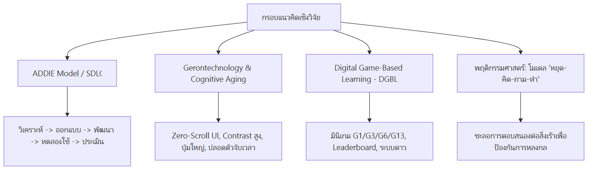

# 01: บทนำ ที่มา และกรอบแนวคิดเชิงวิจัย (Research Background & Framework)

---

## 1. ที่มาและความสำคัญของปัญหา (Background & Problem Statement)

ประเทศไทยได้ก้าวเข้าสู่ **"สังคมสูงวัยอย่างสมบูรณ์" (Complete Aged Society)** อย่างเป็นทางการ โดยมีประชากรอายุ 60 ปีขึ้นไปมากกว่าร้อยละ 20 ของประชากรทั้งประเทศ ขณะเดียวกัน อัตราการเข้าถึงอินเทอร์เน็ตและสมาร์ทโฟนในกลุ่มผู้สูงอายุไทยเติบโตขึ้นอย่างก้าวกระโดด โดยเฉพาะการใช้งานแอปพลิเคชันสนทนา เช่น LINE, Facebook, และ TikTok เพื่อการติดต่อสื่อสารและการรับข้อมูลข่าวสารในชีวิตประจำวัน

อย่างไรก็ตาม การเปิดรับเทคโนโลยีดิจิทัลอย่างรวดเร็วกลับสวนทางกับ **"ภูมิคุ้มกันทางดิจิทัล" (Digital Immunity)** และ **"ทักษะการรู้เท่าทันสื่อ" (Media and Information Literacy - MIL)** ของผู้สูงอายุ ส่งผลให้กลุ่มผู้สูงวัยตกเป็นเป้าหมายสำคัญของภัยคุกคามทางไซเบอร์ ข้อมูลบิดเบือน และมิจฉาชีพออนไลน์ในหลากหลายมิติ:

1. **การแพร่กระจายของข่าวปลอมและข้อมูลสุขภาพลวง (Health Misinformation)**: ข้อมูลยาผีบอก สมุนไพรรักษามะเร็งหายขาด หรือการรักษาโรคเรื้อรังแบบผิดวิธี ซึ่งส่งผลกระทบต่อสุขภาวะและชีวิตของผู้สูงอายุโดยตรง
2. **กลลวงทางจิตวิทยาของมิจฉาชีพ (Social Engineering & Impersonation)**: การโทรศัพท์แอบอ้างเป็นเจ้าหน้าที่รัฐ (Call Center), การปลอมเป็นบุตรหลานขอความช่วยเหลือฉุกเฉิน, และการส่ง SMS แนบลิงก์ฟิชชิง (Phishing SMS)
3. **ภัยคุกคามรูปแบบใหม่จากปัญญาประดิษฐ์ (Generative AI & Deepfakes)**: การใช้ภาพสังเคราะห์และเสียงโคลนนิ่งจาก AI หลอกลวงให้โอนเงินหรือหลงเชื่อข้อมูลเท็จ ซึ่งผู้สูงอายุมีข้อจำกัดในการแยกแยะด้วยสายตาเปล่า

บทเรียนการเรียนรู้ออนไลน์ทั่วไป (E-Learning แบบเดิม) มักใช้การบรรยายตัวหนังสือขนาดยาวหรือวิดีโอคลิปทางเดียว ไม่สอดคล้องกับพฤติกรรมและการลดลงของสมรรถภาพทางกายและสายตาของผู้สูงอายุ โครงการวิจัยนี้จึงมุ่งพัฒนาระบบเว็บแอปพลิเคชันที่ผสาน **Interactive Micro-Learning** และ **Gamification** โดยออกแบบให้รองรับข้อจำกัดของผู้สูงวัยอย่างแท้จริง

---

## 2. วัตถุประสงค์การวิจัย (Research Objectives)

1. **เพื่อศึกษาและวิเคราะห์ข้อกำหนดการออกแบบ (User Requirements & Design Guidelines)** สำหรับระบบสื่อการเรียนรู้แบบมีปฏิสัมพันธ์ที่เหมาะสมกับบริบทของผู้สูงอายุไทย
2. **เพื่อออกแบบและพัฒนาระบบเว็บแอปพลิเคชันการรู้เท่าทันสื่อและภัยไซเบอร์สำหรับผู้สูงอายุ ("รู้ทันสื่อวัยเก๋า")** โดยใช้แนวคิด Micro-Learning, Zero-Scroll UI, และ Interactive Minigames
3. **เพื่อทดสอบและประเมินผลสัมฤทธิ์ของการนำระบบไปใช้งานจริงในภาคสนาม (Field Implementation & Evaluation)** ในพื้นที่ 3 จังหวัดภาคเหนือ (เชียงใหม่, แพร่, น่าน) ทั้งในมิติการมีส่วนร่วม (Engagement) และอัตราความสำเร็จในการเรียนรู้ (Completion Rate)

---

## 3. กรอบแนวคิดเชิงทฤษฎีและระเบียบวิธีวิจัย (Theoretical & Methodological Framework)

โครงการวิจัยนี้บูรณาการ 4 กรอบแนวคิดหลักเข้าด้วยกัน เพื่อขับเคลื่อนกระบวนการวิจัยและพัฒนา:

> 📋 *[ดูโค้ด Mermaid ต้นฉบับ](./diagrams/01-theoretical-framework.mmd)*

### 3.1 วงจรการออกแบบและพัฒนาระบบตามแนวทาง ADDIE Model
1. **Analysis (การวิเคราะห์)**: ศึกษาปัญหา วิเคราะห์กลุ่มผู้สูงอายุ สำรวจรูปแบบกลลวงจริงจากคดีความและสื่อออนไลน์
2. **Design (การออกแบบ)**: วางผังหลักสูตร กำหนด Storyboard วิดีโอสั้น ออกแบบระบบมินิเกม และจัดทำ Design Tokens สำหรับผู้สูงอายุ
3. **Development (การพัฒนา)**: พัฒนาแอปพลิเคชันด้วยสถาปัตยกรรม Next.js + React + Phaser.js และฐานข้อมูล Supabase ตามระเบียบวิธี Agile
4. **Implementation (การนำไปใช้จริง)**: จัดกิจกรรมอบรมเชิงปฏิบัติการจริงในชุมชน (Field Workshop) ณ จังหวัดเชียงใหม่ แพร่ และน่าน
5. **Evaluation (การประเมินผล)**: วิเคราะห์ Action Logs พฤติกรรมการเล่นเกม ความถูกต้องในการตอบคำถาม และอัตราการเรียนจบสมบูรณ์

---

### 3.2 ทฤษฎีความเสื่อมถอยตามวัยและเทคโนโลยีสำหรับผู้สูงอายุ (Gerontechnology & Cognitive Aging)
การออกแบบระบบยึดหลักการลดภาระทางสมอง (Cognitive Load Reduction) เพื่อตอบสนองต่อข้อจำกัดของผู้สูงอายุ:
- **ด้านการมองเห็น (Visual Decline)**: ใช้ขนาดตัวอักษรเริ่มต้นที่ 18–24px (ขยายได้สูงสุด 32px), อัตราส่วนคอนทราสต์ของสี (WCAG AAA Compliance), หลีกเลี่ยงตัวอักษรแบบ Serif
- **ด้านการเคลื่อนไหวและกล้ามเนื้อมือ (Motor Skill Decline)**: พื้นที่สัมผัสปุ่ม (Touch Target) ไม่ต่ำกว่า 56x56 px พร้อมเอฟเฟกต์กดปุ่ม 3D ที่ให้ความรู้สึกทางสายตาชัดเจนว่าปุ่มถูกกดลงไปจริง
- **ด้านความจำใช้งานและการประมวลผล (Working Memory)**: ใช้หลักการ **"หนึ่งหน้าจอ หนึ่งการกระทำหลัก" (Zero-Scroll UI)** เพื่อไม่ให้ผู้สูงอายุต้องเลื่อนหน้าจอหาเนื้อหาหรือจำตำแหน่งเมนู

---

### 3.3 ทฤษฎีการเรียนรู้ผ่านเกม (Digital Game-Based Learning - DGBL)
การเปลี่ยนเนื้อหาเตือนภัยไซเบอร์ที่เคร่งเครียดให้กลายเป็น **มินิเกมสถานการณ์จำลอง (Simulated Scenario Games)**:
- ผู้เรียนได้รับประสบการณ์ตรงในการเผชิญหน้ากับข่าวปลอมและแชทมิจฉาชีพในสภาพแวดล้อมจำลองที่ปลอดภัย (Safe Sandbox)
- มีกลไกการให้รางวัลทันที (Immediate Feedback Loop) ผ่านเสียงเอฟเฟกต์ คำชมเชย การสะสมดาว และเหรียญรางวัล

---

### 3.4 โมเดลพฤติกรรมศาสตร์ "หยุด 🛑 คิด 🧠 ถาม 💬 ทำ ✅"
หัวใจหลักของการเสริมสร้างภูมิคุ้มกันทางดิจิทัลในงานวิจัยนี้ คือการสร้าง **"ช่วงเวลาหยุดคิด" (Cognitive Friction)**:
- มิจฉาชีพมักใช้เทคนิคเร่งเร้าอารมณ์ (ความกลัว ความโลภ ความรีบด่วน) เพื่อปิดกั้นการใช้เหตุผล
- ระบบจะปลูกฝังโมเดล 4 สเต็ปผ่านทุกกิจกรรม:
  - **หยุด (Stop)**: อย่าเพิ่งเชื่อ อย่าเพิ่งคลิก อย่าเพิ่งโอน
  - **คิด (Think)**: สังเกตจุดผิดปกติ ใครส่งมา ได้ประโยชน์อะไร
  - **ถาม (Ask)**: ปรึกษาคนในครอบครัว เพื่อนบ้าน หรือโทรสายด่วน 1441
  - **ทำ (Act)**: ดำเนินการอย่างปลอดภัย บล็อก ลบ หรือแจ้งเตือนผู้อื่น

---

## 4. ขอบเขตโครงการและพื้นที่วิจัย (Research Scope & Target Sites)

- **กลุ่มประชากรเป้าหมาย**: ผู้สูงอายุสัญชาติไทย อายุตั้งแต่ 50 ปีขึ้นไป (รวมถึงวัยเตรียมความพร้อมสู่วัยสูงอายุ)
- **พื้นที่ดำเนินการภาคสนาม (Field Sites)**:
  1. **จังหวัดเชียงใหม่**: พื้นที่ชุมชนต้นแบบ (เช่น อ.สันทราย, อ.เมือง, อ.หางดง)
  2. **จังหวัดแพร่**: พื้นที่ชุมชนและกลุ่มผู้นำผู้สูงอายุ (เช่น อ.เมืองแพร่, อ.หนองม่วงไข่, อ.ลอง)
  3. **จังหวัดน่าน**: พื้นที่ห่างไกลและกลุ่มชาติพันธุ์ (เช่น อ.นาน้อย, อ.ท่าวังผา, อ.เวียงสา)
- **ระยะเวลาเก็บข้อมูลภาคสนาม**: กรกฎาคม – กันยายน 2026
