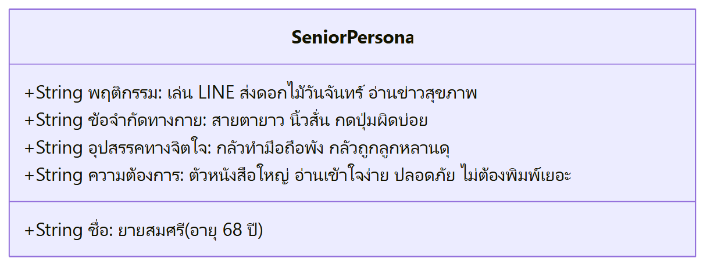
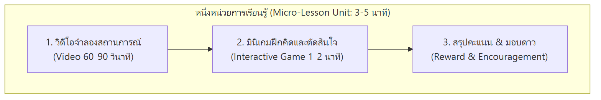
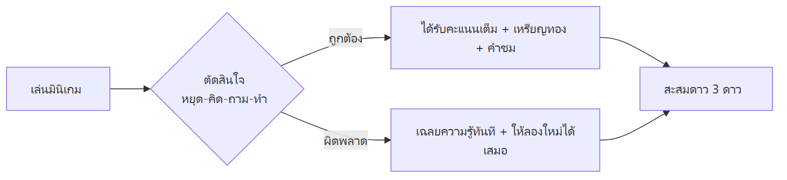

# 02: กระบวนการออกแบบระบบและการเรียนรู้ (Design Process & Methodology)

---

## 1. กระบวนการศึกษาและทำความเข้าใจผู้ใช้ (User Empathy & Persona Analysis)

ในการออกแบบระบบสำหรับผู้สูงอายุ ทีมวิจัยได้นำกระบวนการ **Design Thinking** มาใช้ โดยเริ่มต้นจากการสัมภาษณ์เชิงลึก (In-depth Interviews) และการสังเกตพฤติกรรม (Field Observation) ของผู้สูงอายุในจังหวัดเชียงใหม่และแพร่ เพื่อสกัดออกมาเป็น User Persona และ Pain Points หลัก:



> 📋 *[ดูโค้ด Mermaid ต้นฉบับ](./diagrams/02-senior-persona.mmd)*

### 1.1 Pain Points ที่ค้นพบในกลุ่มผู้สูงอายุไทย
1. **ความวิตกกังวลทางเทคโนโลยี (Technophobia & Fear of Failure)**: ผู้สูงอายุกลัวการกดปุ่มผิด เพราะกลัวว่าจะทำให้เครื่องเสีย หรือเผลอโอนเงิน ทำให้ไม่กล้าทดลองใช้งานระบบใหม่ ๆ
2. **ความยากลำบากในการเลื่อนหน้าจอ (Scrolling Fatigue)**: การใช้แถบ Scrollbar บนมือถือมักทำให้ผู้สูงอายุหลงทิศทาง สูญเสียบริบทของเนื้อหา และเลื่อนเลยปุ่มสำคัญไป
3. **ปัญหาการอ่านตัวหนังสือแบบไม่มีหัว (Loopless Fonts)**: ฟอนต์สมัยใหม่ที่ไม่มีหัว (Loopless) มักสร้างความสับสนระหว่างตัวอักษรไทยที่มีรูปทรงคล้ายกัน เช่น ภ, ถ, ก หรือ ข, ช
4. **ความกดดันจากตัวจับเวลา (Timer Anxiety)**: เกมหรือแบบทดสอบส่วนใหญ่มีแถบเวลานับถอยหลัง ซึ่งทำให้ผู้สูงอายุตื่นตระหนกและกดมั่วเพื่อเร่งรีบ

---

## 2. การออกแบบหลักสูตรและการเรียนรู้ย่อย (Micro-Learning Curriculum)

ทีมวิจัยได้สังเคราะห์คู่มือเนื้อหาเตือนภัยไซเบอร์ให้ออกมาเป็นบทเรียนย่อย (**Micro-Learning Units**) โดยมีข้อกำหนดว่า **แต่ละบทเรียนต้องใช้เวลาไม่เกิน 3–5 นาที** และแบ่งออกเป็น 2 ส่วนต่อเนื่องกัน:
1. **วิดีโอคลิปแอนิเมชันสั้น (1–1.5 นาที)**: เล่าเรื่องราวสถานการณ์จำลองจริงในชีวิตประจำวัน ปลูกฝังคีย์เวิร์ด "หยุด-คิด-ถาม-ทำ"
2. **มินิเกมฝึกปฏิบัติจริง (1–2 นาที)**: ให้ผู้เรียนได้ลงมือตัดสินใจแก้ปัญหาด้วยตนเองทันทีหลังจบคลิป



> 📋 *[ดูโค้ด Mermaid ต้นฉบับ](./diagrams/02-micro-lesson-unit.mmd)*

### 2.1 รายละเอียด 3 หมวดหมู่บทเรียนหลักในโครงการ

| หมวดที่ | ชื่อบทเรียน | เนื้อหาสาระสำคัญ | รูปแบบมินิเกมที่เชื่อมโยง |
| :---: | :--- | :--- | :--- |
| **Topic 1** | **ข่าวจริงหรือข่าวปลอม?** | การตรวจสอบข่าวสุขภาพลวง, ยาผีบอก, พาดหัวล่อให้คลิก (Clickbait) | **G1 / G13: ต่อไอติมฝึกสมอง**<br>รับข่าวจริง หลบระเบิดข่าวปลอม |
| **Topic 3** | **ภาพ AI หรือคนจริง?** | การสังเกตจุดผิดปกติของภาพสังเคราะห์ AI (นิ้วมือ, ฟัน, แววตา, ป้ายความรับผิดชอบ AI) | **G3: นักสืบจับผิดภาพ AI**<br>ส่องแว่นขยายเทียบภาพคนจริง vs AI |
| **Topic 6** | **จำลองแชท LINE ปลอดภัย** | มิจฉาชีพทักแชทอ้างเป็นญาติขอยืมเงิน, SMS แนบลิงก์, การข่มขู่จากเจ้าหน้าที่รัฐ | **G6: จำลองแชท LINE**<br>ชี้จุดอันตราย (Hotspots) และเลือกบทตอบกลับที่ปลอดภัย |

---

## 3. สถาปัตยกรรม UI/UX สำหรับผู้สูงอายุ (Senior Accessibility Design System)

การออกแบบส่วนต่อประสานกับผู้ใช้ (User Interface) ยึดมาตรฐานสากล **WCAG 2.1 ระดับ AAA** ควบคู่กับคู่มือ **Senior Accessibility Guidelines**:

```
+-------------------------------------------------------------+
|                     ZERO-SCROLL VIEWPORT                    |
|                                                             |
|  [ Header / สรุปหัวข้อและคะแนนสะสม ]                           |
|                                                             |
|  +-------------------------------------------------------+  |
|  |                                                       |  |
|  |             พื้นที่แสดงผลหลัก (Main Content Area)       |  |
|  |             - วิดีโอคลิป / กระดานคำถาม / ผ้าใบเกม        |  |
|  |                                                       |  |
|  +-------------------------------------------------------+  |
|                                                             |
|  [ 3D Button: กดปุ่มนี้เพื่อไปต่อ (ขนาดใหญ่ 56px+ สัมผัสง่าย) ] |
+-------------------------------------------------------------+
```

### 3.1 หลักการ "หนึ่งหน้าจอ หนึ่งการกระทำหลัก" (Zero-Scroll UI Principle)
- ออกแบบให้เนื้อหาและปุ่มกดทั้งหมด **ฟิตพอดีกับหน้าจอมือถือ (Single Viewport - 100dvh)** โดยไม่มีการเลื่อนหน้าจอ (No Vertical Scroll)
- ป้องกันไม่ให้ปุ่มตกลงหรือปุ่มไปต่อหลุดออกนอกขอบล่างของหน้าจอโทรศัพท์ ซึ่งเป็นสาเหตุอันดับ 1 ที่ผู้สูงอายุหาปุ่มไม่เจอ

### 3.2 ปุ่มกดแบบสามมิติที่จับต้องได้ (3D Pushable Buttons)
- ปุ่มกดถูกออกแบบให้มีมิติความลึก (Isometric Depth) และขอบเงาหนา
- เมื่อผู้ใช้ใช้นิ้วแตะลงบนปุ่ม ปุ่มจะเคลื่อนยุบตัวลงตามแรงกดจริง (Active State: `transform: translateY(4px)`) พร้อมเสียงเอฟเฟกต์คลิก (Click Audio Feedback) เพื่อยืนยันว่าการกดสำเร็จแล้ว

### 3.3 ระบบการเลือกฟอนต์ (Typography Selection)
- ใช้ฟอนต์ **Noto Sans Thai Looped** ซึ่งมี **"หัวกลมชัดเจน"** สำหรับข้อความอ่านยาวและคำอธิบาย ช่วยให้อ่านง่าย สบายตา และไม่สับสนรูปตัวอักษร
- กำหนดขนาดตัวอักษรพื้นฐานไม่ต่ำกว่า 18px และหัวข้อขนาด 24–32px

### 3.4 ระบบเสียงบรรยายประกอบ (Voice Narration & Audio Cue)
- เพิ่มไอคอนลำโพงและเสียงอ่านคำอธิบายในทุกหน้าจอสำคัญ เพื่อช่วยเหลือผู้สูงอายุที่มีปัญหาทางสายตาหรือการอ่านหนังสือไม่คล่อง

---

## 4. การออกแบบเกมและกลไกเชิงพฤติกรรม (Game Mechanics & Gamification)

การออกแบบเกมในงานวิจัยนี้ มุ่งเน้นการสร้าง **"ความมั่นใจ" (Self-Efficacy)** มากกว่าความพ่ายแพ้:



> 📋 *[ดูโค้ด Mermaid ต้นฉบับ](./diagrams/02-positive-gamification-loop.mmd)*

1. **ไม่มีระบบ Game Over / ปรับตก (No Punitive Failure)**: หากผู้เรียนเลือกคำตอบผิด ระบบจะไม่ขึ้นข้อความปฏิเสธสีแดงรุนแรง แต่จะแสดงคำอธิบายเฉลยเชิงบวกทันที พร้อมเปิดโอกาสให้ลองเลือกใหม่อีกครั้ง
2. **ระบบการสะสมดาวและเหรียญรางวัล (Star Rating & Badges)**:
   - ผู้เรียนสะสมได้สูงสุด 3 ดาวในแต่ละบทเรียน
   - เมื่อเรียนจบครบทุกหมวดหมู่ จะได้รับการ์ดเหรียญรางวัลทองคำเกียรติยศ (Completion Medal) เพื่อเสริมสร้างความภาคภูมิใจ
3. **ระบบกระดานผู้นำแบบเป็นมิตร (Friendly Leaderboard)**:
   - ให้ผู้เล่นตั้งชื่อเล่นสั้น ๆ เพื่อบันทึกคะแนนในกลุ่มเพื่อนร่วมห้องอบรม สร้างบรรยากาศสนุกสนานในการแลกเปลี่ยนเรียนรู้ระหว่างวัย
