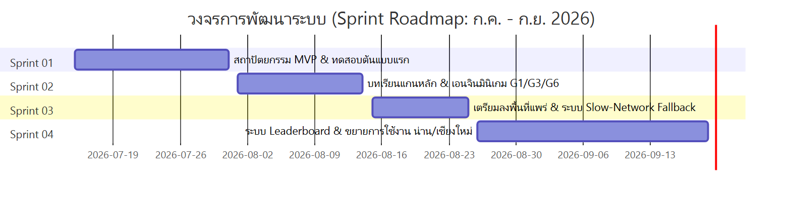
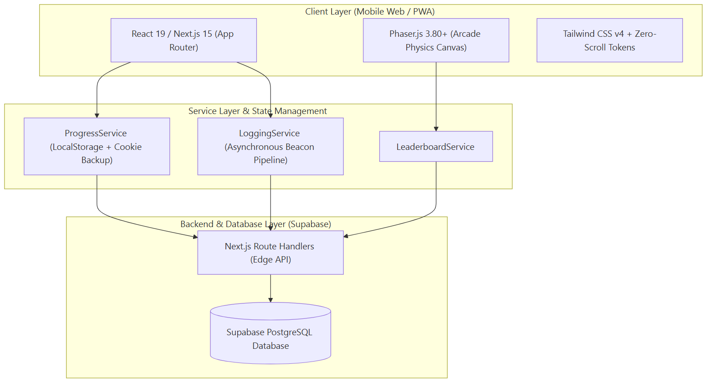

# 03: วงจรการพัฒนาระบบและสถาปัตยกรรมทางเทคนิค (Development Lifecycle & System Architecture)

---

## 1. กระบวนการพัฒนาซอฟต์แวร์แบบ Agile (Agile Development Process)

การพัฒนาระบบดำเนินไปตามกรอบการทำงานแบบ **Agile / Scrum Framework** โดยแบ่งรอบการพัฒนาออกเป็น 4 สปรินต์หลัก (Sprints) เพื่อให้สามารถทดสอบ ปรับปรุง และรับข้อเสนอแนะจากผู้เชี่ยวชาญและผู้สูงอายุได้อย่างต่อเนื่อง:



> 📋 *[ดูโค้ด Mermaid ต้นฉบับ](./diagrams/03-sprint-roadmap.mmd)*

### 1.1 สรุปภารกิจในแต่ละรอบการพัฒนา (Sprint Breakdown)
- **Sprint 01: Architecture & Foundation (15 – 31 ก.ค. 2026)**
  - วางโครงสร้างสถาปัตยกรรมระบบ Next.js + React
  - ออกแบบฐานข้อมูล PostgreSQL และสร้างระบบบันทึก Session ผู้ใช้งาน
  - สร้าง Prototype หน้า Landing Page และ Consent Form
- **Sprint 02: Core Lessons & Game Engines (1 – 14 ส.ค. 2026)**
  - บูรณาการเอนจิน **Phaser 3** เข้ากับ React Components
  - พัฒนามินิเกม 3 รูปแบบแรก: G1 (จริงหรือมั่ว), G3 (จับผิด AI), G6 (จำลองแชท LINE)
  - เพิ่มระบบเสียงบรรยายและปรับปรุงการรองรับอุปกรณ์เคลื่อนที่
- **Sprint 03: Field Test Readiness & Resilience (15 – 25 ส.ค. 2026)**
  - แก้ปัญหาหน้าจอตกขอบบนมือถือผู้สูงอายุด้วย **Zero-Scroll CSS Architecture**
  - พัฒนาระบบ **Slow Network Fallback** เพื่อรองรับการลงพื้นที่จริงในจังหวัดแพร่ (18-19 ส.ค.)
  - เสริมระบบความปลอดภัยของคุกกี้เพื่อรองรับ **LINE In-App Browser**
- **Sprint 04: Leaderboard, Polish & Multi-Site Scaling (26 ส.ค. – 19 ก.ย. 2026)**
  - พัฒนาระบบตารางคะแนนเกียรติยศ (Leaderboard Service) พร้อมระบบตั้งชื่อเล่น
  - ปรับปรุงประสิทธิภาพมินิเกมต่อไอติม G13 และระบบแจกเหรียญรางวัล
  - ดำเนินการเก็บข้อมูลภาคสนามต่อเนื่องในจังหวัดน่านและเชียงใหม่

---

## 2. การคัดเลือกและสถาปัตยกรรมเทคโนโลยี (Technology Stack & Justification)



> 📋 *[ดูโค้ด Mermaid ต้นฉบับ](./diagrams/03-system-architecture.mmd)*

### 2.1 เหตุผลในการเลือกเทคโนโลยีหลัก (Technical Rationale)

| เทคโนโลยี | เวอร์ชันที่ใช้ | เหตุผลความเหมาะสมต่องานวิจัย |
| :--- | :---: | :--- |
| **Next.js (App Router)** | v15.x | รองรับการเรนเดอร์ที่มีประสิทธิภาพ รวดเร็ว และรองรับ Server-side Logic สำหรับ Route Handlers ปลอดภัยต่อการเชื่อมต่อ Database |
| **React** | v19.x | Component-based Lifecycle จัดการสถานะบทเรียนและการสลับฉากระหว่างวิดีโอกับเกมได้อย่างไร้รอยต่อ |
| **Phaser.js** | v3.80+ | เอนจินเกม 2D ระดับมาตรฐานที่ทำงานบน HTML5 Canvas โดยตรง ประสิทธิภาพสูงถึง 60fps แม้บนสมาร์ทโฟนราคาประหยัดของผู้สูงอายุ |
| **Tailwind CSS v4** | v4.x | ระบบ Utility Tokens ที่ช่วยให้ควบคุมการจัดหน้าจอ Zero-Scroll (100dvh) ได้อย่างแม่นยำสูง และขนาดไฟล์เล็กมาก |
| **Supabase (PostgreSQL)** | v15 | ฐานข้อมูลเชิงสัมพันธ์ที่รองรับ JSONB Data สำหรับเก็บบันทึก Action Logs ที่มีความยืดหยุ่นสูง พร้อมระบบ Connection Pooling |

---

## 3. นวัตกรรมทางเทคนิคสำคัญเพื่อแก้ปัญหาผู้สูงอายุ (Key Technical Innovations)

### 3.1 ระบบคงสถานะไฮบริดสองชั้น (Hybrid Session Persistence)
- **ปัญหาที่พบ**: ผู้สูงอายุส่วนใหญ่เปิดลิงก์โครงการผ่าน **LINE In-App Browser** ซึ่งเมื่อกดสลับแอปไปตอบแชท หรือปิดหน้าต่าง ตัวเว็บเบราว์เซอร์จะล้าง `localStorage` ส่งผลให้ข้อมูลบทเรียนที่เรียนค้างไว้สูญหาย ผู้สูงอายุต้องเริ่มใหม่และเกิดความท้อแท้
- **วิธีแก้ปัญหา**: พัฒนา `progressService.ts` ที่ทำงานแบบ **Dual-Storage Synchronization**:
  1. บันทึกข้อมูลลงทั้ง `localStorage` และ `document.cookie` (พร้อมกำหนดอายุ 365 วันและ `SameSite=Lax`)
  2. เมื่อผู้ใช้กลับเข้ามา ระบบจะอ่านค่าจากแหล่งที่มีข้อมูลสมบูรณ์ที่สุดมารวมกันโดยอัตโนมัติ ทำให้ผู้สูงอายุสามารถ **"เรียนต่อจากจุดเดิมได้ทันที"**

```typescript
// กลไกการอ่านและซิงค์ข้อมูลแบบสองชั้น (progressService.ts)
let session = getLocalStorageSession();
const cookieSession = getCookieSession();

if (session && !cookieSession) {
  setCookie(SESSION_KEY, session, 365); // ซิงค์ลง Cookie
} else if (!session && cookieSession) {
  session = cookieSession;              // กู้คืนจาก Cookie สู่ LocalStorage
  saveLocalStorage(session);
}
```

---

### 3.2 ท่อส่งข้อมูลพฤติกรรมแบบอะซิงโครนัส (Asynchronous Action Logging Pipeline)
- **สถาปัตยกรรม**: ระบบสร้าง `loggingService.ts` ที่ส่งข้อมูลผ่าน API แบบ Background Fetch ไม่กีดขวางการเรนเดอร์ (Non-blocking UI Thread)
- **การเก็บข้อมูลเชิงลึก**: ทุกการกระทำของผู้ใช้ (การคลิกปุ่ม, การดูคลิป, การข้าม, การตอบคำถามถูก/ผิด, การหมุนจอ) จะถูกส่งเข้าตาราง `action_logs` เพื่อนำไปวิเคราะห์เส้นทางผู้ใช้ (Funnel Analysis) ต่อไป รวมกว่า **65,035 เรคคอร์ด**

---

### 3.3 ระบบรับมือเน็ตช้าอัจฉริยะ (Adaptive Slow-Network Video Fallback)
- **ปัญหาที่พบ**: ในการลงพื้นที่ชนบทของจังหวัดแพร่และน่าน สัญญาณอินเทอร์เน็ตมือถือมีความเร็วต่ำ ทำให้วิดีโอคลิปค้าง หมุนวน (Buffering) จนผู้สูงอายุเข้าใจว่าเครื่องพัง
- **วิธีแก้ปัญหา**: 
  - ระบบติดตั้งตัวจับเวลาอัตโนมัติ (Watchdog Timer) หากวิดีโอโหลดไม่สำเร็จภายใน 8–10 วินาที ระบบจะแสดงปุ่มแจ้งเตือนขนาดใหญ่:
    > *"สัญญาณอินเทอร์เน็ตของท่านช้า ท่านสามารถกดปุ่มนี้เพื่อข้ามไปเล่นเกมได้ทันที"*
  - จากสถิติพบว่า มีผู้สูงอายุใช้งานฟังก์ชันนี้กว่า 106 ครั้งใน 30 Sessions ช่วยลดอัตราการกดออกจากระบบ (Drop-off) ได้อย่างมหาศาล
