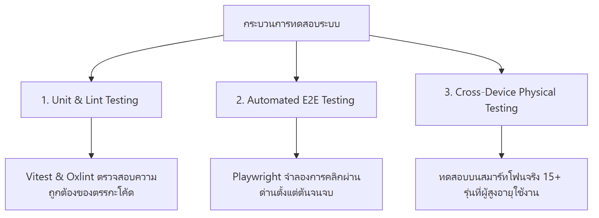
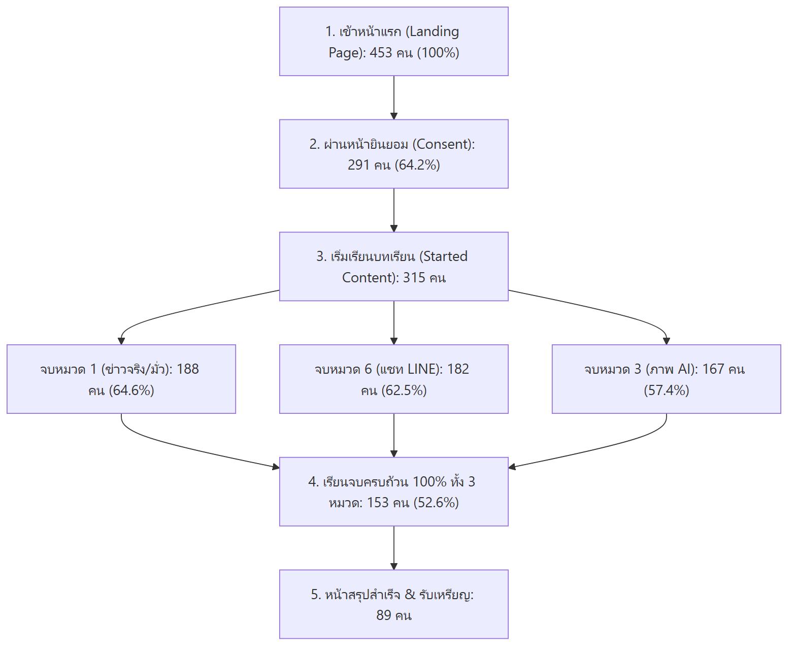

# 04: การทดสอบ การประเมินผล และการนำไปใช้จริงในภาคสนาม (Testing, Evaluation & Field Deployments)

---

## 1. การทดสอบระบบและการประกันคุณภาพ (Quality Assurance & Technical Testing)

ก่อนการนำระบบลงสู่พื้นที่จริง ทีมวิจัยได้ดำเนินกระบวนการทดสอบคุณภาพซอฟต์แวร์อย่างเข้มงวดใน 3 ระดับ:



> 📋 *[ดูโค้ด Mermaid ต้นฉบับ](./diagrams/04-qa-testing-levels.mmd)*

### 1.1 การทดสอบจำลองเส้นทางผู้ใช้ (Automated E2E Testing with Playwright)
- ใช้ Playwright เขียนสคริปต์จำลองการเข้าใช้งานตั้งแต่หน้า Landing Page -> หน้า Consent -> หน้าสารบัญบทเรียน -> การเล่นวิดีโอจนจบ -> การเล่นมินิเกมจนผ่านด่าน -> หน้าจบหลักสูตร เพื่อยืนยันว่าไม่มีหน้าจอใดที่เกิดข้อผิดพลาดหรือบล็อกผู้ใช้งาน

### 1.2 การทดสอบบนอุปกรณ์จริงของผู้สูงอายุ (Cross-Device Testing on Low-end Devices)
- ผู้สูงอายุไทยส่วนใหญ่ใช้สมาร์ทโฟนระดับเริ่มต้น (Entry-level) หรือรุ่นที่มีอายุการใช้งานหลายปี
- ทีมงานได้ทดสอบระบบบนเครื่องจริงกว่า 15 รุ่น ครอบคลุม:
  - **Android (คิดเป็น 62.8% ของผู้ใช้ที่ระบุ OS)**: Samsung Galaxy A-series, OPPO A-series, Vivo, Xiaomi Redmi
  - **iOS (คิดเป็น 25.2% ของผู้ใช้ที่ระบุ OS)**: iPhone 8, iPhone XR, iPhone 11, iPhone 13
  - **ความละเอียดหน้าจอที่พบบ่อยที่สุด**: `360x800` (มาตรฐาน Android จอเล็ก), `393x873`, `412x915`

---

## 2. การลงพื้นที่จัดอบรมเชิงปฏิบัติการจริง (Field Workshops Implementation)

โครงการได้ดำเนินการนำร่องและเก็บข้อมูลจริงใน 3 จังหวัดภาคเหนือ ระหว่างเดือนกรกฎาคม ถึง กันยายน 2026:

| วันที่จัดกิจกรรม | พื้นที่ดำเนินการ | กลุ่มผู้เข้าร่วม | กิจกรรมหลัก |
| :---: | :--- | :--- | :--- |
| **7 ส.ค. 2026** | **เชียงใหม่ (นำร่อง)** | ผู้สูงอายุและผู้ดูแล 14 คน | Alpha Test: สังเกตการใช้งานต้นแบบแรก และปรับปรุง UI |
| **18 ส.ค. 2026** | **จ.แพร่ (วันที่ 1)** | ผู้สูงอายุและแกนนำชุมชน 60 คน | Field Workshop 1: อบรมการรู้เท่าทันสื่อและมินิเกม G1/G13 |
| **19 ส.ค. 2026** | **จ.แพร่ (วันที่ 2)** | ผู้สูงอายุในชุมชน 45 คน | Field Workshop 2: อบรมการตรวจจับภาพ AI (G3) และแชทมิจฉาชีพ (G6) |
| **ปลาย ส.ค. 2026** | **จ.น่าน** | ผู้สูงอายุ อ.นาน้อย, ท่าวังผา, เวียงสา 69 คน | ขยายผลสู่พื้นที่ห่างไกลและการทดสอบสัญญาณเน็ตต่ำ |
| **18 ก.ย. 2026** | **จ.เชียงใหม่** | ผู้สูงอายุ อ.สันทราย และ อ.เมือง 76 คน | Full Scale Workshop: สรุปผลการเรียนรู้และการสะสมเหรียญรางวัล |

---

## 3. สรุปผลการประเมินเชิงประจักษ์ (Empirical Findings & Data Analysis)

จากการประมวลผลข้อมูลการใช้งานจริงตั้งแต่วันแรก (**19 กรกฎาคม 2026**) จนถึงปัจจุบัน (**19 กันยายน 2026**) สรุปผลเชิงปริมาณได้ดังนี้:

### 3.1 ข้อมูลกลุ่มประชากรและพื้นที่ (Demographics Analysis)
- **ผู้ใช้งานที่ไม่ซ้ำกันทั้งหมด (Total Unique Users)**: **548 คน**
- **ผู้ใช้งานที่ผ่านการยืนยันตัวตน (Identified Users)**: **291 คน**
  - **กลุ่มผู้สูงวัยและวัยก่อนสูงวัย (50 ปีขึ้นไป)**: มีจำนวนรวม **203 คน (69.76%)**
    - 50–59 ปี: 99 คน (34.02%)
    - 60–69 ปี: 59 คน (20.27%)
    - 70–79 ปี: 35 คน (12.03%)
    - 80 ปีขึ้นไป: 10 คน (3.44%)
  - **การกระจายตัวตามพื้นที่**:
    - เชียงใหม่: 93 คน (31.96%) — อ.สันทราย สูงสุด 32 คน
    - แพร่: 83 คน (28.52%) — อ.เมืองแพร่ สูงสุด 25 คน
    - น่าน: 69 คน (23.71%) — อ.นาน้อย สูงสุด 20 คน
    - พื้นที่อื่น ๆ: 46 คน (15.81%)

```
+-------------------------------------------------------------------------+
|                  การกระจายตัวของผู้ใช้งาน 291 คน                         |
|                                                                         |
|  [เชียงใหม่ 93 คน (32.0%)]  [แพร่ 83 คน (28.5%)]  [น่าน 69 คน (23.7%)]   |
|                                                                         |
|  * กลุ่มอายุ 50 ปีขึ้นไป รวม 203 คน (คิดเป็น 69.8% ของผู้ใช้ทั้งหมด)        |
+-------------------------------------------------------------------------+
```

---

### 3.2 ปริมาณการมีส่วนร่วมในระบบ (Engagement Volume)
- **จำนวนบันทึกพฤติกรรมทั้งหมด (Total Action Logs)**: **65,035 ครั้ง**
- **อัตราการมีส่วนร่วมเฉลี่ย**: **118.68 ครั้งต่อผู้ใช้** (มัธยฐาน 13 ครั้ง)
- **สัดส่วนกิจกรรมหลัก**:
  - มินิเกมและการตอบคำถาม: **76.8%** (การรับไอศกรีม 27,724 ครั้ง, การหลบระเบิด 7,644 ครั้ง, การตอบคำถาม 3,200 ครั้ง)
  - การรับชมวิดีโอคลิป: **5.4%** (กดดูคลิป 1,445 ครั้ง, ดูคลิปจนจบ 721 ครั้ง)
  - การนำทางในระบบ: **6.2%**

---

### 3.3 ผลสัมฤทธิ์ของเส้นทางผู้เรียน (Completion Funnel Analysis)



> 📋 *[ดูโค้ด Mermaid ต้นฉบับ](./diagrams/04-completion-funnel.mmd)*

> 🎯 **ข้อสรุปสำคัญด้านประสิทธิผลของระบบ**:
> - มีผู้เรียนที่สามารถ **เรียนจบครบถ้วนสมบูรณ์ทั้ง 3 หมวดหมู่ (ทั้งวิดีโอและมินิเกมครบ 100%) จำนวนทั้งสิ้น 153 คน**
> - คิดเป็น **52.58% ของผู้ที่ลงทะเบียนยินยอมทั้งหมด**
> - อัตราการเรียนจบเกินกว่าร้อยละ 50 ในกลุ่มผู้สูงอายุ ถือเป็นตัวชี้วัดความสำเร็จที่โดดเด่นมากสำหรับนวัตกรรมการเรียนรู้แบบดิจิทัล สะท้อนว่าการออกแบบ Zero-Scroll UI ร่วมกับมินิเกมที่เข้าใจง่ายสามารถรักษาความสนใจและลดอัตราการละทิ้งระบบ (Drop-off Rate) ได้อย่างมีประสิทธิภาพ
