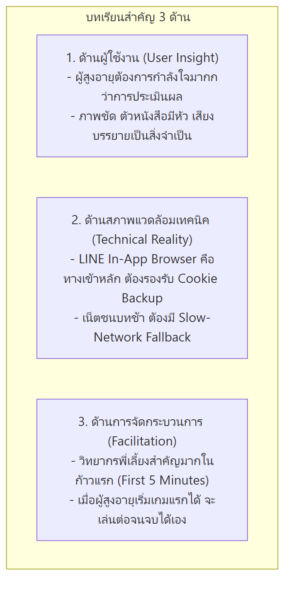

# 05: สรุป อภิปรายผล บทเรียน และข้อเสนอแนะเชิงนโยบาย (Discussion, Lessons Learned & Recommendations)

---

## 1. การอภิปรายผลการวิจัย (Research Discussion)

ผลการดำเนินงานวิจัยและพัฒนาระบบ "รู้ทันสื่อวัยเก๋า" สามารถตอบสนองต่อวัตถุประสงค์การวิจัยได้ครบถ้วนทั้ง 3 ประการ:

### 1.1 การลดความวิตกกังวลทางเทคโนโลยีด้วย Zero-Scroll UI และปุ่ม 3D
- การค้นพบเชิงประจักษ์ยืนยันว่า **การกำจัดแถบเลื่อนหน้าจอ (Zero-Scroll UI)** และการใช้ **ปุ่มกดสามมิติ (3D Pushable Button)** ช่วยลดความสับสนและลดอัตราการกดผิดได้อย่างมีนัยสำคัญ
- ผู้สูงอายุไม่เกิดความเครียดจากการหาปุ่มยืนยันไม่เจอ และมีผลการตอบสนองเชิงบวกต่อการสั่น/เสียงสะท้อนกลับ (Haptic & Audio Feedback) ซึ่งสร้างความมั่นใจว่าคำสั่งของตนเองได้รับการประมวลผลแล้ว

### 1.2 ประสิทธิผลของการเรียนรู้ผ่านเกมต่อผู้สูงอายุ (Gamification Efficacy)
- ในวงการการศึกษาออนไลน์ทั่วไป (E-Learning) อัตราการเรียนจบหลักสูตร (Course Completion Rate) มักอยู่ที่เพียงร้อยละ 15–25 โดยเฉพาะในกลุ่มผู้สูงวัยที่มีความเปราะบางทางดิจิทัล
- อย่างไรก็ตาม โครงการนี้สามารถบรรลุ **อัตราการเรียนจบสมบูรณ์สูงถึงร้อยละ 52.58** (153 คนจากผู้ยืนยันตัวตน 291 คน)
- ปัจจัยแห่งความสำเร็จเกิดจาก:
  1. การแบ่งเนื้อหาเป็นคลิปสั้นและมินิเกมกระชับ (Micro-Learning ไม่เกิน 3 นาทีต่อบท)
  2. การไม่มีระบบ "Game Over" หรือปรับตก ทำให้ผู้สูงอายุไม่รู้สึกสูญเสียความมั่นใจ
  3. การให้คำชมเชยเชิงบวกและเหรียญรางวัลในทันที (Immediate Positive Reinforcement)

---

## 2. บทเรียนสำคัญที่ได้รับจากการพัฒนา (Key Lessons Learned)



> 📋 *[ดูโค้ด Mermaid ต้นฉบับ](./diagrams/05-lessons-learned.mmd)*

### 2.1 สภาพแวดล้อมจริงของผู้สูงอายุ (The Real-World Context)
- **พฤติกรรมการเข้าเว็บ**: ผู้สูงอายุไทยเกือบ 100% ไม่เปิดเบราว์เซอร์ Chrome หรือ Safari โดยตรง แต่จะกดลิงก์ที่ส่งต่อกันมาในห้องแชท LINE ดังนั้น สถาปัตยกรรมระบบจึงต้องถูกออกแบบให้ทนทานต่อข้อจำกัดของ **LINE In-App Browser** ตั้งแต่วันแรก
- **ความไม่เสถียรของโครงข่าย**: การจัดกิจกรรมในพื้นที่ห่างไกล จำเป็นต้องมีระบบสำรอง เช่น การแคชเนื้อหาล่วงหน้า และปุ่มข้ามกรณีวิดีโอโหลดไม่ขึ้น เพื่อไม่ให้การเรียนรู้หยุดชะงัก

### 2.2 ผลกระทบของการมี "วิทยากรพี่เลี้ยง" (The Facilitator Effect)
- ในช่วง 5 นาทีแรก ผู้สูงอายุจะมีความลังเลและกลัวการกดปุ่ม แต่เมื่อมีวิทยากรหรือลูกหลานคอยแนะนำให้ลองกดปุ่มแรก ผู้สูงอายุจะเปลี่ยนทัศนคติเป็นความเพลิดเพลิน และสามารถทำกิจกรรมในบทที่ 2 และ 3 ได้อย่างเป็นอิสระด้วยตนเอง

---

## 3. ข้อเสนอแนะเชิงวิชาการและการวิจัยต่อยอด (Future Research Directions)

1. **การศึกษาผลสัมฤทธิ์ระยะยาว (Longitudinal Study on Retention)**:
   - ควรมีการติดตามผล (Follow-up Evaluation) ที่ระยะ 3 เดือน และ 6 เดือนหลังการอบรม เพื่อทดสอบว่าผู้สูงอายุยังคงรักษาพฤติกรรม "หยุด-คิด-ถาม-ทำ" และสามารถป้องกันตนเองจากการถูกหลอกลวงในชีวิตจริงได้มากน้อยเพียงใด
2. **การพัฒนาเกมจำลองภัยคุกคาม AI ขั้นสูง (Advanced Deepfake Scenarios)**:
   - ปัจจุบันมิจฉาชีพเริ่มใช้ **AI โคลนนิ่งเสียง (Voice Cloning)** โทรมาหาผู้สูงอายุเพื่อขอยืมเงิน งานวิจัยในระยะต่อไปควรพัฒนา Interactive Audio Simulation เพื่อฝึกให้ผู้สูงอายุตรวจจับเสียงผิดปกติของ AI
3. **ระบบแจ้งเตือนเชื่อมโยงครอบครัว (Family-Involved Safety Circle)**:
   - การพัฒนาฟังก์ชันที่ให้ผู้สูงอายุสามารถกดปุ่ม "ส่งต่อให้ลูกหลานช่วยดู" เมื่อพบข้อความที่น่าสงสัยในชีวิตจริง เพื่อสร้างเกราะป้องกันภัยระดับครอบครัว

---

## 4. ข้อเสนอแนะเชิงนโยบายและการขยายผล (Policy Recommendations)

```
+-------------------------------------------------------------------------+
|                  ข้อเสนอแนะเชิงนโยบายการขยายผลระดับชาติ                   |
|                                                                         |
|  [1. บูรณาการเข้าสู่ รร.ผู้สูงอายุ 2,000+ แห่งทั่วประเทศ]                     |
|  [2. บรรจุเป็นหลักสูตรดิจิทัลชุมชนของ พม. และ ดีอี]                         |
|  [3. ขยายผลสู่โมเดล "ลูกหลานสอนผู้สูงวัย" (Intergenerational Learning)]     |
+-------------------------------------------------------------------------+
```

1. **การบรรจุเข้าเป็นหลักสูตรมาตรฐานของ "โรงเรียนผู้สูงอายุ"**:
   - กรมกิจการผู้สูงอายุ กระทรวงการพัฒนาสังคมและความมั่นคงของมนุษย์ (พม.) และองค์กรปกครองส่วนท้องถิ่น (อปท.) สามารถนำเว็บแอปพลิเคชันนี้ไปใช้เป็นสื่อการสอนมาตรฐานในโรงเรียนผู้สูงอายุที่มีมากกว่า 2,000 แห่งทั่วประเทศ
2. **การเผยแพร่ผ่านช่องทางสาธารณสุขและ อสม.**:
   - ใช้อาสาสมัครสาธารณสุขประจำหมู่บ้าน (อสม.) เป็นแกนนำในการนำแอปพลิเคชันไปแนะนำผู้สูงอายุในชุมชน ควบคู่กับการตรวจสุขภาพประจำเดือน
3. **การพัฒนาต่อยอดเป็นแคมเปญระดับประเทศ**:
   - สื่อสารโมเดลพฤติกรรม **"หยุด 🛑 คิด 🧠 ถาม 💬 ทำ ✅"** ผ่านสื่อมวลชนกระแสหลักและโทรทัศน์ เพื่อสร้างการจดจำระดับชาติ
