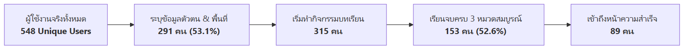

# 📑 สรุปกระบวนการออกแบบและพัฒนาระบบ (System Design & Development Research Summary)
**โครงการวิจัย**: ระบบเว็บแอปพลิเคชันสร้างเสริมสมรรถนะการรู้เท่าทันสื่อ ไซเบอร์ และปัญญาประดิษฐ์ (AI) สำหรับผู้สูงอายุ  
**แพลตฟอร์ม**: "รู้ทันสื่อวัยเก๋า" (Elderly Media Literacy Interactive Learning Platform)  
**หน่วยงานวิจัย**: NAPLAB ร่วมกับ วิทยาลัยศิลปะ สื่อ และเทคโนโลยี (CAMT) มหาวิทยาลัยเชียงใหม่  
**ระยะเวลาดำเนินการ**: กรกฎาคม 2026 – กันยายน 2026 (รวม 63 วัน)

---

## 🎯 วัตถุประสงค์ของเอกสารชุดนี้

เอกสารชุดนี้จัดทำขึ้นเพื่อ **สังเคราะห์และสรุปกระบวนการวิจัย ออกแบบ และพัฒนาระบบ (Research Methodology & System Development Lifecycle)** ตั้งแต่ระยะเริ่มต้นจนถึงปัจจุบัน เพื่อใช้เป็นเนื้อหาอ้างอิงหลักในการเขียน **รายงานสรุปการวิจัย (Research Final Report)**, รายงานส่งมอบทุนวิจัย, และบทความวิชาการ (Academic Paper)

เนื้อหาถูกจัดหมวดหมู่ให้สอดคล้องกับโครงสร้างรายงานวิจัยมาตรฐาน 5 บท:
- **บทที่ 1**: ความเป็นมา ความสำคัญ และวัตถุประสงค์การวิจัย
- **บทที่ 2**: กรอบแนวคิดเชิงทฤษฎี งานวิจัยที่เกี่ยวข้อง และกลุ่มผู้ใช้เป้าหมาย
- **บทที่ 3**: วิธีดำเนินการวิจัย: กระบวนการออกแบบและพัฒนาระบบ (Methodology & System Architecture)
- **บทที่ 4**: ผลการพัฒนา การทดสอบระบบ และผลการนำไปใช้จริงในภาคสนาม (Empirical Results & Field Validation)
- **บทที่ 5**: สรุป อภิปรายผล บทเรียนที่ได้รับ (Lessons Learned) และข้อเสนอแนะเชิงนโยบาย

---

## 📚 สารบัญเอกสารสรุปในโฟลเดอร์นี้

| ลำดับไฟล์ | หัวข้อเอกสาร | เทียบเคียงบทในรายงานวิจัย | เนื้อหาสำคัญ |
| :---: | :--- | :---: | :--- |
| **01** | [**01-research-background-and-framework.md**](./01-research-background-and-framework.md) | **บทที่ 1 - 2** | ที่มาและความสำคัญของปัญหา, วัตถุประสงค์, กรอบแนวคิด (ADDIE, Design Thinking, Gamification, Cognitive Aging) |
| **02** | [**02-design-process-and-methodology.md**](./02-design-process-and-methodology.md) | **บทที่ 3** (ส่วนออกแบบ) | การวิเคราะห์ Persona ผู้สูงอายุ, การออกแบบหลักสูตร "หยุด-คิด-ถาม-ทำ", สถาปัตยกรรม UI/UX (Zero-Scroll UI), และกลไกเกม (Game Mechanics G1, G3, G6, G13) |
| **03** | [**03-development-lifecycle-and-tech-stack.md**](./03-development-lifecycle-and-tech-stack.md) | **บทที่ 3** (ส่วนพัฒนา) | กระบวนการพัฒนาแบบ Agile Sprints, การเลือก Tech Stack (Next.js 15, Phaser 3, Supabase), สถาปัตยกรรมระบบ, นวัตกรรมทางเทคนิค (Hybrid Cookie, Slow-network fallback) |
| **04** | [**04-testing-evaluation-and-field-deployments.md**](./04-testing-evaluation-and-field-deployments.md) | **บทที่ 4** | การทดสอบเชิงเทคนิค (Playwright E2E, Unit Tests), การลงพื้นที่จริง 3 จังหวัด (แพร่, น่าน, เชียงใหม่), สถิติผู้ใช้จริง 548 คน และอัตราเรียนจบ 52.6% |
| **05** | [**05-discussion-lessons-learned-and-recommendations.md**](./05-discussion-lessons-learned-and-recommendations.md) | **บทที่ 5** | อภิปรายผลการวิจัย, ปัจจัยความสำเร็จ (Success Factors), ปัญหาอุปสรรคและแนวทางแก้ไข, ข้อเสนอแนะเชิงวิชาการและนโยบาย |

---

## 📊 สรุปตัวเลขเชิงประจักษ์สำคัญของโครงการ (Key Empirical Highlights)

> 📋 *[ดูโค้ด Mermaid ต้นฉบับ](./diagrams/00-empirical-highlights.mmd)*

- **ผู้ใช้งานทั้งหมดในระบบ**: **548 Unique Sessions** จาก 35 อำเภอทั่วภาคเหนือ
- **ผู้ใช้งานกลุ่มเป้าหมาย (50 ปีขึ้นไป)**: **203 คน (69.8% ของผู้ระบุข้อมูลตัวตน)**
- **ปริมาณการมีปฏิสัมพันธ์ทั้งหมด**: **65,035 Actions** (เฉลี่ย 118.7 ครั้งต่อคน)
- **อัตราการเรียนจบสมบูรณ์ (Completion Rate)**: **52.6%** (153 คนจากผู้ลงทะเบียนยินยอม 291 คน)
- **พื้นที่ภาคสนามหลัก**: เชียงใหม่ (32.0%), แพร่ (28.5%), น่าน (23.7%), อื่นๆ (15.8%)

---

## 🔗 ความเชื่อมโยงกับเอกสารอื่นในโครงการ
- **เอกสารการวิเคราะห์สถิติล่าสุด**: [`docs/analytics/sep19/`](../../analytics/sep19/)
- **เอกสารข้อกำหนดการออกแบบ (Design Specs)**: [`docs/wiki/design/`](../design/)
- **เอกสารการออกแบบเกม (GDD)**: [`docs/gdd/`](../../gdd/)
- **เอกสารสถาปัตยกรรมซอฟต์แวร์**: [`docs/software/`](../../software/)
- **เอกสารกระบวนการ Agile**: [`docs/agile/`](../../agile/)
