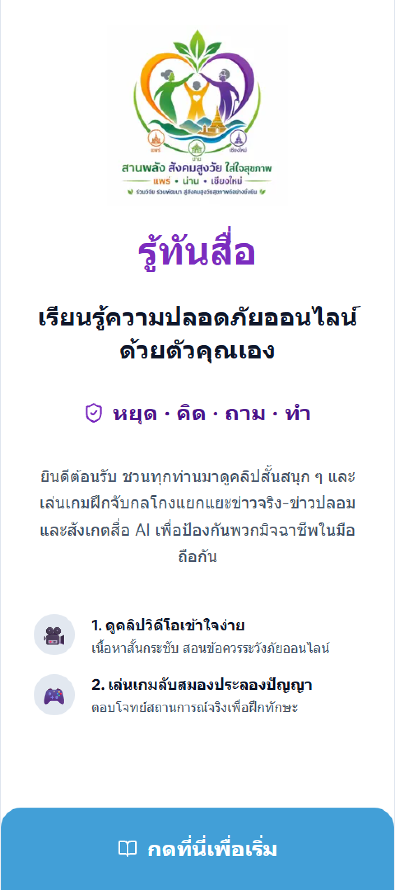
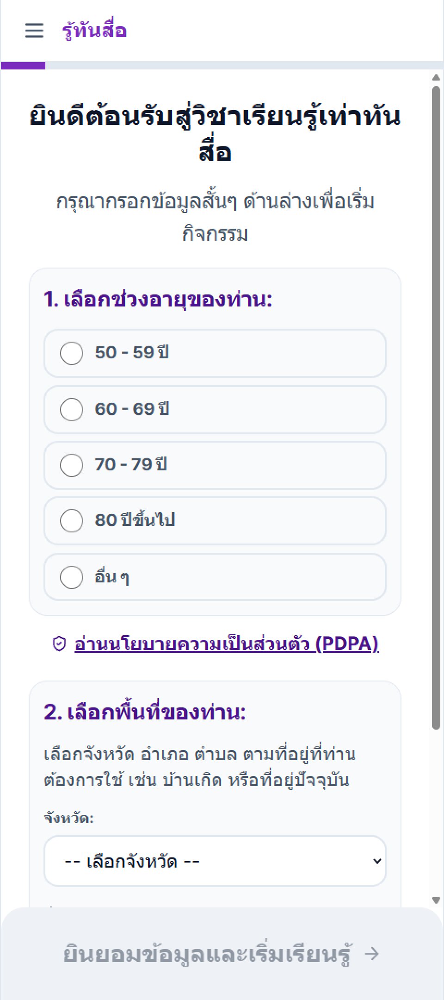
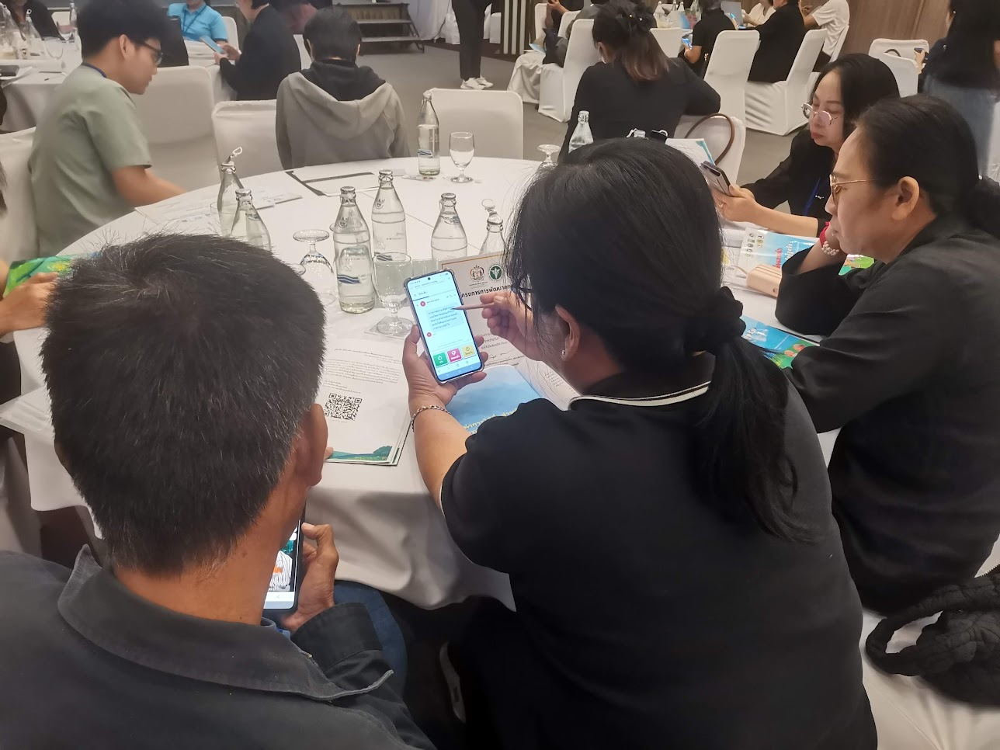
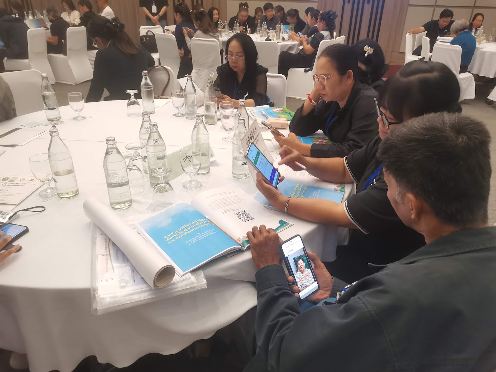

# รายงานการส่งมอบงาน งวดที่ 1

## 1. เงื่อนไขการส่งมอบงานงวดที่ 1

> **TOR ข้อ 10.1.1** ผู้รับจ้างต้องส่งมอบงานงวดที่ 1 ประกอบด้วย prototype สำหรับการทดสอบก่อนใช้จริง ของการออกแบบระบบ และพัฒนาเว็บแอปพลิเคชันเวอร์ชันทดสอบ ส่งมอบระบบที่พัฒนาเกมครบทั้ง 3 หัวข้อ และมีระบบจัดเก็บข้อมูล ที่ผ่านการทดสอบการใช้งานจริงแล้ว

ผู้ให้บริการได้ดำเนินงานครบตามเงื่อนไขทั้ง 4 ส่วน และขอส่งมอบงานดังนี้

| ส่วน | เงื่อนไขตาม TOR ข้อ 10.1.1                                                     | สิ่งที่ส่งมอบ                                                                                                                           | หลักฐาน                       |
| -------- | -------------------------------------------------------------------------------------------- | ---------------------------------------------------------------------------------------------------------------------------------------------------- | ------------------------------------ |
| 1        | Prototype สำหรับการทดสอบก่อนใช้จริงของการออกแบบระบบ | เอกสารออกแบบระบบ 6 ฉบับ เอกสารออกแบบเกม และ prototype ที่ผ่านการทดลองกับผู้สูงอายุ | เอกสารแนบ 2, ข้อ 2       |
| 2        | เว็บแอปพลิเคชันเวอร์ชันทดสอบ                                     | เว็บแอปพลิเคชันที่เปิดใช้งานผ่านลิงก์                                                                           | ลิงก์ระบบ, ข้อ 3         |
| 3        | ระบบที่พัฒนาเกมครบทั้ง 3 หัวข้อ                                  | เกมในลำดับการเรียน 6 เกม ครอบคลุม Social Media Literacy, Scammer Literacy และ AI Literacy                            | ข้อ 4                             |
| 4        | ระบบจัดเก็บข้อมูลที่ผ่านการทดสอบการใช้งานจริง   | ระบบบันทึกข้อมูลผู้ใช้และผลกิจกรรม ใช้งานจริงแล้วใน 3 จังหวัด                               | ข้อ 5–6, เอกสารแนบ 4–5 |

## 2. Prototype สำหรับการทดสอบก่อนใช้จริงของการออกแบบระบบ

ผู้ให้บริการนำ prototype ไปทดลองกับผู้สูงอายุและผู้ดูแล 14 คน ที่จังหวัดเชียงใหม่ เมื่อวันที่ 7 สิงหาคม 2569 แล้วปรับปรุงระบบตามข้อสังเกตก่อนนำไปใช้ในการอบรมจริง ได้แก่

- ตรึงขนาดตัวอักษรไม่ให้ถูกขยายจากการตั้งค่าโทรศัพท์จนหน้าจอเสียรูป
- ให้คลิปเล่นพร้อมเสียงทันที โดยไม่ต้องกดปุ่มเปิดเสียง
- เพิ่มปุ่มข้ามวิดีโอเมื่อคลิปโหลดช้า
- เปลี่ยนการระบุพื้นที่จาก GPS เป็นให้ผู้ใช้เลือกจังหวัด/อำเภอ/ตำบลเอง เนื่องจากพิกัดคลาดเคลื่อน

## 3. เว็บแอปพลิเคชันเวอร์ชันทดสอบ

- เปิดใช้งานผ่านลิงก์เดียวที่แชร์ทาง LINE ได้ทันที ไม่ต้องสมัครสมาชิก ไม่ต้องล็อกอิน และไม่ต้องติดตั้งแอป
- ออกแบบสำหรับโทรศัพท์มือถือเป็นหลัก ตัวอักษรใหญ่ ปุ่มกดง่าย เส้นทางเดียวไม่มีเมนูซับซ้อน
- ลำดับการใช้งาน: หน้าแรก → ขอความยินยอมและเลือกช่วงอายุ/พื้นที่ → สารบัญบทเรียน → ดูคลิป → เล่นเกม → บทถัดไป → เกมปิดท้ายและใบประกาศ

## 4. ระบบที่พัฒนาเกมครบทั้ง 3 หัวข้อ

| บทที่     | หัวข้อ           | เกม                    | สาระที่ผู้เรียนฝึก                       |
| -------------- | ---------------------- | ------------------------- | ---------------------------------------------------------- |
| 1              | Social Media Literacy  | จริงหรือมั่ว? | สังเกตข่าวปลอมและโพสต์ลวงโลก   |
| 2              | Scammer Literacy       | จำลองแชท LINE     | รับมือมิจฉาชีพในแชทจำลอง           |
| 3              | AI Literacy            | AI หรือคน?          | แยกภาพที่สร้างจาก AI กับภาพจริง |
| ปิดท้าย | เกมผ่อนคลาย | ต่อไอติม          | เกมเพื่อความสนุกท้ายหลักสูตร   |

- ทุกบทเรียนให้ผู้เรียนดูคลิปก่อน แล้วจึงเล่นเกมของหัวข้อนั้น
- ทุกเกมไม่มีการแพ้ เมื่อตอบผิดจะแสดงเฉลยพร้อมเหตุผล
- รวมทั้งหมด 3 เกมในลำดับการเรียนและ 1 เกมเล่นผ่อนคลาย โดยจะขยายผลให้เป็น 6 เกมในลำดับการเรียนและ 3 เกมเล่นผ่อนคลายในงวดถัดไป

## 5. ระบบจัดเก็บข้อมูล

| ข้อมูลที่ TOR กำหนด (ข้อ 2.3 และ 3.4)  | การจัดเก็บ                                                                              |
| ---------------------------------------------------------- | ------------------------------------------------------------------------------------------------- |
| อายุผู้เล่น                                     | ช่วงอายุ (ไม่เก็บวันเกิด)                                                   |
| ตำแหน่งที่เปิดเล่นแอปพลิเคชัน | จังหวัด/อำเภอ/ตำบล ที่ผู้ใช้เลือกหลังให้ความยินยอม |
| ผลการทำกิจกรรม/เกมรายหัวข้อ      | ความคืบหน้ารายบท ผลเกม คะแนน และคำตอบรายข้อ               |
| การใช้งาน                                         | การเข้าหน้าจอ การดูคลิป และการกดปุ่มสำคัญ                  |

ระบบไม่เก็บชื่อจริง เบอร์โทรศัพท์ เลขประจำตัว หรือหมายเลข IP ผู้ใช้แต่ละคนระบุด้วยรหัส session แบบไม่ระบุตัวตน ข้อมูลส่งออกเป็นไฟล์ CSV เพื่อใช้วิเคราะห์และเชื่อมโยงกับแบบประเมินก่อน–หลังการอบรมได้

## 6. ผลการทดสอบการใช้งานจริง

ระบบและเกมผ่านการใช้งานจริงในกิจกรรมอบรมผู้สูงอายุแบบกลุ่มในพื้นที่จังหวัดนำร่องตาม TOR ข้อ 1 ข้อมูลในหัวข้อนี้นับเฉพาะผู้เข้าร่วมกิจกรรมอบรม ไม่รวมการเข้าใช้งานรายบุคคลนอกกิจกรรมและการทดสอบของทีมพัฒนา

**6.1 เกณฑ์การนับข้อมูลกิจกรรมอบรม**

ภายในกิจกรรมที่ผ่านเกณฑ์ นับเฉพาะผู้ที่ให้ความยินยอมและอยู่ในจังหวัดที่จัดกิจกรรม หากพบ session ที่มีอุปกรณ์ ช่วงอายุ และตำบลตรงกันทุกประการ ถือว่าเป็นผู้ใช้คนเดิมเข้าซ้ำและนับเพียงครั้งเดียว

**6.2 กิจกรรมอบรมที่ใช้ระบบ**

| พื้นที่                                  | ผู้เข้าร่วม (คน) | อายุ 50 ปีขึ้นไป (คน) | ช่วงอายุอื่นๆ (คน) |
| ----------------------------------------------- | ----------------------------: | ----------------------------------: | --------------------------------: |
| เชียงใหม่                              |                            93 |                                  73 |                                20 |
| แพร่                                        |                            83 |                                  71 |                                12 |
| น่าน                                        |                            69 |                                  50 |                                19 |
| **รวมทั้งหมด 3 จังหวัด** |                 **245** |                       **194** |                      **51** |

**6.3 สรุปผลการจัดเก็บข้อมูลจากกิจกรรมอบรม**

| ตัวชี้วัด                                                      | ผล                                                                                                                                  |
| ----------------------------------------------------------------------- | ------------------------------------------------------------------------------------------------------------------------------------- |
| ผู้เข้าร่วมอายุ 50 ปีขึ้นไป                      | 194 จาก 245 คน (ร้อยละ 79.18) — 50–59 ปี 99 คน, 60–69 ปี 58 คน, 70–79 ปี 34 คน, 80 ปีขึ้นไป 3 คน |
| การเปิดใช้งานผ่านเบราว์เซอร์ในแอป LINE | 130 จาก 204 session ในช่วงกิจกรรม                                                                                     |

ผู้ทดสอบระบบบนโทรศัพท์จริงมากกว่า 15 รุ่น ทั้ง Android ราคาประหยัดและ iPhone รุ่นเก่า และมีชุดทดสอบอัตโนมัติสำหรับเส้นทางผู้ใช้ตั้งแต่หน้าแรกจนจบหลักสูตร

## 7. ภาคผนวก

ภาพบรรยากาศระหว่างผู้ทดสอบใช้งานแอปพลิเคชันผ่านโทรศัพท์มือถือ

## 8. เอกสารแนบ

1. ลิงก์เว็บแอปพลิเคชัน [https://ageconnect.camt.cmu.ac.th/]()
